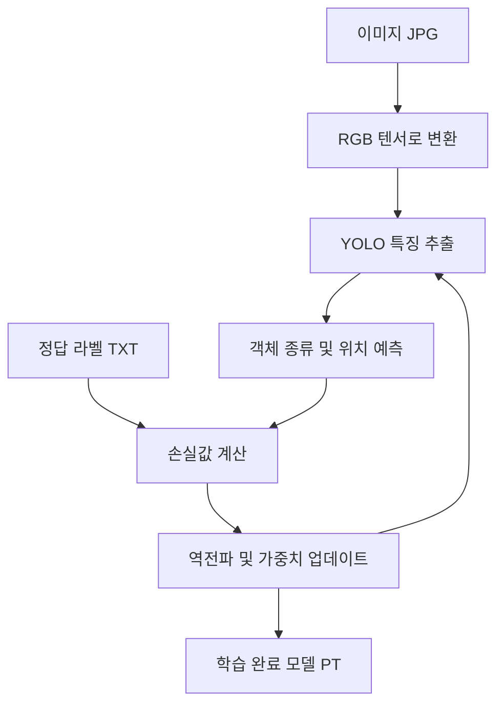
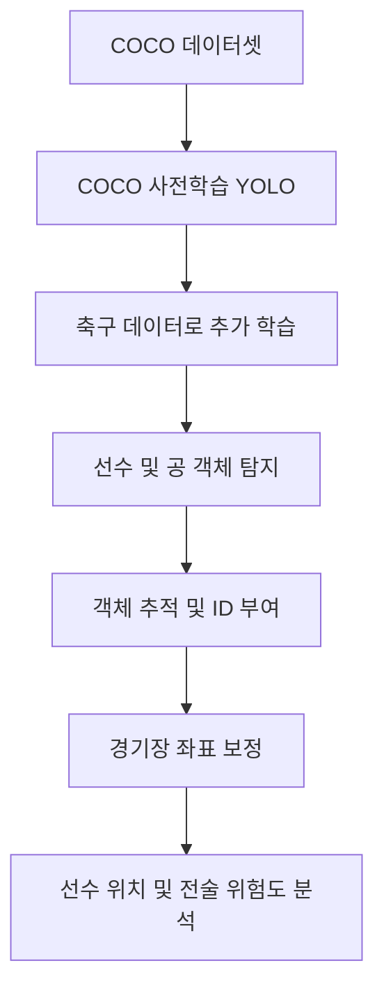

# **2-1. [컴퓨터 비전 모델과 주요 태스크] ; CNN과 사전학습 모델**

**[ 전체 학습 흐름 ]**

```text
원본 이미지
     ↓
이미지 전처리
     ↓
CNN 입력 Tensor
     ↓
Convolution
     ↓
Activation Function
     ↓
Pooling
     ↓
계층적 특징 추출
     ↓
Feature Map
     ↓
Backbone
     ↓
Classifier
     ↓
사전학습 모델 활용
     ↓
Transfer Learning
     ↓
 ┌───────────┼───────────┐
Feature      Partial       Full
Extraction  Fine-tuning   Fine-tuning
     ↓           ↓           ↓
학습 대상 파라미터 설정
              ↓
모델 학습 및 검증
              ↓
최적의 학습 전략 선택
```

<br><br>

---

# **1. CNN의 특징 추출과 레이어 깊이**

> ## **1-1 ) CNN(Convolutional Neural Network)이란?**

**[ CNN(Convolutional Neural Network, 합성곱 신경망) ]**
- 합성곱 연산을 이용하여 이미지의 공간적인 특징을 학습하는 인공신경망

- 일반적인 이미지는 가로, 세로, 채널로 구성된 수치 데이터이다.

- CNN은 이러한 이미지에서 주변 픽셀 간의 관계를 활용하여 이미지 분석에 필요한 특징을 추출한다.

예를 들어 다음과 같은 특징을 학습할 수 있다.

- 밝기의 변화
- 선과 모서리
- 색상의 변화
- 질감과 패턴
- 객체의 부분적인 형태
- 복합적인 시각적 특징

**[ CNN의 주요 구성 요소 ]**

| 구성 요소 | 의미 | 역할 |
|---|---|---|
| Input Layer | 입력층 | 이미지 Tensor 입력 |
| Convolution Layer | 합성곱층 | 이미지의 국소적인 특징 추출 |
| Filter / Kernel | 합성곱 필터 | 특정 패턴에 반응하는 가중치 |
| Feature Map | 특징 맵 | 이미지에서 추출한 특징 표현 |
| Activation Function | 활성화 함수 | 모델에 비선형성 부여 |
| Pooling Layer | 풀링층 | 공간적 크기 축소 및 정보 요약 |
| Batch Normalization | 배치 정규화 | 중간 특징의 정규화 및 학습 안정화 |
| Fully Connected Layer | 완전연결층 | 추출한 특징을 조합 |
| Classifier | 분류기 | 최종 클래스 예측 |

**[ CNN의 기본 구조 ]**

```text
Input Image
     ↓
Convolution
     ↓
Activation Function
     ↓
Pooling
     ↓
Convolution
     ↓
Activation Function
     ↓
Pooling
     ↓
Feature Vector
     ↓
Classifier
     ↓
Prediction
```

실제 CNN 모델에서는 위 구조에 Batch Normalization, Residual Connection 등 다양한 구성 요소가 추가될 수 있다.

**[ 핵심 원리 ]**

CNN은 이미지에서 사용할 특징을 사람이 모두 직접 정의하는 것이 아니라, 학습 과정에서 문제 해결에 필요한 특징을 자동으로 학습하는 모델이다.

<br>

> ## **1-2 ) DNN과 CNN의 차이**

일반적인 완전연결 신경망(MLP)은 이미지를 1차원 벡터로 변환하여 입력하는 경우가 많다.

반면 CNN은 **이미지의 공간적 구조**를 유지하면서 합성곱 연산을 수행한다.

CNN 여러 레이어로 구성된 심층신경망(DNN)의 한 종류이다.

| 구분 | 완전연결 신경망(MLP) | CNN |
|---|---|---|
| 이미지 입력 | 일반적으로 1차원 벡터 | 공간적 구조를 가진 Tensor |
| 주요 연산 | 행렬 곱 | 합성곱 |
| 연결 방식 | 모든 입력과 뉴런 연결 | 국소 영역 연결 |
| 가중치 공유 | 일반적으로 사용하지 않음 | 사용 |
| 공간적 관계 활용 | 직접적인 구조 활용이 제한적 | 상대적으로 유리 |
| 특징 추출 | 전체 입력의 조합 | 국소적·계층적 특징 추출 |
| 주요 활용 | 정형 데이터 등 | 이미지, 영상, 공간 데이터 |

CNN의 대표적인 특징은 다음 두 가지이다.

**1. Local Connectivity(국소 연결)**

- 이미지 전체를 한 번에 연결하지 않고 작은 영역의 픽셀 정보를 이용하여 특징을 추출한다.

**2. Weight Sharing(가중치 공유)**

- 동일한 필터를 이미지의 여러 위치에 반복적으로 적용한다.

- 따라서 이미지의 다른 위치에서도 동일한 패턴을 탐색할 수 있으며, 완전연결 구조보다 파라미터 수를 줄이는 데 유리하다.

<br>

> ## **1-3 ) Convolution: 합성곱 연산**

**Convolution(합성곱)**
- 필터를 입력 데이터의 여러 위치에 적용하여 국소적인 특징을 계산하는 연산

예를 들어 3 × 3 필터를 이미지에 적용한다고 가정하자.

**[ 입력 이미지의 일부 영역 ]**

| 10 | 20 | 30 |
|---:|---:|---:|
| 10 | 20 | 30 |
| 10 | 20 | 30 |

**[ 합성곱 필터 ]**

| -1 | 0 | 1 |
|---:|---:|---:|
| -1 | 0 | 1 |
| -1 | 0 | 1 |

입력 이미지의 각 위치에 필터의 값을 곱한 후 모두 더한다.

```math
y=
\sum_{i=1}^{K_h}
\sum_{j=1}^{K_w}
X_{ij}W_{ij}+b
```

| 기호 | 의미 |
|---|---|
| `X` | 입력 이미지 또는 특징 맵 |
| `W` | 합성곱 필터의 가중치 |
| `K_h` | 필터의 세로 크기 |
| `K_w` | 필터의 가로 크기 |
| `b` | 편향(Bias) |
| `y` | 합성곱 출력값 |

편향이 0이라면 다음과 같이 계산된다.

```math
y=
(-10+0+30)
+(-10+0+30)
+(-10+0+30)
```

```math
y=60
```

결과적으로 해당 영역에서 밝기의 수평 방향 변화에 반응하는 값을 얻을 수 있다.

이러한 연산을 이미지 전체에 반복하면 하나의 특징 맵이 생성된다.

엄밀하게는 PyTorch의 `Conv2d()`는 필터를 뒤집지 않는 Cross-Correlation(교차상관) 연산을 수행한다. 

딥러닝에서는 이를 합성곱이라고 부른다.

<br>

> ## **1-4 ) Kernel과 Filter의 개념**

**Kernel 또는 Filter**
- 입력 이미지의 국소적인 영역에서 특정 특징을 계산하는 가중치 집합이다.

- CNN에서는 학습 과정에서 필터의 가중치가 조정된다.

**[ 대표적인 필터의 역할 ]**

| 필터 유형 | 주요 역할 |
|---|---|
| Edge Detection Filter | 경계 및 밝기 변화 탐색 |
| Horizontal Edge Filter | 수평 경계 탐색 |
| Vertical Edge Filter | 수직 경계 탐색 |
| Blur Filter | 주변 정보를 평균화하여 이미지 완화 |
| Sharpening Filter | 이미지의 경계 강조 |
| Learned Filter | 학습 데이터에 필요한 특징 추출 |

일반적인 이미지 처리에서는 사람이 필터의 값을 직접 설정할 수 있다.

반면 CNN에서는 학습 과정에서 손실함수를 줄이는 방향으로 필터의 가중치를 학습한다.

| 구분 | 전통적인 이미지 필터 | CNN 필터 |
|---|---|---|
| 가중치 설정 | 사람이 직접 정의 | 모델이 학습 |
| 특징 추출 기준 | 사전에 정의 | 데이터 기반 |
| 특징의 복잡성 | 상대적으로 제한적 | 여러 레이어에서 복합적인 특징 학습 가능 |
| 학습 필요 | 일반적으로 없음 | 필요 |

**[ 핵심 원리 ]**

필터는 단순히 이미지의 크기를 변경하는 도구가 아니라, 특정 시각적 패턴에 반응하도록 구성된 가중치이다.

<br>

> ## **1-5 ) Python 실무 예제 - 운동역학 영상의 경계 특징 추출**

운동역학 실험에서 고속 카메라로 촬영한 반사 마커와 배경의 경계를 탐색한다고 가정하자.

밝기가 서로 다른 영역을 포함하는 가상의 흑백 이미지에 수직 경계 탐지 필터를 적용한다.

**[ Python : code ]** "합성곱 필터를 이용한 이미지의 밝기 변화 탐색"

```python
import torch
import torch.nn.functional as F

# 1. 가상 운동역학 영상의 관심 영역
image = torch.tensor([
    [0., 0., 10., 10.],
    [0., 0., 10., 10.],
    [0., 0., 10., 10.],
    [0., 0., 10., 10.]
]).unsqueeze(0).unsqueeze(0)

# 2. 수직 경계 탐지 필터
kernel = torch.tensor([
    [-1., 0., 1.],
    [-1., 0., 1.],
    [-1., 0., 1.]
]).unsqueeze(0).unsqueeze(0)

# 3. 합성곱 연산
feature_map = F.conv2d(image, kernel, stride=1, padding=0)

print("입력 Shape:", image.shape)
print("필터 Shape:", kernel.shape)
print("출력 Shape:", feature_map.shape)
print("특징 맵:", feature_map[0, 0].tolist())
```

**[ Result ]**

```text
입력 Shape: torch.Size([1, 1, 4, 4])
필터 Shape: torch.Size([1, 1, 3, 3])
출력 Shape: torch.Size([1, 1, 2, 2])
특징 맵: [[30.0, 30.0], [30.0, 30.0]]
```

**[ 주요 함수 및 변수 설명 ]**

| 코드 | 역할 |
|---|---|
| `torch.tensor()` | 이미지 및 필터 Tensor 생성 |
| `unsqueeze(0)` | 크기가 1인 차원 추가 |
| `F.conv2d()` | 지정한 필터를 이용하여 합성곱 수행 |
| `stride=1` | 필터를 한 픽셀씩 이동 |
| `padding=0` | 입력에 여백을 추가하지 않음 |
| `feature_map[0, 0]` | 첫 번째 이미지의 첫 번째 특징 맵 선택 |

> ### 수직 경계 탐지 필터

**[ 수직 경계 탐지 필터를 사용하는 이유 ]**

**이미지에서 물체의 경계와 형태를 파악하기 위해서이다.**

이미지는 수많은 픽셀로 구성되어 있으며, 물체와 배경이 만나는 부분에서는 밝기가 달라지는 경우가 많다.

수직 경계 탐지 필터는 이러한 **좌우 밝기 차이를 계산하여 물체의 경계선을 찾아낸다.**

**[ 예시 ]**

```text
입력 이미지        수직 경계 탐지 필터

0   0   10         -1   0   1
0   0   10         -1   0   1
0   0   10         -1   0   1

              ↓

      합성곱 결과 = 30
```

- `30`: 오른쪽으로 밝아지는 경계
- `-30`: 오른쪽으로 어두워지는 경계
- `0`: 좌우 밝기 차이가 없음

**[ 왜 중요한가? ]**

CNN은 처음부터 이미지 속 물체가 무엇인지 아는 것이 아니다.

일반적으로 다음과 같이 특징을 단계적으로 학습한다.

```text
원본 이미지
    ↓
초기 CNN 레이어
→ 선, 경계, 색상 변화 탐지
    ↓
중간 CNN 레이어
→ 질감, 모서리, 부분적인 형태 학습
    ↓
깊은 CNN 레이어
→ 여러 특징을 조합하여 복잡한 형태 학습
    ↓
최종 분류
→ 물체가 어떤 클래스인지 예측
```

**[ 핵심 정리 ]**

수직 경계 탐지는 **이미지에서 물체의 윤곽과 형태를 구분하는 데 필요한 기초 특징을 추출하기 위해 사용한다.**

실제 CNN에서는 이러한 경계 탐지와 유사한 특징을 포함하여 다양한 특징을 추출하는 필터의 가중치를 학습 과정에서 자동으로 조정한다.


**[ 코드 실행 흐름도 ]**

```text
4×4 흑백 이미지
        ↓
Batch 및 Channel 차원 추가
        ↓
(1, 1, 4, 4)
        ↓
3×3 경계 탐지 필터 적용
        ↓
영역별 곱셈 및 합산
        ↓
필터 이동
        ↓
2×2 Feature Map 생성
        ↓
밝기 변화에 대한 반응 확인
```

**[ 결과 해석 ]**

- 이미지의 왼쪽 영역은 밝기가 0이고 오른쪽 영역은 밝기가 10이다.

- 수직 경계를 탐색하는 필터를 적용했을 때 각 출력 위치에서 30이라는 값이 계산되었다.

- 이는 해당 영역에 밝기의 방향성 있는 변화가 존재한다는 것을 나타낸다.

다만 이번 예제는 사람이 직접 설정한 필터를 사용한 것이며, CNN의 학습을 통해 필터가 생성된 것은 아니다. 

또한 필터의 반응만으로 실제 반사 마커의 위치나 정체를 확정할 수는 없다.

<br>

> ## **1-6 ) CNN의 주요 합성곱 파라미터**

합성곱 레이어에서는 필터의 크기뿐 아니라 이동 간격과 이미지 주변 여백 등을 설정할 수 있다.

**[ PyTorch 기본 문법 ]**

```python
nn.Conv2d(
    in_channels=3,
    out_channels=16,
    kernel_size=3,
    stride=1,
    padding=1
)
```

**[ 주요 인자 설명 ]**

| 인자 | 의미 | 역할 |
|---|---|---|
| `in_channels` | 입력 채널 수 | 입력 Tensor의 채널 수 |
| `out_channels` | 출력 채널 수 | 생성할 특징 맵의 채널 수 |
| `kernel_size` | 필터 크기 | 한 번에 확인하는 국소 영역 |
| `stride` | 이동 간격 | 필터가 이동하는 간격 |
| `padding` | 입력 주변 여백 | 공간적 크기 및 경계 정보 처리 |
| `dilation` | 필터 요소 간 간격 | 더 넓은 영역에 대한 특징 추출 |
| `bias` | 편향 사용 여부 | 출력에 학습 가능한 편향 추가 |
| `groups` | 입력·출력 채널의 그룹 수 | 채널 연결 방식 설정 |

**1. Kernel Size**

- 필터가 한 번에 처리하는 영역의 크기이다.

| Kernel Size | 특징 |
|---|---|
| 1 × 1 | 채널 간 특징 조합 및 채널 수 조정 |
| 3 × 3 | 국소적인 특징 추출 |
| 5 × 5 | 상대적으로 넓은 영역의 특징 추출 |
| 7 × 7 | 더 넓은 영역을 한 번에 처리 |

**2. Stride**

- 필터가 입력 이미지에서 이동하는 간격이다.

- Stride가 커지면 일반적으로 출력 특징 맵의 공간적 크기가 감소한다.

**3. Padding**

- 입력 이미지 또는 특징 맵의 주변에 여백을 추가하는 방식이다.

- Padding을 적용하면 합성곱으로 인해 공간적 크기가 지나치게 감소하는 문제를 조절할 수 있다.

- 다만 Padding을 적용한다고 해서 원래 이미지의 모든 경계 정보가 완벽하게 보존되는 것은 아니다.

<br>

> ## **1-7 ) 합성곱 출력 크기 계산**

합성곱 레이어의 출력 크기는 입력 크기, Kernel Size, Padding, Stride, Dilation에 따라 결정된다.

**[ 일반적인 합성곱 출력 크기 공식 ]**

```math
H_{out}=
\left\lfloor
\frac{H_{in}+2P-D(K-1)-1}{S}+1
\right\rfloor
```

```math
W_{out}=
\left\lfloor
\frac{W_{in}+2P-D(K-1)-1}{S}+1
\right\rfloor
```

위 공식은 가로와 세로에 동일한 설정을 사용한 경우이다.

| 기호 | 의미 |
|---|---|
| `H_in`, `W_in` | 입력 특징 맵의 세로·가로 크기 |
| `H_out`, `W_out` | 출력 특징 맵의 세로·가로 크기 |
| `K` | Kernel Size |
| `P` | Padding |
| `S` | Stride |
| `D` | Dilation |
| `floor` | 소수점 이하 내림 |

Dilation이 1이면 다음과 같이 단순화할 수 있다.

```math
O=
\left\lfloor
\frac{I+2P-K}{S}+1
\right\rfloor
```

**[ 계산 예시 ]**

- 입력 이미지: `(1, 3, 32, 32)`
- Kernel Size: 3
- Padding: 1
- Stride: 1
- Output Channels: 16

```math
O=
\frac{32+2(1)-3}{1}+1
```

```math
O=32
```

따라서 출력 Shape는 다음과 같다.

`(1, 16, 32, 32)`

**[ 설정에 따른 출력 크기 비교 ]**

입력 공간적 크기가 32 × 32이고 Dilation이 1인 경우이다.

| Kernel Size | Padding | Stride | 출력 크기 |
|---:|---:|---:|---|
| 3 | 0 | 1 | 30 × 30 |
| 3 | 1 | 1 | 32 × 32 |
| 3 | 1 | 2 | 16 × 16 |
| 5 | 0 | 1 | 28 × 28 |
| 5 | 2 | 1 | 32 × 32 |
| 7 | 3 | 1 | 32 × 32 |

**[ 핵심 원리 ]**

- 출력 채널 수는 `out_channels`에 의해 결정된다.
- 출력 공간적 크기는 Kernel, Padding, Stride, Dilation에 의해 결정된다.

<br>

> ## **1-8 ) Feature Map: 특징 맵**

**Feature Map(특징 맵)** 은 입력 이미지 또는 이전 레이어의 특징에 필터 등의 연산을 적용하여 생성한 특징 표현이다.

예를 들어 RGB 이미지에 8개의 합성곱 필터를 적용한다고 가정하자.

```text
입력 RGB 이미지
(3, 32, 32)
       ↓
8개 합성곱 필터
       ↓
8개의 Feature Map
       ↓
(8, 32, 32)
```

입력 이미지가 RGB 3채널이라면 일반적인 합성곱에서 하나의 출력 채널을 생성하는 필터는 입력의 세 채널을 모두 처리한다.

따라서 `Conv2d(3, 8, kernel_size=3)`의 가중치 Tensor Shape는 다음과 같다.

`(8, 3, 3, 3)`

| 차원 | 크기 | 의미 |
|---|---:|---|
| Output Channels | 8 | 출력 특징 맵 수 |
| Input Channels | 3 | 입력 채널 수 |
| Kernel Height | 3 | 필터의 세로 크기 |
| Kernel Width | 3 | 필터의 가로 크기 |

**[ 입력 이미지 채널과 특징 맵 채널의 차이 ]**

| 구분 | 이미지 채널 | Feature Map 채널 |
|---|---|---|
| 의미 | 원본 이미지의 표현 정보 | 모델이 추출한 특징 표현 |
| 예시 | R, G, B | 경계, 질감, 복합 패턴 등 |
| 결정 기준 | 이미지 데이터 형식 | 모델의 `out_channels` |
| 학습 여부 | 원본 데이터에 의해 결정 | 필터 가중치 학습을 통해 형성 |

특징 맵의 채널 수가 증가했다고 해서 원본 이미지의 새로운 관측 정보가 추가되었다는 의미는 아니다.

기존 정보를 서로 다른 특징 표현으로 변환한 것이다.

<br>

> ## **1-9 ) 합성곱 레이어의 파라미터 수 계산**

CNN의 필터는 여러 개의 학습 가능한 가중치로 구성된다.

일반적인 합성곱에서 `groups=1`, `bias=True`일 때 파라미터 수는 다음과 같다.

```math
P_{conv}=
(K_h\times K_w\times C_{in}+1)
\times C_{out}
```

여기서 `+1`은 출력 채널마다 존재하는 Bias를 의미한다.

예를 들어 다음과 같은 합성곱 레이어가 있다고 가정하자.

```python
nn.Conv2d(3, 16, kernel_size=3, padding=1)
```

파라미터 수는 다음과 같다.

```math
P_{conv}=(3\times3\times3+1)\times16
```

```math
P_{conv}=28\times16=448
```

**[ Python : code ]** "합성곱 레이어의 가중치 구조와 전체 파라미터 수 확인"

```python
import torch.nn as nn

conv = nn.Conv2d(
    in_channels=3, out_channels=16,
    kernel_size=3, padding=1
)

weight_count = conv.weight.numel()
bias_count = conv.bias.numel()

print("Weight Shape:", conv.weight.shape)
print("Weight 개수:", weight_count)
print("Bias 개수:", bias_count)
print("전체 파라미터:", weight_count + bias_count)
```

**[ Result ]**

```text
Weight Shape: torch.Size([16, 3, 3, 3])
Weight 개수: 432
Bias 개수: 16
전체 파라미터: 448
```

**[ 완전연결층과 합성곱층의 파라미터 비교 ]**

| 레이어 | 계산 조건 | 파라미터 수 |
|---|---|---:|
| Fully Connected | 32 × 32 × 3 입력, 출력 16개 | 49,168 |
| Convolution | RGB 입력, 3 × 3 필터 16개 | 448 |

두 레이어는 출력 구조와 기능이 다르므로 완전히 동일한 작업을 수행하는 것은 아니다.

하지만 CNN이 가중치 공유를 통해 파라미터 수를 효율적으로 관리하는 원리를 확인할 수 있다.

<br>

> ## **1-10 ) Activation Function: 활성화 함수**

합성곱 연산은 기본적으로 입력과 가중치의 곱셈 및 합산으로 구성된다.

CNN에서 복잡한 비선형 관계를 학습하기 위해 활성화 함수를 적용한다.

대표적인 활성화 함수는 ReLU이다.

**[ ReLU(Rectified Linear Unit) ]**

```math
f(x)=\max(0,x)
```

| 입력값 | ReLU 출력값 |
|---:|---:|
| -5 | 0 |
| -2 | 0 |
| 0 | 0 |
| 3 | 3 |
| 10 | 10 |

**[ 대표적인 활성화 함수 비교 ]**

| 함수 | 특징 | 출력 범위 |
|---|---|---|
| ReLU | 음수 제거, 양수 유지 | 0 이상 |
| Leaky ReLU | 음수에도 작은 기울기 유지 | 제한 없음 |
| Sigmoid | 입력을 확률 형태로 변환 가능 | 0~1 |
| Tanh | 입력을 양수·음수 범위로 변환 | -1~1 |
| GELU | 입력을 부드럽게 조절하는 비선형 함수 | 위쪽 제한 없음 |

일반적인 CNN에서는 합성곱 이후 ReLU 등의 활성화 함수를 적용할 수 있다.

```text
Input
  ↓
Convolution
  ↓
Batch Normalization (선택)
  ↓
ReLU
  ↓
Feature Map
```

합성곱 레이어를 여러 개 연결하더라도 비선형 연산이 없다면 복잡한 비선형 특징을 표현하는 데 제한이 있다.

<br>

> ## **1-11 ) Pooling: 풀링 연산**

**Pooling(풀링)** 은 특징 맵의 국소 영역에서 정보를 요약하여 공간적인 크기를 줄이거나 특징을 집계하는 연산이다.

대표적으로 Max Pooling과 Average Pooling이 존재한다.

**[ 입력 특징 맵 ]**

| 1 | 3 |
|---:|---:|
| 2 | 6 |

**[ Max Pooling ]**

해당 영역의 최댓값을 선택한다.

```math
y_{max}=\max(1,3,2,6)=6
```

**[ Average Pooling ]**

해당 영역의 평균값을 계산한다.

```math
y_{avg}=\frac{1+3+2+6}{4}=3
```

**[ 풀링 방법 비교 ]**

| 구분 | Max Pooling | Average Pooling | Global Average Pooling |
|---|---|---|---|
| 처리 방식 | 최댓값 선택 | 평균값 계산 | 전체 공간 영역 평균 |
| 주요 특징 | 큰 활성값 강조 | 주변 정보 요약 | 채널별 대표값 구성 |
| 출력 크기 | 설정에 따라 감소 | 설정에 따라 감소 | 일반적으로 채널당 1 × 1 |
| 학습 가능한 가중치 | 없음 | 없음 | 없음 |
| 단점 | 세부 정보 손실 가능 | 강한 특징이 약화될 수 있음 | 위치 정보 손실 |

**[ 풀링의 주요 목적 ]**

- 공간적 크기 감소
- 이후 레이어의 연산 부담 감소
- 주변 특징 요약
- 작은 위치 변화에 대한 민감도 완화

다만 풀링을 적용한다고 해서 모든 위치 변화에 불변하게 대응할 수 있는 것은 아니다.

<br>

> ## **1-12 ) Python 실무 예제 - Max Pooling과 Average Pooling 비교**

양궁 표적 영상에서 화살 주변의 경계에 반응한 특징 맵이 생성되었다고 가정하자.

4 × 4 특징 맵에 Kernel Size 2, Stride 2인 풀링을 적용한다.

**[ Python : code ]** "양궁 영상의 가상 특징 맵에 Max Pooling과 Average Pooling 적용"

```python
import torch
import torch.nn.functional as F

feature_map = torch.tensor([
    [1., 3., 2., 4.],
    [5., 2., 1., 6.],
    [3., 7., 4., 2.],
    [0., 1., 8., 5.]
]).unsqueeze(0).unsqueeze(0)

# 1. 풀링 연산
max_pooled = F.max_pool2d(feature_map, kernel_size=2, stride=2)
avg_pooled = F.avg_pool2d(feature_map, kernel_size=2, stride=2)

# 2. 결과 확인
print("입력 Shape:", feature_map.shape)
print("Max Pooling:", max_pooled[0, 0].tolist())
print("Average Pooling:", avg_pooled[0, 0].tolist())
print("출력 Shape:", max_pooled.shape)
```

**[ Result ]**

```text
입력 Shape: torch.Size([1, 1, 4, 4])
Max Pooling: [[5.0, 6.0], [7.0, 8.0]]
Average Pooling: [[2.75, 3.25], [2.75, 4.75]]
출력 Shape: torch.Size([1, 1, 2, 2])
```

**[ Max Pooling 결과 ]**

| 5 | 6 |
|---:|---:|
| 7 | 8 |

**[ Average Pooling 결과 ]**

| 2.75 | 3.25 |
|---:|---:|
| 2.75 | 4.75 |

**[ 풀링 전후 비교 ]**

| 항목 | 풀링 전 | 풀링 후 |
|---|---:|---:|
| Height | 4 | 2 |
| Width | 4 | 2 |
| 공간적 원소 수 | 16 | 4 |
| Channel | 1 | 1 |

공간적 원소 수의 감소율은 다음과 같다.

```math
\text{감소율}=
\frac{16-4}{16}\times100=75\%
```

**[ 코드 실행 흐름도 ]**

```text
4×4 Feature Map
       ↓
2×2 영역 선택
       ↓
Stride 2씩 이동
       ↓
 ┌─────┴─────┐
Max Pooling  Average Pooling
     ↓              ↓
최댓값 선택      평균값 계산
     ↓              ↓
2×2 Feature Map 생성
```

**[ 결과 해석 ]**

- Max Pooling은 각 영역에서 가장 강한 특징값을 유지한다.

- Average Pooling은 해당 영역의 정보를 평균화한다.

- 두 방식 모두 공간적 크기를 감소시키지만 특징을 요약하는 방식은 다르다.

- 예를 들어 작은 화살이나 테니스 공처럼 특정 위치의 세부 정보가 중요한 분석에서는 과도한 풀링을 적용하면 중요한 특징이 손실될 수 있다.

<br>

> ## **1-13 ) CNN의 레이어 깊이와 계층적 특징 추출**

CNN은 여러 레이어를 연결하면서 이전 단계에서 추출한 특징을 조합한다.

이를 **Hierarchical Feature Learning(계층적 특징 학습)** 이라고 한다.

| 레이어 깊이 | 일반적인 특징 | 특징 수준 |
|---|---|---|
| 초기 레이어 | 선, 모서리, 색상 변화 | Low-level Feature |
| 중간 레이어 | 질감, 곡선, 부분적인 형태 | Mid-level Feature |
| 깊은 레이어 | 복합적인 형태와 클래스 구분 특징 | High-level Feature |

예를 들어 야구 경기 이미지를 분류하는 모델을 학습한다고 가정하자.

| 레이어 | 학습할 수 있는 특징의 예시 |
|---|---|
| 초기 레이어 | 야구공의 경계, 유니폼의 색상 변화 |
| 중간 레이어 | 팔의 형태, 야구공의 원형 패턴 |
| 깊은 레이어 | 투구 자세나 경기 장면을 구분하는 복합 특징 |

위 내용은 CNN의 일반적인 특징 학습 경향을 설명하기 위한 예시이다.

실제로 개별 채널이 어떤 특징을 학습하는지는 모델 구조, 데이터셋 및 학습 결과에 따라 달라진다.

**[ 계층적 특징 추출 흐름 ]**

```text
Raw Pixels
     ↓
Edge / Color / Texture
     ↓
Local Patterns
     ↓
Object Parts
     ↓
Complex Feature Representation
     ↓
Classification
```

**[ 레이어가 깊어질 때 고려할 점 ]**

| 장점 | 주의사항 |
|---|---|
| 복합적인 특징 학습 가능 | 연산량 증가 가능 |
| 넓은 영역의 특징 활용 가능 | 학습 난이도 증가 가능 |
| 높은 표현력 확보 가능 | 과적합 가능성 |
| 다양한 특징 조합 가능 | 메모리 사용량 증가 가능 |

레이어가 많다고 해서 반드시 모델의 성능이 향상되는 것은 아니다.

<br>

> ## **1-14 ) Receptive Field: 수용 영역**

**Receptive Field(수용 영역)**
- 특징 맵의 특정 위치가 원본 이미지의 어느 범위에 영향을 받는지를 의미

CNN의 레이어가 깊어질수록 일반적으로 하나의 특징값이 참조할 수 있는 원본 이미지 영역이 넓어진다.

예를 들어 Stride 1인 3 × 3 합성곱을 연속적으로 적용한다고 가정하자.

| 합성곱 레이어 | Kernel Size | 이론적 Receptive Field |
|---|---|---|
| Conv1 | 3 × 3 | 3 × 3 |
| Conv2 | 3 × 3 | 5 × 5 |
| Conv3 | 3 × 3 | 7 × 7 |
| Conv4 | 3 × 3 | 9 × 9 |

일반적인 수용 영역 계산 공식은 다음과 같다.

```math
R_l=R_{l-1}+(K_l-1)J_{l-1}
```

```math
J_l=J_{l-1}S_l
```

초기값은 다음과 같다.

```math
R_0=1,\quad J_0=1
```

| 기호 | 의미 |
|---|---|
| `R_l` | 현재 레이어의 이론적 수용 영역 |
| `R_(l-1)` | 이전 레이어의 수용 영역 |
| `K_l` | 현재 레이어의 Kernel Size |
| `J_l` | 인접한 출력 위치가 원본 입력에서 떨어진 간격 |
| `S_l` | 현재 레이어의 Stride |

위 공식은 Dilation이 1인 일반적인 연산을 기준으로 한다.

**[ 핵심 원리 ]**

- CNN의 초기 레이어는 상대적으로 작은 영역의 특징을 처리하고, 깊은 레이어는 더 넓은 영역에서 특징을 조합할 수 있다.

- 다만 이론적인 수용 영역의 모든 픽셀이 실제 출력에 동일한 영향을 주는 것은 아니다.

<br>

> ## **1-15 ) Python 실무 통합 예제 - CNN의 특징 맵 구조 확인**

축구 경기 영상의 관심 영역을 CNN에 입력하여 합성곱과 풀링을 거칠 때 특징 맵의 구조가 어떻게 변화하는지 확인한다.

**[ Python : code ]** "CNN의 합성곱 / ReLU / 풀링에 따른 특징 맵 Shape 변화 확인"

```python
import torch
import torch.nn as nn

# 1. 가상의 경기 영상 입력
batch_size, channels = 1, 3
height, width = 32, 32
x = torch.randn(batch_size, channels, height, width)

# 2. CNN 특징 추출 레이어 구성
conv1 = nn.Conv2d(3, 8, kernel_size=3, padding=1)
pool = nn.MaxPool2d(kernel_size=2, stride=2)
conv2 = nn.Conv2d(8, 16, kernel_size=3, padding=1)

# 3. 특징 추출
feature1 = torch.relu(conv1(x))
feature2 = pool(feature1)
feature3 = torch.relu(conv2(feature2))

# 4. 단계별 Shape 확인
print("입력:", x.shape)
print("첫 번째 합성곱:", feature1.shape)
print("풀링:", feature2.shape)
print("두 번째 합성곱:", feature3.shape)
```

**[ Result ]**

```text
입력: torch.Size([1, 3, 32, 32])
첫 번째 합성곱: torch.Size([1, 8, 32, 32])
풀링: torch.Size([1, 8, 16, 16])
두 번째 합성곱: torch.Size([1, 16, 16, 16])
```

**[ 단계별 특징 맵 변화 ]**

| 단계 | Shape | Channel | Height | Width |
|---|---|---:|---:|---:|
| Input | `(1, 3, 32, 32)` | 3 | 32 | 32 |
| Conv1 | `(1, 8, 32, 32)` | 8 | 32 | 32 |
| MaxPool | `(1, 8, 16, 16)` | 8 | 16 | 16 |
| Conv2 | `(1, 16, 16, 16)` | 16 | 16 | 16 |

**[ 코드 실행 흐름도 ]**

```text
Input Image
(1, 3, 32, 32)
       ↓
Conv2d
3 → 8 Channels
Kernel=3, Padding=1
       ↓
ReLU
       ↓
(1, 8, 32, 32)
       ↓
MaxPool2d
Kernel=2, Stride=2
       ↓
(1, 8, 16, 16)
       ↓
Conv2d
8 → 16 Channels
Kernel=3, Padding=1
       ↓
ReLU
       ↓
Final Feature Map
(1, 16, 16, 16)
```

**[ 결과 해석 ]**

- 첫 번째 합성곱에서는 출력 채널이 3개에서 8개로 증가하고 공간적 크기는 유지된다.

- Max Pooling을 적용하면 채널 수는 유지되지만 높이와 너비가 각각 절반으로 감소한다.

- 두 번째 합성곱에서는 특징 맵의 채널이 16개로 증가한다.

- 다만 이번 코드에는 손실함수 계산, 역전파 및 가중치 업데이트가 포함되어 있지 않다.

- 따라서 필터는 초기화된 상태이며 의미 있는 경기 특징이 실제로 학습되었다고 해석할 수는 없다.


> **[ conv1, conv2, conv3, conv4의 차이 ]**

`conv1`, `conv2`, `conv3`, `conv4`의 숫자는 **합성곱 레이어의 개수가 아니라 각 레이어를 구분하기 위해 붙인 이름**이다.

**[ Python : code ]** "CNN의 합성곱 레이어 구성"

```python
import torch.nn as nn

conv1 = nn.Conv2d(3, 8, kernel_size=3, padding=1)
conv2 = nn.Conv2d(8, 16, kernel_size=3, padding=1)
conv3 = nn.Conv2d(16, 32, kernel_size=3, padding=1)
conv4 = nn.Conv2d(32, 64, kernel_size=3, padding=1)
```

**[ 레이어별 비교 ]**

| 구분 | 입력 채널 | 출력 채널 | 합성곱 레이어 개수 |
|---|---:|---:|---:|
| `conv1` | 3 | 8 | 1개 |
| `conv2` | 8 | 16 | 1개 |
| `conv3` | 16 | 32 | 1개 |
| `conv4` | 32 | 64 | 1개 |
| 합계 | - | - | **4개** |

**[ CNN 처리 흐름 ]**

```text
입력 이미지 (RGB 3채널)
        ↓
conv1 (합성곱 레이어 1개)
        ↓
8채널 Feature Map
        ↓
conv2 (합성곱 레이어 1개)
        ↓
16채널 Feature Map
        ↓
conv3 (합성곱 레이어 1개)
        ↓
32채널 Feature Map
        ↓
conv4 (합성곱 레이어 1개)
        ↓
64채널 Feature Map
```

> **[ ResNet18의 layer1~layer4와 차이 ]**

ResNet18의 `layer1`, `layer2`, `layer3`, `layer4`는 **여러 합성곱 레이어를 포함한 BasicBlock의 묶음**이다.

| 구분 | BasicBlock 개수 | 블록 내부의 합성곱 레이어 수 |
|---|---:|---:|
| `layer1` | 2개 | 4개 |
| `layer2` | 2개 | 4개 |
| `layer3` | 2개 | 4개 |
| `layer4` | 2개 | 4개 |

<br><br>

---

# **2. 사전학습 모델과 전이학습**

> ## **2-1 ) Scratch Learning: 처음부터 학습하는 방식**

**Scratch Learning**
- 모델의 가중치를 초기화하고 현재 확보한 학습 데이터를 이용하여 처음부터 모델을 학습하는 방식

- ResNet18의 모델 구조를 사용하더라도 사전학습 가중치를 불러오지 않으면 Scratch Learning 방식으로 학습할 수 있다.

```python
model = resnet18(weights=None)
```

**[ Scratch Learning의 학습 과정 ]**

```text
모델 구조 선택
       ↓
가중치 초기화
       ↓
Train Dataset 입력
       ↓
Forward Propagation
       ↓
Loss 계산
       ↓
Backward Propagation
       ↓
Optimizer
       ↓
새로운 가중치 학습
```

**[ 장점과 단점 ]**

| 장점 | 단점 |
|---|---|
| 현재 데이터에 적합한 특징 학습 가능 | 충분한 학습 데이터가 필요할 수 있음 |
| 기존 사전학습 데이터의 영향이 없음 | 학습 시간 증가 가능 |
| 모델 설계의 자유도가 높음 | 연산 자원 부담 증가 가능 |
| 특수한 데이터에 맞게 학습 가능 | 데이터 부족 시 과적합 위험 |

실제 초기화에서는 레이어 종류에 따라 무작위 초기화뿐 아니라 0이나 1 등의 값이 사용될 수도 있다.

<br>

> ## **2-2 ) Pre-trained Model: 사전학습 모델**

**사전학습 모델(Pre-trained Model)**
- 기존 데이터셋을 이용하여 사전에 학습된 가중치를 가진 모델

- mageNet 이미지 분류 데이터로 학습된 CNN은 다양한 자연 이미지의 특징을 학습한 상태이다.
- 이러한 모델의 가중치를 새로운 이미지 분석 문제에 활용할 수 있다.

**[ 대표적인 이미지 모델 ]**

| 모델 | 주요 특징 |
|---|---|
| VGG | 반복적인 합성곱 레이어 구조 |
| ResNet | Residual Connection 활용 |
| DenseNet | 여러 레이어의 특징 연결 |
| MobileNet | 경량화 및 효율적인 연산 |
| EfficientNet | 모델 깊이·너비·해상도 등을 고려한 확장 |
| ConvNeXt | 현대적인 CNN 설계 방식 |
| Vision Transformer | Attention 기반 이미지 특징 학습 |

Vision Transformer는 CNN 계열 모델은 아니지만 이미지 분석에서 사전학습 모델로 활용할 수 있다.

**[ 사전학습 모델의 장점 ]**

- 기존에 학습한 특징을 활용할 수 있다.
- 학습 데이터가 부족할 때 유리할 수 있다.
- 새로운 문제에 필요한 학습 시간과 비용을 줄일 수 있다.
- 모델의 초기 성능 확보에 도움이 될 수 있다.

다만 기존 모델이 학습한 데이터의 특징과 새로운 데이터의 특징이 크게 다르면 사전학습 모델의 효과가 제한적일 수 있다.

<br>

> ## **2-3 ) Transfer Learning: 전이학습**

**전이학습(Transfer Learning)**
- 기존 문제에서 학습한 지식이나 특징 표현을 새로운 문제에 활용하는 학습 방법

- 일반적인 객체 분류를 학습한 ImageNet 모델을 배드민턴 경기 장면 분류에 활용 가능하다.

```text
Source Domain
기존 대규모 이미지 데이터
          ↓
사전학습 수행
          ↓
학습된 가중치
          ↓
Transfer Learning
          ↓
Target Domain
새로운 이미지 데이터
          ↓
새로운 작업에 맞게 학습
```

**[ 전이학습의 주요 개념 ]**

| 개념 | 의미 |
|---|---|
| Source Domain | 기존 모델이 학습한 데이터 영역 |
| Target Domain | 새롭게 분석할 데이터 영역 |
| Source Task | 기존 모델의 학습 목적 |
| Target Task | 새로운 분석 목적 |
| Pre-trained Weights | 기존에 학습한 가중치 |
| Transfer Learning | 기존 학습 정보를 새로운 문제에 활용 |

예를 들어 다음과 같이 전이학습을 적용할 수 있다.

| 구분 | Source | Target |
|---|---|---|
| Dataset | ImageNet | 배드민턴 경기 이미지 |
| Task | 일반 이미지 분류 | 경기 장면 분류 |
| Class | 1,000개 | 스매시·드롭·클리어 |
| Weight | 기존 학습 가중치 | 기존 가중치 활용 및 조정 |

**[ 핵심 원리 ]**

전이학습은 모델의 구조뿐 아니라 기존 데이터에서 학습한 가중치와 특징 표현을 활용하는 것이다.

<br>

> ## 2-4) 사전학습 모델(COCO와 YOLO 객체 탐지)

> ### 1. 기본 개념

- COCO는 객체 탐지 모델을 학습시키는 데이터셋
- YOLO는 이미지에서 객체의 종류와 위치를 예측하는 모델

| 용어 | 의미 | 쉬운 비유 |
|---|---|---|
| COCO (Common Objects in Context) | 이미지와 정답 정보가 포함된 데이터셋 | 문제집과 정답지 |
| YOLO (You Only Look Once) | 객체 탐지 모델 | 공부하는 학생 |
| Training | 모델의 가중치를 학습하는 과정 | 공부하는 과정 |
| Weight | 학습을 통해 조정되는 모델 내부의 숫자 | 학습한 지식 |
| Pre-trained Model | 미리 학습된 모델 | 이미 공부한 학생 |
| Inference | 새로운 이미지에서 객체를 예측하는 과정 | 새로운 문제 풀기 |

> ### 2. COCO는 어떤 파일인가?

- COCO는 하나의 파일이 아니라 이미지(JPG)와 정답(JSON)으로 이루어진 데이터셋이다. 

- COCO 2017 객체 탐지 기준으로 학습용 이미지 118,287장, 검증용 이미지 5,000장, 일반적으로 사용하는 객체 클래스 80개가 있다.

```text
coco/
├── train2017/                     # 학습용 이미지
│   ├── 000000000009.jpg
│   └── ...
├── val2017/                       # 검증용 이미지
│   ├── 000000000139.jpg
│   └── ...
└── annotations/                   # 원본 정답 파일
    ├── instances_train2017.json
    └── instances_val2017.json
```

- JPG: 실제 사진
- JSON: 사진 속 객체의 종류, 위치, 크기 등의 정답

### 2-1. JSON 정답 파일 예시

640×400 픽셀 이미지 한 장에 사람과 공이 있다고 가정한다. 아래는 설명을 위한 일부 필드만 포함한 예시다.

```json
{
  "images": [
    {"id": 1, "file_name": "000001.jpg", "width": 640, "height": 400}
  ],
  "annotations": [
    {"id": 1, "image_id": 1, "category_id": 1, "bbox": [100, 50, 120, 240]},
    {"id": 2, "image_id": 1, "category_id": 37, "bbox": [380, 280, 40, 40]}
  ],
  "categories": [
    {"id": 1, "name": "person"},
    {"id": 37, "name": "sports ball"}
  ]
}
```

| 항목 | 의미 |
|---|---|
| images | 이미지 파일 이름, ID, 크기 |
| annotations | 객체에 대한 정답 정보 |
| categories | 객체의 종류와 ID |
| image_id | 객체가 포함된 이미지의 ID |
| category_id | 객체 종류의 ID |
| bbox (Bounding Box) | 객체의 사각형 영역 |

COCO의 `bbox`는 `[왼쪽 위 X, 왼쪽 위 Y, 너비, 높이]` 순서이며 단위는 픽셀이다.

> ### 3. COCO를 YOLO 학습용 형식으로 변환하기

Ultralytics YOLO의 일반적인 객체 탐지 학습 형식은 이미지마다 대응하는 TXT 라벨 파일을 사용하는 방식이다. 

원본 COCO JSON은 변환해서 사용하거나 이미 변환된 라벨을 내려받아 사용할 수 있다.

```text
coco/
├── images/
│   ├── train2017/
│   │   └── 000001.jpg
│   └── val2017/
└── labels/
    ├── train2017/
    │   └── 000001.txt
    └── val2017/
```

`000001.txt` 예시:

```text
0 0.25 0.425 0.1875 0.6
32 0.625 0.75 0.0625 0.1
```

| 클래스 ID | 중심 X | 중심 Y | 너비 | 높이 |
|---:|---:|---:|---:|---:|
| 0 (사람) | 0.25 | 0.425 | 0.1875 | 0.6 |
| 32 (스포츠 공) | 0.625 | 0.75 | 0.0625 | 0.1 |

YOLO는 좌표를 이미지 가로·세로 크기로 나누어 0~1 범위로 정규화한다.

사람의 경우:

```text
COCO bbox = [100, 50, 120, 240]
중심 X = (100 + 120/2) / 640 = 0.25
중심 Y = (50 + 240/2) / 400 = 0.425
너비   = 120 / 640 = 0.1875
높이   = 240 / 400 = 0.6
```

COCO의 원래 클래스 ID(사람 1, 스포츠 공 37)는 YOLO의 연속적인 클래스 ID(사람 0, 스포츠 공 32)로 매핑된다. 단순히 모든 ID에서 1을 빼는 것은 아니다.

> ### 4. YAML과 PT의 차이

| 파일 | 역할 | 학습된 가중치 포함 여부 |
|---|---|---|
| yolo11n.yaml | 신경망의 구조를 정의하는 모델 설정 | X |
| coco.yaml | 데이터셋 경로와 클래스 이름을 정의하는 설정 | X |
| yolo11n.pt | 공식 COCO 사전학습 모델 체크포인트 | O |
| best.pt | 학습 중 가장 좋은 검증 성능 기준으로 저장한 체크포인트 | O |
| last.pt | 마지막 학습 시점의 체크포인트 | O |

`yolo11n.yaml`은 어떤 레이어와 필터를 사용할지 정하는 설계도다. `coco.yaml`은 어떤 이미지를 학습하고 어떤 클래스를 찾을지 알려주는 안내서다.

> #### 4-1. coco.yaml 구조 예시

```yaml
path: coco
train: train2017.txt
val: val2017.txt

names:
  0: person
  1: bicycle
  2: car
  # 중간 클래스 생략
  32: sports ball
  # 나머지 클래스 생략
  79: toothbrush
```

위 코드는 설명용으로 일부만 나타낸 것이므로 그대로 저장해 사용하지 않는다. 실습에서는 Ultralytics가 제공하는 `coco.yaml` 또는 `coco8.yaml`을 사용한다.

> ### 5. YOLO가 실제로 학습하는 과정



1. 이미지의 RGB 픽셀을 숫자 텐서로 변환한다.
2. 합성곱 레이어의 필터가 이미지의 특징을 추출한다.
3. 모델이 객체의 종류와 사각형 위치를 예측한다.
4. 예측 결과와 실제 정답 라벨을 비교한다.
5. 손실 함수(Loss Function)를 이용해 오차를 계산한다.
6. 역전파(Backpropagation)로 가중치에 대한 기울기를 계산하고, 옵티마이저(Optimizer)로 가중치를 수정한다.
7. 이 과정을 반복하고 학습된 모델을 PT 파일로 저장한다.

개발자가 색상, 테두리, 질감 필터를 각각 지정하는 것이 아니라 모델이 학습을 통해 유용한 특징을 추출하는 필터 가중치를 스스로 조정한다.

> ### 6. 실제 Python 실습

> #### 6-1. 라이브러리 설치

```bash
pip install ultralytics
```

> #### 6-2. 처음부터 COCO로 학습하기

```python
from ultralytics import YOLO

# 모델 구조만 불러오기 (학습된 가중치 없음)
model = YOLO("yolo11n.yaml")

# COCO 데이터셋으로 학습
model.train(data="coco.yaml", epochs=100, imgsz=640, batch=16)
```

| 파라미터 | 의미 |
|---|---|
| data | 학습 데이터셋 설정 파일 |
| epochs | 전체 학습 데이터셋을 반복 학습하는 횟수 |
| imgsz | 모델 입력 이미지의 목표 크기 |
| batch | 한 번의 배치에 처리하는 이미지 수 |

전체 COCO는 데이터 용량과 연산 비용이 크다. 공식 데이터셋 설정을 사용하면 필요한 데이터의 자동 다운로드가 지원되지만 인터넷과 충분한 저장 공간이 필요하다.

> #### 6-3. 초보자용 COCO8 실습 (추천)

COCO8은 학습 이미지 4장과 검증 이미지 4장으로 구성된 작은 데이터셋이다. 

모델 성능 확보가 아닌 학습 코드가 정상 작동하는지 확인하는 용도다.

```python
from ultralytics import YOLO

model = YOLO("yolo11n.yaml")
model.train(data="coco8.yaml", epochs=10, imgsz=640, batch=4)
```

학습이 완료되면 실행 결과에 표시되는 저장 경로의 `weights/best.pt` 또는 `weights/last.pt`를 확인한다.

> #### 6-4. 사전학습 모델로 객체 탐지하기

```python
from ultralytics import YOLO

model = YOLO("yolo11n.pt")
results = model("football.jpg", save=True)
```

`yolo11n.pt`는 이미 COCO로 학습되어 있으므로 추가 학습 없이 예측할 수 있다. 

`football.jpg`는 실제로 존재하는 이미지 경로로 변경한다.

> #### 6-5. 축구 전용 모델로 추가 학습하기

```python
from ultralytics import YOLO

model = YOLO("yolo11n.pt")
model.train(data="football.yaml", epochs=50, imgsz=640)
```

이 코드가 작동하려면 사용자 정의 축구 이미지, 정답 라벨, 데이터셋 설정 파일(`football.yaml`)을 먼저 준비해야 한다. 

기존 가중치를 활용해 새 데이터로 학습하는 방법은 전이학습(Transfer Learning), 그중 미세조정(Fine-tuning)에 해당한다.

> ### 7. 축구 영상 분석에 적용하기

COCO의 기본 탐지 모델은 사람과 스포츠 공을 탐지할 수 있지만 홈팀, 원정팀, 심판, 골키퍼 등을 별도 클래스로 구분하지는 않는다. 

이런 구분이 필요하다면 축구 전용 데이터로 추가 학습하거나 별도의 팀 분류 모듈 등을 구성할 수 있다.



객체 탐지 모델만으로 전술 위험도를 바로 산출하는 것은 아니며, 추적·좌표 보정·상황 정의·위험도 계산 등의 후속 단계가 필요하다.

> ### 8. 핵심 요약

```text
COCO             = 학습 데이터 (이미지 + 정답)
yolo11n.yaml     = 모델 구조
coco.yaml        = 데이터셋 설정
yolo11n.pt       = COCO 사전학습 모델
model.train()    = 모델 학습
best.pt          = 학습 결과물
model(image)     = 새로운 이미지 객체 탐지
```

**COCO는 학습 재료, YOLO는 학습하는 모델, PT는 학습 결과물이다.**

<br>

> ## **2-5 ) Scratch Learning과 Transfer Learning의 차이**

| 구분 | Scratch Learning | Transfer Learning |
|---|---|---|
| 초기 가중치 | 새롭게 초기화 | 사전학습 가중치 활용 |
| 기존 특징 활용 | 없음 | 가능 |
| 학습 데이터 요구량 | 상대적으로 많을 수 있음 | 상대적으로 적을 수 있음 |
| 학습 시간 | 상대적으로 길 수 있음 | 상대적으로 짧을 수 있음 |
| 데이터 부족 대응 | 제한적일 수 있음 | 기존 특징 활용 가능 |
| 새로운 도메인 적응 | 처음부터 학습 | 기존 특징을 활용하거나 조정 |
| 주요 고려사항 | 데이터와 모델 규모 | 도메인 유사성 및 학습 전략 |

두 방식이 동일한 모델 구조를 사용하더라도 초기 가중치가 다르기 때문에 학습 과정과 최종 성능이 달라질 수 있다.

전이학습이 항상 Scratch Learning보다 우수한 것은 아니므로 동일한 검증 조건에서 비교해야 한다.

<br>

> ## **2-6 ) Backbone과 Classifier의 구조**

이미지 분류 모델은 크게 특징 추출 부분과 최종 예측 부분으로 구분할 수 있다.

**[ 1. Backbone ]**

입력 이미지에서 분류나 탐지에 필요한 특징을 추출하는 모델의 주요 부분

**[ 2. Classifier ]**

Backbone이 추출한 특징을 이용하여 최종 클래스를 예측하는 부분

| 구분 | Backbone | Classifier |
|---|---|---|
| 역할 | 특징 추출 | 최종 클래스 예측 |
| 주요 구성 | Convolution, Activation 등 | Linear Layer 등 |
| 출력 | 특징 맵 또는 특징 벡터 | 클래스별 Logit |
| 전이학습 | 가중치 활용 및 선택적 학습 | 새로운 클래스에 맞게 변경 가능 |

**[ ResNet18의 이미지 분류 구조 ]**

```text
Input Image
(N, 3, 224, 224)
         ↓
Conv1 / BatchNorm / ReLU
         ↓
Max Pooling
         ↓
Layer1
         ↓
Layer2
         ↓
Layer3
         ↓
Layer4
         ↓
Feature Map
(N, 512, 7, 7)
         ↓
Global Average Pooling
(N, 512, 1, 1)
         ↓
Flatten
(N, 512)
         ↓
Fully Connected Layer
         ↓
Class Logits
(N, num_classes)
```

위 Shape는 일반적인 torchvision ResNet18에 224 × 224 이미지를 입력했을 때의 구조이다.

기존 ImageNet 분류기는 512개의 입력 특징을 이용하여 1,000개의 클래스에 대한 Logit을 생성한다.

```python
Linear(in_features=512, out_features=1000)
```

이를 새로운 세 가지 클래스를 분류하는 문제에 활용한다면 다음과 같이 변경할 수 있다.

```python
Linear(in_features=512, out_features=3)
```

<br>

> ## **2-7 ) 최종 Classifier의 파라미터 수**

완전연결층의 파라미터 수는 다음과 같이 계산할 수 있다.

```math
P_{fc}=(N_{in}\times N_{out})+N_{out}
```

Bias를 사용하는 ResNet18 분류기를 기준으로 계산하면 다음과 같다.

| 클래스 수 | Classifier | 파라미터 수 |
|---:|---|---:|
| 2 | `Linear(512, 2)` | 1,026 |
| 3 | `Linear(512, 3)` | 1,539 |
| 5 | `Linear(512, 5)` | 2,565 |
| 10 | `Linear(512, 10)` | 5,130 |
| 1,000 | `Linear(512, 1000)` | 513,000 |

예를 들어 수영 영법을 자유형, 배영, 평영, 접영으로 분류하는 모델이라면 Classifier의 출력 크기를 4로 설정할 수 있다.

```math
P_{fc}=(512\times4)+4
```

```math
P_{fc}=2052
```

최종 분류기의 출력 크기는 분석하려는 클래스 개수에 맞춰 설정해야 한다.

<br>

> ## **2-8 ) Python 실무 예제 - Scratch 모델과 사전학습 모델 비교**

제조 공정에서 수집한 이미지의 정상·불량 여부를 분류하기 위해 동일한 ResNet18 구조의 두 모델을 준비한다.

차이는 사전학습 가중치 사용 여부이다.

**[ Python : code ]** "ResNet18의 Scratch 모델과 Pre-trained 모델 생성 및 분류기 변경"

```python
import torch
import torch.nn as nn
from torchvision.models import resnet18, ResNet18_Weights

num_classes = 2

# 1. Scratch 모델 생성
scratch_model = resnet18(weights=None)
scratch_model.fc = nn.Linear(
    scratch_model.fc.in_features, num_classes
)

# 2. 사전학습 모델 생성
pretrained_model = resnet18(
    weights=ResNet18_Weights.DEFAULT
)
pretrained_model.fc = nn.Linear(
    pretrained_model.fc.in_features, num_classes
)

# 3. 분류기 및 첫 번째 합성곱 가중치 비교
print("Scratch 분류기:", scratch_model.fc)
print("Pre-trained 분류기:", pretrained_model.fc)

same_weights = torch.equal(
    scratch_model.conv1.weight,
    pretrained_model.conv1.weight
)

print("첫 번째 합성곱 가중치 일치:", same_weights)
```

**[ Result ]**

사전학습 가중치를 정상적으로 불러온 경우의 예상 출력이다.

```text
Scratch 분류기: Linear(in_features=512, out_features=2, bias=True)
Pre-trained 분류기: Linear(in_features=512, out_features=2, bias=True)
첫 번째 합성곱 가중치 일치: False
```

**[ 주요 함수 및 변수 설명 ]**

| 코드 | 역할 |
|---|---|
| `resnet18()` | ResNet18 모델 생성 |
| `weights=None` | 사전학습 가중치 미사용 |
| `ResNet18_Weights.DEFAULT` | 기본 사전학습 가중치 지정 |
| `model.fc` | 최종 완전연결 분류기 |
| `model.fc.in_features` | 분류기의 입력 특징 개수 |
| `nn.Linear()` | 새로운 완전연결층 생성 |
| `torch.equal()` | 두 Tensor의 값과 Shape 일치 여부 확인 |

**[ 코드 실행 흐름도 ]**

```text
ResNet18 Architecture
          ↓
 ┌────────┴────────┐
Scratch Model    Pre-trained Model
     ↓                  ↓
새로운 가중치 초기화   기존 학습 가중치 로드
     ↓                  ↓
Classifier 교체
512 → 2
     ↓                  ↓
동일한 분류 구조 구성
          ↓
기존 합성곱 가중치 비교
```

**[ 결과 해석 ]**

- 두 모델의 최종 분류기는 동일하게 512개의 입력 특징을 받아 2개의 클래스에 대한 출력을 생성한다.

- 하지만 Backbone의 초기 가중치는 서로 다르다.

- 사전학습 모델의 기존 특징 추출 가중치는 유지되며, 새롭게 생성한 분류기의 가중치는 초기화된 상태이다.

- 따라서 새로운 분류 문제에 사용하려면 분류기를 추가로 학습해야 한다.

- 이 코드는 모델을 구성하는 예제이며 실제 모델 학습은 수행하지 않는다.

- 또한 사전학습 가중치가 로컬에 저장되어 있지 않다면 다운로드를 위한 인터넷 연결이 필요하다.

<br>

> ## **2-9 ) Domain Similarity와 Domain Shift**

**Domain Similarity(도메인 유사성)**
- 기존 학습 데이터와 새로운 데이터의 특성이 얼마나 유사한지를 의미

**Domain Shift(도메인 변화)**
- 기존 학습 환경과 새로운 데이터 환경의 분포가 달라지는 현상

예를 들어 일반적인 자연 이미지로 학습된 모델을 다음 데이터에 적용한다고 가정하자.

| Target Dataset | 기존 자연 이미지와의 관계에서 고려할 사항 |
|---|---|
| 축구 경기 이미지 | 사람과 객체의 형태 활용 가능 |
| 테니스 경기 이미지 | 객체와 배경의 일반적인 시각적 특징 활용 가능 |
| 의료 MRI 이미지 | 이미지 생성 원리 및 표현 방식의 차이 |
| 열화상 카메라 이미지 | 색상 및 물리적 측정 특성의 차이 |
| 압력 센서 Heatmap | 시각적 형태와 실제 데이터 의미의 차이 |

일반 이미지와 새로운 데이터의 특성이 유사하다면 기존 특징을 그대로 활용하기에 유리할 수 있다.

반면 데이터 분포의 차이가 크다면 기존 특징을 추가로 조정하거나 해당 도메인에 특화된 사전학습 모델을 검토해야 한다.

**[ 핵심 원리 ]**

사전학습 모델을 선택할 때는 모델의 기존 성능뿐 아니라 현재 해결하려는 문제와 데이터의 유사성을 함께 고려해야 한다.

<br><br>

---

# **3. Feature Extraction과 Fine-tuning**

> ## **3-1 ) 전이학습의 주요 학습 전략**

사전학습 모델을 새로운 데이터에 적용할 때 기존 가중치를 어느 범위까지 학습할지 결정해야 한다.

대표적으로 다음 세 가지 방법이 존재한다.

| 학습 전략 | Backbone | 새로운 Classifier |
|---|---|---|
| Feature Extraction | 전체 고정 | 학습 |
| Partial Fine-tuning | 일부 학습 | 학습 |
| Full Fine-tuning | 전체 학습 | 학습 |

**[ 학습 방식의 구조 비교 ]**

```text
[Feature Extraction]

Layer1 → Layer2 → Layer3 → Layer4 → FC
 Freeze   Freeze   Freeze   Freeze  Train

[Partial Fine-tuning]

Layer1 → Layer2 → Layer3 → Layer4 → FC
 Freeze   Freeze   Freeze   Train   Train

[Full Fine-tuning]

Layer1 → Layer2 → Layer3 → Layer4 → FC
 Train    Train    Train    Train   Train
```

위 Partial Fine-tuning 구조에서는 마지막 특징 추출 단계만 학습하는 경우를 예시로 나타냈다.

실제 학습 범위는 모델과 데이터 특성에 따라 선택할 수 있다.

<br>

> ## 3-2) 사전학습 모델 비교(ResNet / YOLO)

**[ Resnet18 ]**
- **이미지**의 특징을 추출하고 분류하기 위해 만들어진 CNN(Convolutional Neural Network) 기반의 딥러닝 모델

- Residual Network(잔차 신경망)의 약자이고, 18은 가중치를 가진 주요 레이어가 18개라는 의미

|구분| ResNet18|     YOLO|
|---|---|---|
|기본 목적|   이미지 분류|  객체 탐지|
|종류 분류|   O|     O|
|객체 위치 추출|     X|     O|
|특징 추출|   O|     O|
|대표적인 사전학습 데이터셋|       ImageNet|     COCO|
|활용 사례|   공의 종류 분류|      영상 속 공의 위치 탐지|

**[ YOLO + Resnet 사용 과정 ]**

```text
축구 경기 영상
(원본 영상 입력)
       ↓
YOLO
(선수, 공, 심판 등의 위치 탐지)
       ↓
Crop
(탐지된 선수 영역을 이미지로 잘라내기)
       ↓
ResNet18
(유니폼, 외형 등의 특징 추출 및 분류)
       ↓
Tracking
(프레임별 동일 선수 추적)
       ↓
좌표 및 데이터 추출
(선수 위치, 이동 경로, 상대 거리)
       ↓
전술 분석
(공간 생성, 수비 붕괴, 위험도 점수 산출)
```

<br>

> ## **3-3 ) Feature Extraction: 특징 추출 방식**

전이학습에서 **Feature Extraction** 은 사전학습 모델의 특징 추출 가중치를 고정하고 새로운 분류기만 학습하는 방식이다.

```text
Input Image
     ↓
Frozen Backbone
기존 특징 추출 가중치 유지
     ↓
Feature Vector
     ↓
Trainable Classifier
     ↓
Prediction
```

**[ 장점과 단점 ]**

| 장점 | 단점 |
|---|---|
| 학습 대상 파라미터가 적음 | 기존 특징에 의존 |
| 학습 비용 감소 가능 | 새로운 도메인 적응 능력 제한 |
| 데이터 부족 시 유리할 수 있음 | 기존 특징이 적합하지 않으면 성능 제한 |
| 빠르게 기준 모델 구성 가능 | 특징 추출 부분 자체는 학습하지 않음 |

Feature Extraction은 기존 모델이 학습한 특징을 새로운 문제에서도 충분히 활용할 수 있을 때 고려할 수 있다.

참고로 일반적인 Feature Extraction이라는 용어는 특징을 추출하는 과정 자체를 의미하기도 한다.

이번 강의에서는 전이학습 전략으로서 Backbone을 고정하는 방식을 의미한다.

<br>

> ## **3-4 ) Fine-tuning: 미세조정**

**Fine-tuning(미세조정)** 은 사전학습 모델의 기존 가중치를 새로운 데이터에 적합하도록 추가 학습하는 방식이다.

Fine-tuning에서는 기존 특징 표현을 유지하면서 새로운 문제에 필요한 특징을 조정할 수 있다.

**[ 1. Partial Fine-tuning ]**

사전학습 모델의 일부 레이어와 새로운 분류기를 학습한다.

```text
Input
  ↓
Frozen Early Layers
  ↓
Frozen Middle Layers
  ↓
Trainable Final Layers
  ↓
Trainable Classifier
  ↓
Prediction
```

**[ 2. Full Fine-tuning ]**

모델 전체의 가중치를 새로운 데이터에 맞게 추가 학습한다.

```text
Input
  ↓
Trainable Early Layers
  ↓
Trainable Middle Layers
  ↓
Trainable Final Layers
  ↓
Trainable Classifier
  ↓
Prediction
```

**[ 학습 방식별 비교 ]**

| 구분 | Feature Extraction | Partial Fine-tuning | Full Fine-tuning |
|---|---|---|---|
| 기존 특징 유지 | 상대적으로 높음 | 일부 유지 | 학습에 따라 변화 |
| 새로운 특징 학습 | 제한적 | 가능 | 전체 레이어에서 가능 |
| 학습 파라미터 | 적음 | 중간 | 많음 |
| 학습 비용 | 낮은 편 | 중간 | 높은 편 |
| 도메인 적응 범위 | 제한적 | 중간 | 넓음 |
| 과적합 위험 | 상대적으로 낮을 수 있음 | 고려 필요 | 데이터 부족 시 주의 |

Full Fine-tuning이 모델의 모든 가중치를 학습한다고 해서 반드시 가장 좋은 성능을 얻는 것은 아니다.

<br>

> ## 3-5) ResNet18 전이학습(Transfer Learning) - 레이어별 학습 방법

> ### 1. 전이학습이란?

- 이미 대규모 이미지 데이터로 학습된 모델의 가중치를 가져와 새로운 분류 문제에 활용하는 방법

예를 들어 ImageNet으로 학습된 ResNet18을 이용해 축구 선수의 유니폼을 분류한다고 가정한다.

**분류 목표**

- Class 0: 홈팀(Home)
- Class 1: 원정팀(Away)
- Class 2: 심판(Referee)

기존 ResNet18의 마지막 분류 레이어는 ImageNet의 1,000개 클래스를 분류하도록 구성되어 있다.

이를 축구 이미지 분류에 맞게 3개 클래스로 변경하고, 선택한 레이어를 다시 학습한다.

<br>

> ### 2. ResNet18의 주요 레이어 구조

| 레이어 | 역할 | 학습하는 특징의 예시 |
|---|---|---|
| `conv1` | 최초 합성곱 레이어 | 경계선, 색상 변화 등 기초적인 시각 패턴 |
| `bn1` | Batch Normalization | 특징값의 분포를 조정 |
| `layer1` | 초기 특징 추출 | 작은 형태와 질감 패턴 |
| `layer2` | 중간 특징 추출 | 좀 더 복잡한 형태와 패턴 |
| `layer3` | 고수준 특징 추출 | 물체의 부분적 형태와 복합 특징 |
| `layer4` | 후반부 특징 추출 | 분류에 유용한 고수준 특징 |
| `avgpool` | 특징값 요약 | 공간상의 특징을 하나의 벡터로 압축 |
| `fc` | 최종 분류 레이어 | 추출된 특징으로 클래스 점수 출력 |

**주의:** 레이어별 특징은 이해를 위한 예시이며, 특정 레이어가 반드시 유니폼이나 색상만 학습하도록 고정된 것은 아니다.

<br>

> ### 3. 공통 코드 — 사전학습 모델 불러오기

```python
import torch
import torch.nn as nn
from torchvision.models import resnet18, ResNet18_Weights

# ImageNet으로 학습된 ResNet18 불러오기
model = resnet18(weights=ResNet18_Weights.DEFAULT)

# 기존 분류 레이어 확인
print(model.fc)
```

출력 결과:

```text
Linear(in_features=512, out_features=1000, bias=True)
```

- `in_features=512`: 앞선 레이어에서 전달되는 특징값 512개
- `out_features=1000`: ImageNet의 분류 클래스 1,000개
- `bias=True`: 편향값을 사용하는 선형 계층

축구 선수 이미지를 홈팀, 원정팀, 심판으로 분류하려면 마지막 출력 크기를 3으로 변경해야 한다.

```python
model.fc = nn.Linear(512, 3)
```

또는 기존 입력 특징 수를 자동으로 가져올 수 있다.

```python
model.fc = nn.Linear(model.fc.in_features, 3)
```

이렇게 하면 마지막 분류 레이어가 1,000개 클래스용에서 3개 클래스용으로 변경된다.

<br>

> ### 4. Feature Extraction — 마지막 분류 레이어만 학습

- 사전학습된 ResNet18의 기존 특징 추출 레이어를 고정하고, 마지막 분류 레이어(fc)만 새롭게 학습하는 방식

[Python : Code]

```python
from torchvision.models import resnet18, ResNet18_Weights
import torch.nn as nn

# 1. 사전학습 모델 불러오기
model = resnet18(weights=ResNet18_Weights.DEFAULT)

# 2. 기존 모든 가중치 고정
for param in model.parameters():
    param.requires_grad = False

# 3. 마지막 분류 레이어 교체
model.fc = nn.Linear(model.fc.in_features, 3)

# 4. 학습 가능한 레이어 확인
for name, param in model.named_parameters():
    if param.requires_grad:
        print(name)
```

[Result]

```text
fc.weight
fc.bias
```

[코드 의미]

| 코드 | 역할 |
|---|---|
| `model.parameters()` | 모델의 학습 가능한 가중치 파라미터들을 가져옴 |
| `requires_grad = False` | 기존 가중치를 고정 |
| `model.fc = nn.Linear(512, 3)` | 분류 레이어를 3개 클래스용으로 교체 |
| `requires_grad = True` | 새로 생성된 fc 레이어의 기본 설정 |

**[축구 예시]**

ResNet18이 기존에 학습한 색상, 경계, 질감 등의 시각적 특징을 활용하여 홈팀과 원정팀을 분류한다.

기존 특징 추출 레이어의 가중치는 변경하지 않고, 마지막 fc 레이어만 축구 데이터에 맞게 학습한다.

[특징]

- 학습 파라미터가 적음
- 학습 속도가 빠른 편
- 데이터가 적을 때 시작하기 좋음
- 새로운 축구 도메인 특징에 적응하는 범위가 제한적

<br>

> ### 5. Partial Fine-tuning — 일부 레이어만 다시 학습

- 기존에 학습한 초기 레이어는 고정하고, 후반부 일부 레이어와 마지막 분류 레이어를 다시 학습하는 방식

예를 들어 ResNet18의 `layer4`와 `fc`만 다시 학습할 수 있다.

[Python : Code]

```python
from torchvision.models import resnet18, ResNet18_Weights
import torch.nn as nn

# 1. 사전학습 모델 불러오기
model = resnet18(weights=ResNet18_Weights.DEFAULT)

# 2. 모든 기존 레이어 고정
for param in model.parameters():
    param.requires_grad = False

# 3. layer4만 학습 가능하도록 변경
for param in model.layer4.parameters():
    param.requires_grad = True

# 4. 마지막 분류 레이어 교체
model.fc = nn.Linear(model.fc.in_features, 3)

# 5. 학습 가능한 파라미터 확인
for name, param in model.named_parameters():
    if param.requires_grad:
        print(name)
```

출력되는 파라미터는 `layer4`에 속한 가중치와 `fc.weight`, `fc.bias`이다.

[레이어별 학습 여부]

| 레이어 | 학습 여부 |
|---|---|
| conv1 | 고정 |
| bn1 | 고정 |
| layer1 | 고정 |
| layer2 | 고정 |
| layer3 | 고정 |
| layer4 | 학습 |
| fc | 학습 |

[축구 예시]

기존 ResNet18이 학습한 기초 시각 특징은 유지하면서, 후반부 특징 추출 레이어가 축구 유니폼의 무늬나 색상 조합 등 분류에 유용한 특징에 더 잘 적응하도록 학습한다.

[layer3까지 학습하려면?]

```python
# layer3 학습 허용
for param in model.layer3.parameters():
    param.requires_grad = True

# layer4 학습 허용
for param in model.layer4.parameters():
    param.requires_grad = True
```

이렇게 하면 layer3, layer4, fc가 학습 대상이 된다.

[특징]

- 초기 특징을 유지하면서 일부 새로운 특징 학습 가능
- Feature Extraction보다 학습 파라미터가 많음
- 학습 비용과 도메인 적응 범위의 균형을 맞추기 좋음

<br>

> ### 6. Full Fine-tuning — 전체 레이어 학습

- 사전학습 모델의 모든 가중치를 학습할 수 있도록 설정한 뒤, 새로운 데이터셋으로 전체 모델을 추가 학습하는 방식

[Python : Code]

```python
from torchvision.models import resnet18, ResNet18_Weights
import torch.nn as nn

# 1. 사전학습 모델 불러오기
model = resnet18(weights=ResNet18_Weights.DEFAULT)

# 2. 마지막 분류 레이어 교체
model.fc = nn.Linear(model.fc.in_features, 3)

# 3. 모든 레이어 학습 허용
for param in model.parameters():
    param.requires_grad = True

# 4. 학습 가능한 파라미터 확인
for name, param in model.named_parameters():
    if param.requires_grad:
        print(name)
```

[레이어별 학습 여부]

| 레이어 | 학습 여부 |
|---|---|
| conv1 | 학습 |
| bn1 | 학습 |
| layer1 | 학습 |
| layer2 | 학습 |
| layer3 | 학습 |
| layer4 | 학습 |
| fc | 학습 |

[축구 예시]

기존 ResNet18이 학습한 가중치를 초기값으로 사용하면서, 축구 선수 이미지 데이터에 맞게 모든 레이어의 가중치를 다시 조정한다.

[특징]

- 전체 모델의 특징 학습 가능
- 학습 파라미터가 많음
- 학습 비용이 상대적으로 높음
- 데이터가 부족하면 과적합 위험이 증가할 수 있음

<br>

### 7. 실제 가중치는 어떻게 변경될까?

`requires_grad=True`는 가중치를 학습할 수 있도록 허용하는 설정이다.

실제로 가중치가 업데이트되려면 손실 계산, 역전파, 옵티마이저 업데이트 과정이 필요하다.

아래는 앞서 구성한 `model`을 학습시키는 기본 예시이다.

```python
import torch
import torch.nn as nn

# 학습 대상인 파라미터만 선택
trainable_params = [
    p for p in model.parameters()
    if p.requires_grad
]

# 손실 함수
criterion = nn.CrossEntropyLoss()

# 옵티마이저
optimizer = torch.optim.Adam(
    trainable_params,
    lr=0.0001
)

# 구조 설명용 가상 이미지 4장
images = torch.randn(4, 3, 224, 224)

# 정답 라벨
# 0: 홈팀, 1: 원정팀, 2: 심판
labels = torch.tensor([0, 1, 2, 0])

# 학습 모드
model.train()

# 이전 기울기 초기화
optimizer.zero_grad()

# 순전파
outputs = model(images)

# 손실 계산
loss = criterion(outputs, labels)

# 역전파
loss.backward()

# 학습 가능한 가중치 업데이트
optimizer.step()

print("Loss:", loss.item())
```

[주요 코드 의미]

| 코드 | 의미 |
|---|---|
| `requires_grad=False` | 파라미터 기울기 계산 비활성화 |
| `requires_grad=True` | 파라미터 기울기 계산 활성화 |
| `criterion` | 예측과 정답의 차이를 손실값으로 계산 |
| `loss.backward()` | 역전파를 통해 기울기 계산 |
| `optimizer.step()` | 학습 가능한 가중치 업데이트 |
| `lr=0.0001` | 학습률(Learning Rate) 설정 |

위 예시는 가상 데이터를 이용해 학습 구조를 설명한 것이며 실제 분류 성능을 나타내는 코드는 아니다.

또한 Batch Normalization의 이동 평균과 분산은 `requires_grad=False`만으로 고정되지 않는다. 

Feature Extraction에서 기존 특징 추출 부분을 완전히 고정하려면 해당 BatchNorm 레이어를 평가 모드로 설정하는 등의 추가 처리가 필요하다.

<br>

> ### 8. 세 가지 전이학습 방식 비교

| 구분 | Feature Extraction | Partial Fine-tuning | Full Fine-tuning |
|---|---|---|---|
| 기본 개념 | 기존 특징 추출기 고정 | 일부 레이어만 재학습 | 전체 모델 재학습 |
| conv1 | 고정 | 고정 | 학습 |
| layer1 | 고정 | 고정 | 학습 |
| layer2 | 고정 | 고정 | 학습 |
| layer3 | 고정 | 선택적으로 학습 | 학습 |
| layer4 | 고정 | 학습 | 학습 |
| fc | 학습 | 학습 | 학습 |
| 대표 코드 | `model.fc.parameters()` | `model.layer4.parameters()` + `model.fc.parameters()` | `model.parameters()` |
| 기존 특징 유지 | 높음 | 일부 유지 | 학습에 따라 변화 |
| 새로운 특징 학습 | 제한적 | 가능 | 전체 레이어에서 가능 |
| 학습 비용 | 낮음 | 중간 | 높음 |
| 데이터가 적을 때 | 좋은 시작점 | 검증 필요 | 과적합 주의 |
| 축구 분석 예시 | 기존 이미지 특징으로 유니폼 분류 | 후반부 레이어를 축구 이미지에 적응 | 모든 레이어를 축구 이미지에 적응 |

<br>

> ### 9. 핵심 정리

[ Feature Extraction ]

```python
for param in model.parameters():
    param.requires_grad = False

model.fc = nn.Linear(model.fc.in_features, 3)
```

기존 특징 추출 레이어는 고정하고 마지막 분류 레이어만 학습한다.

[ Partial Fine-tuning ]

```python
for param in model.parameters():
    param.requires_grad = False

for param in model.layer4.parameters():
    param.requires_grad = True

model.fc = nn.Linear(model.fc.in_features, 3)
```

기존 레이어 일부를 고정하고, 후반부 레이어와 분류 레이어를 학습한다.

[ Full Fine-tuning ]

```python
model.fc = nn.Linear(model.fc.in_features, 3)

for param in model.parameters():
    param.requires_grad = True
```

모든 레이어의 가중치를 학습할 수 있도록 설정한다.

<br>

> ## **3-6 ) Freeze와 Unfreeze**

**Freeze**
- 모델의 특정 파라미터가 학습 과정에서 업데이트되지 않도록 고정하는 것

**Unfreeze**
- 고정되어 있던 파라미터를 다시 학습 가능한 상태로 설정하는 것

PyTorch에서는 `requires_grad`를 이용한다.

```python
param.requires_grad = False
```

```python
param.requires_grad = True
```

**[ requires_grad 설정 비교 ]**

| 설정 | 의미 |
|---|---|
| `requires_grad=True` | 해당 파라미터에 대한 Gradient 계산 대상 |
| `requires_grad=False` | 해당 파라미터에 대한 Gradient 계산 제외 |
| `requires_grad_(True)` | Gradient 계산이 가능하도록 직접 변경 |
| `requires_grad_(False)` | Gradient 계산을 제외하도록 직접 변경 |

**[ 모델 전체 고정 ]**

```python
for param in model.parameters():
    param.requires_grad = False
```

**[ 특정 레이어만 학습 ]**

```python
for param in model.layer4.parameters():
    param.requires_grad = True
```

**[ 분류기 학습 설정 ]**

```python
for param in model.fc.parameters():
    param.requires_grad = True
```

단, `requires_grad=True`로 설정했다고 해서 무조건 파라미터가 업데이트되는 것은 아니다.

Gradient 계산, 역전파, Optimizer에 해당 파라미터 포함, `optimizer.step()` 등이 정상적으로 수행되어야 한다.

<br>

> ## **3-7 ) Trainable Parameter와 Frozen Parameter**

모델의 전체 파라미터는 학습 대상 파라미터와 고정된 파라미터로 구분할 수 있다.

```math
P_{total}=P_{trainable}+P_{frozen}
```

학습 대상 파라미터 비율은 다음과 같다.

```math
\text{Trainable Ratio}
=
\frac{P_{trainable}}{P_{total}}
\times100
```

PyTorch에서는 다음 기능을 활용할 수 있다.

| 코드 | 역할 |
|---|---|
| `model.parameters()` | 모델의 파라미터 순회 |
| `model.named_parameters()` | 파라미터의 이름과 값 반환 |
| `p.numel()` | 파라미터에 포함된 전체 원소 수 |
| `p.requires_grad` | Gradient 계산 여부 확인 |
| `sum()` | 전체 파라미터 수 합산 |

예를 들어 다음과 같이 전체 파라미터와 학습 대상 파라미터를 계산할 수 있다.

```python
total_params = sum(
    p.numel() for p in model.parameters()
)

trainable_params = sum(
    p.numel() for p in model.parameters()
    if p.requires_grad
)
```

이 계산은 모델의 파라미터를 기준으로 하며 Batch Normalization의 Running Mean 등 Buffer는 포함하지 않는다.

<br>

> ## **3-8 ) Python 실무 예제 - 세 가지 전이학습 전략의 파라미터 비교**

동일한 ResNet18 모델을 이용하여 정상 제품과 불량 제품을 분류한다고 가정하자.

Feature Extraction, Partial Fine-tuning, Full Fine-tuning의 학습 대상 파라미터 수를 비교한다.

파라미터 개수는 모델의 구조에 의해 결정되므로 이번 검증용 코드는 사전학습 가중치 없이 실행한다.

실제로 전이학습을 수행할 때는 `ResNet18_Weights.DEFAULT` 등 적절한 사전학습 가중치를 불러와야 한다.

**[ Python : code ]** "ResNet18의 Freeze 설정에 따른 학습 대상 파라미터 수 비교"

```python
import torch.nn as nn
from torchvision.models import resnet18

# 1. ResNet18 모델 및 분류기 구성
model = resnet18(weights=None)
model.fc = nn.Linear(model.fc.in_features, 2)

total_params = sum(p.numel() for p in model.parameters())

# 2. 학습 전략별 Freeze 설정
for method in ["feature", "partial", "full"]:

    # Full Fine-tuning을 제외하면 전체 고정
    for param in model.parameters():
        param.requires_grad = (method == "full")

    # Partial Fine-tuning: 마지막 특징 추출 단계 학습
    if method == "partial":
        for param in model.layer4.parameters():
            param.requires_grad = True

    # 분류기는 항상 학습
    for param in model.fc.parameters():
        param.requires_grad = True

    # 3. 파라미터 수 계산
    trainable = sum(
        p.numel() for p in model.parameters()
        if p.requires_grad
    )

    frozen = total_params - trainable

    print(f"{method}: {trainable:,}")
    print(f"Frozen: {frozen:,}")
    print(f"학습 비율: {trainable / total_params:.4%}")
```

**[ Result ]**

```text
feature: 1,026
Frozen: 11,176,512
학습 비율: 0.0092%

partial: 8,394,754
Frozen: 2,782,784
학습 비율: 75.1038%

full: 11,177,538
Frozen: 0
학습 비율: 100.0000%
```

**[ 학습 전략별 파라미터 비교 ]**

| 학습 전략 | 학습 대상 파라미터 | 고정 파라미터 | 학습 비율 |
|---|---:|---:|---:|
| Feature Extraction | 1,026 | 11,176,512 | 약 0.0092% |
| Partial Fine-tuning | 8,394,754 | 2,782,784 | 약 75.10% |
| Full Fine-tuning | 11,177,538 | 0 | 100% |

**[ 코드 실행 흐름도 ]**

```text
ResNet18 생성
       ↓
Classifier 교체
       ↓
전체 파라미터 계산
       ↓
학습 전략 선택
       ↓
 ┌─────────┼──────────┐
Feature    Partial     Full
   ↓          ↓          ↓
전체 고정    전체 고정    전체 학습
   ↓          ↓          ↓
FC 학습     Layer4 학습   FC 학습 포함
              ↓
            FC 학습
       ↓
requires_grad=True 확인
       ↓
Trainable Parameter 계산
       ↓
Frozen Parameter 계산
       ↓
학습 비율 비교
```

**[ 결과 해석 ]**

Feature Extraction에서는 512개의 입력 특징과 2개의 출력 클래스를 연결하는 분류기만 학습 대상으로 설정된다.

Partial Fine-tuning에서는 마지막 특징 추출 단계인 `layer4`와 분류기가 학습 대상이 된다.

Full Fine-tuning에서는 모델 전체의 파라미터를 학습 대상으로 설정한다.

특히 ResNet18의 `layer4`는 많은 파라미터를 포함하므로 마지막 특징 추출 단계 하나만 추가로 학습하더라도 전체 파라미터의 약 75.1%가 학습 대상이 된다.

**[ 핵심 원리 ]**

학습할 레이어의 개수와 학습 대상 파라미터 수는 반드시 비례하지 않는다.

또한 학습 파라미터가 감소하더라도 고정된 Backbone의 순전파 연산은 여전히 필요하므로, 전체 연산량이 파라미터 비율만큼 감소하는 것은 아니다.

<br>

> ## **3-9 ) requires_grad와 model.train(), model.eval()의 차이**

전이학습에서 파라미터를 고정할 때는 Gradient 계산 여부와 모델의 실행 모드를 구분해야 한다.

| 코드 | 주요 역할 |
|---|---|
| `requires_grad=False` | 특정 파라미터의 Gradient 계산 제외 |
| `requires_grad=True` | 특정 파라미터의 Gradient 계산 허용 |
| `model.train()` | 모델을 학습 모드로 변경 |
| `model.eval()` | 모델을 평가 모드로 변경 |
| `torch.no_grad()` | 지정 영역의 역전파 그래프 기록 비활성화 |
| `torch.inference_mode()` | 추론에 최적화된 Gradient 추적 비활성화 |

**[ 중요한 차이 ]**

`model.eval()`을 실행한다고 해서 모델의 파라미터가 자동으로 Freeze되는 것은 아니다.

반대로 `requires_grad=False`를 설정한다고 해서 Batch Normalization이나 Dropout의 동작이 평가 모드로 변경되는 것도 아니다.

**[ Batch Normalization 비교 ]**

| 항목 | Train Mode | Eval Mode |
|---|---|---|
| 평균·분산 | 현재 배치의 통계 사용 | 일반적으로 저장된 Running Statistics 사용 |
| Running Mean | 업데이트 가능 | 업데이트하지 않음 |
| Running Variance | 업데이트 가능 | 업데이트하지 않음 |

사전학습 Backbone을 Freeze한 상태라도 Batch Normalization이 Train Mode라면 Running Mean과 Running Variance가 변경될 수 있다.

따라서 기존 특징 추출 부분의 상태까지 유지하려면 실행 모드를 함께 관리해야 한다.

예를 들어 ResNet18에서 분류기만 학습하려면 다음과 같이 설정할 수 있다.

```python
model.eval()
model.fc.train()
```

이 설정과 별도로 Backbone의 `requires_grad=False` 및 Optimizer의 학습 대상 설정이 필요하다.

<br>

> ## **3-10 ) Fine-tuning에서 Learning Rate의 중요성**

**Learning Rate(학습률)** 는 역전파를 통해 계산한 Gradient를 이용하여 가중치를 얼마나 변경할지 결정하는 하이퍼파라미터이다.

일반적인 Gradient Descent의 가중치 업데이트 공식은 다음과 같다.

```math
\theta_{t+1}
=
\theta_t-\eta\nabla_{\theta}L
```

| 기호 | 의미 |
|---|---|
| `θ_t` | 현재 가중치 |
| `θ_(t+1)` | 업데이트된 가중치 |
| `η` | Learning Rate |
| `L` | Loss Function |
| `∇L` | 손실함수의 Gradient |

사전학습 모델은 이미 학습된 가중치를 활용하기 때문에 지나치게 큰 Learning Rate를 사용하면 기존에 학습한 특징이 크게 변경될 수 있다.

따라서 Fine-tuning에서는 비교적 작은 Learning Rate부터 검토하는 경우가 많다.

**[ 학습률 설정 예시 ]**

| 학습 대상 | Learning Rate 예시 |
|---|---:|
| Frozen Backbone | 학습하지 않음 |
| 기존 특징 추출 레이어 | `1e-5` |
| 마지막 특징 추출 레이어 | `1e-5` 또는 `1e-4` |
| 새로운 Classifier | `1e-4` 또는 `1e-3` |

위 값은 초기 실험을 위한 예시이며 모든 모델에 적용되는 고정된 권장값은 아니다.

**[ Discriminative Learning Rate ]**

모델의 레이어나 파라미터 그룹마다 서로 다른 Learning Rate를 적용하는 방식이다.

새롭게 초기화된 분류기는 상대적으로 큰 Learning Rate를 사용하고, 기존 사전학습 레이어에는 더 작은 Learning Rate를 사용할 수 있다.

<br>

> ## **3-11 ) Python 실무 통합 예제 - Partial Fine-tuning과 Optimizer 설정**

배드민턴 경기 이미지에서 타격 장면을 세 가지 클래스로 분류하는 모델을 구성한다고 가정하자.

**[ 분류 대상 ]**

| Class ID | Label |
|---:|---|
| 0 | Smash |
| 1 | Drop |
| 2 | Clear |

단일 이미지에서 세 동작을 충분히 구별할 수 있는지는 실제 영상 데이터에서 별도로 검증해야 한다.

이번 예제에서는 다음과 같은 학습 전략을 적용한다.

- 기존 Backbone 전체 Freeze
- 마지막 특징 추출 단계인 `layer4` Unfreeze
- 새로운 3개 클래스 분류기 구성
- `layer4`와 Classifier에 서로 다른 Learning Rate 적용
- 고정된 레이어의 Batch Normalization 상태 유지

**[ Python : code ]** "ResNet18의 Partial Fine-tuning 및 레이어별 Learning Rate 설정"

```python
import torch
import torch.nn as nn
from torchvision.models import resnet18, ResNet18_Weights

# 1. 사전학습 모델 및 분류기 설정
weights = ResNet18_Weights.DEFAULT
model = resnet18(weights=weights)

num_classes = 3
model.fc = nn.Linear(model.fc.in_features, num_classes)

# 2. 전체 파라미터 Freeze
for param in model.parameters():
    param.requires_grad_(False)

# 3. 마지막 특징 추출 단계와 분류기 Unfreeze
for layer in [model.layer4, model.fc]:
    for param in layer.parameters():
        param.requires_grad_(True)

# 4. 고정된 레이어는 평가 모드로 유지
model.eval()
model.layer4.train()
model.fc.train()

# 5. 레이어별 Learning Rate 설정
optimizer = torch.optim.AdamW([
    {"params": model.layer4.parameters(), "lr": 1e-5},
    {"params": model.fc.parameters(), "lr": 1e-4}
], weight_decay=1e-4)

# 6. 다중 클래스 분류 손실함수
criterion = nn.CrossEntropyLoss()

# 7. Optimizer 설정 확인
for idx, group in enumerate(optimizer.param_groups, start=1):
    count = sum(p.numel() for p in group["params"])

    print(f"Group {idx}:")
    print("Learning Rate:", group["lr"])
    print("파라미터 수:", count)

print("초기 BatchNorm 학습 모드:", model.bn1.training)
print("Layer4 학습 모드:", model.layer4.training)
print("Classifier:", model.fc)
```

**[ Result ]**

다음은 사전학습 가중치가 정상적으로 로드된 경우의 예상 출력이다. 파라미터 수와 Optimizer 그룹 구성은 동일한 ResNet18 구조에서 직접 검증한 값이다.

```text
Group 1:
Learning Rate: 1e-05
파라미터 수: 8393728

Group 2:
Learning Rate: 0.0001
파라미터 수: 1539

초기 BatchNorm 학습 모드: False
Layer4 학습 모드: True
Classifier: Linear(in_features=512, out_features=3, bias=True)
```

**[ 레이어별 학습 설정 ]**

| 레이어 | 학습 여부 | Learning Rate |
|---|---|---:|
| Conv1 | Freeze | - |
| BatchNorm1 | Freeze 및 Eval Mode | - |
| Layer1 | Freeze | - |
| Layer2 | Freeze | - |
| Layer3 | Freeze | - |
| Layer4 | Unfreeze | 0.00001 |
| FC | Unfreeze | 0.0001 |

**[ 주요 함수 및 변수 설명 ]**

| 코드 | 역할 |
|---|---|
| `requires_grad_(False)` | 파라미터 고정 |
| `requires_grad_(True)` | Gradient 계산 활성화 |
| `model.layer4` | ResNet18의 마지막 특징 추출 단계 |
| `model.fc` | 최종 이미지 분류기 |
| `model.eval()` | 전체 모델을 평가 모드로 설정 |
| `model.layer4.train()` | 마지막 특징 추출 단계를 학습 모드로 설정 |
| `AdamW()` | 가중치 감쇠를 분리한 Optimizer |
| `param_groups` | Optimizer의 파라미터 그룹 |
| `weight_decay` | 가중치 감쇠 계수 |
| `CrossEntropyLoss()` | 다중 클래스 분류 손실함수 |

PyTorch의 `CrossEntropyLoss()`에 일반적인 클래스 인덱스 라벨을 전달할 경우, 모델 출력에 Softmax를 미리 적용할 필요가 없다.

**[ 코드 실행 흐름도 ]**

```text
ImageNet Pre-trained ResNet18
               ↓
Classifier 교체
512 → 3
               ↓
전체 파라미터 Freeze
               ↓
Layer4 + FC Unfreeze
               ↓
고정된 Backbone 실행 모드 관리
               ↓
Optimizer Parameter Group 구성
               ↓
 ┌─────────────┴─────────────┐
Layer4                       FC
Learning Rate=1e-5           Learning Rate=1e-4
               ↓
CrossEntropyLoss 설정
               ↓
Fine-tuning 준비 완료
```

**[ 결과 해석 ]**

기존 특징 추출 레이어인 `layer4`에는 0.00001의 Learning Rate를 설정했다.

새롭게 초기화된 Classifier에는 0.0001의 Learning Rate를 설정했다.

따라서 분류기의 학습률은 `layer4`의 학습률보다 10배 크다.

이를 통해 새로 구성한 분류기는 상대적으로 적극적으로 학습하고, 기존 특징 추출 가중치는 비교적 작은 범위에서 조정하도록 유도할 수 있다.

다만 실제 가중치 변화량은 Gradient와 Optimizer의 내부 상태에도 영향을 받으므로 반드시 10배의 차이가 발생하는 것은 아니다.

이번 코드는 Fine-tuning을 위한 학습 환경을 구성하는 예제이며, 실제 Forward·Backward·Optimizer Update는 수행하지 않았다.

또한 학습 루프에서 `model.train()`을 다시 호출하면 고정된 레이어까지 Train Mode로 변경될 수 있으므로 필요한 실행 모드를 다시 설정해야 한다.

<br>

> ## **3-12 ) 데이터의 양과 도메인 특성에 따른 학습 방식 선택**

전이학습 전략을 선택할 때는 데이터의 양과 기존 학습 데이터와의 유사성을 함께 고려해야 한다.

| 데이터 양 | 도메인 유사성 | 우선 고려할 전략 |
|---|---|---|
| 적음 | 높음 | Feature Extraction |
| 적음 | 낮음 | 도메인 특화 사전학습 모델 또는 제한적인 Fine-tuning |
| 충분함 | 높음 | Partial 또는 Full Fine-tuning |
| 충분함 | 낮음 | Full Fine-tuning 또는 Scratch 비교 |

**[ 실제 분석 분야별 고려사항 ]**

| 분석 분야 | 고려할 수 있는 전략 | 이유 |
|---|---|---|
| 축구 경기 장면 분류 | Feature Extraction부터 비교 | 일반적인 객체 특징 활용 가능 |
| 수영 영법 분류 | Partial Fine-tuning | 신체 자세의 특징 조정 필요 |
| 야구 투구 동작 분류 | Partial 또는 Full Fine-tuning | 작업에 맞는 움직임·자세 특징 필요 |
| 보행 패턴 분석 | Partial 또는 Full Fine-tuning | 사람과 실험 환경에 따른 특징 차이 |
| 열화상 센서 분석 | 도메인 특화 모델 또는 Fine-tuning | 자연 이미지와 표현 방식 차이 |
| 산업용 미세 결함 검사 | Partial 또는 Full Fine-tuning | 세부 질감과 결함 특징 중요 |

위 전략은 분석 초기 단계에서 검토할 수 있는 가설이다.

실제 성능이나 최적의 전략은 동일한 검증 데이터에서 비교해야 한다.

또한 투구 동작이나 수영 영법처럼 시간적인 정보가 중요한 분석에서는 단일 프레임 CNN뿐 아니라 여러 프레임을 사용하는 영상 모델도 고려할 필요가 있다.

<br>

> ## **3-13 ) 단계적 Fine-tuning 전략**

처음부터 모든 레이어를 학습하기보다 학습 범위를 단계적으로 확장하는 방법도 고려할 수 있다.

```text
Step 1
Feature Extraction
분류기만 학습
       ↓
Validation 성능 확인
       ↓
성능이 부족한가?
       ↓
Step 2
Partial Fine-tuning
마지막 특징 추출 단계 추가 학습
       ↓
Validation 성능 확인
       ↓
추가 조정이 필요한가?
       ↓
Step 3
Fine-tuning 범위 확대
       ↓
필요시 Full Fine-tuning
       ↓
검증 성능 및 학습 비용 비교
       ↓
최적 학습 전략 선택
```

| 단계 | 학습 범위 | 목적 |
|---|---|---|
| Stage 1 | Classifier | 기존 특징의 활용 가능성 확인 |
| Stage 2 | Classifier + Layer4 | 마지막 특징 표현 조정 |
| Stage 3 | Classifier + Layer3·4 | 특징 조정 범위 확대 |
| Stage 4 | 전체 모델 | 새로운 데이터에 대한 전체적인 적응 |

이러한 접근을 **Gradual Unfreezing(점진적 동결 해제)** 이라고 할 수 있다.

학습 범위를 변경할 때는 Optimizer의 파라미터 그룹과 Learning Rate 설정도 함께 확인해야 한다.

<br>

> ## **3-14 ) 전이학습 전략의 성능 비교**

학습 전략을 비교할 때는 Train 성능만으로 모델의 적절성을 판단해서는 안 된다.

다음은 동일한 데이터셋에서 네 가지 학습 전략을 비교한 가상의 실험 결과이다.

| 학습 전략 | Train Accuracy | Validation Accuracy | Macro F1-score | 학습 시간 |
|---|---:|---:|---:|---:|
| Scratch | 92% | 76% | 0.73 | 120분 |
| Feature Extraction | 88% | 85% | 0.83 | 12분 |
| Partial Fine-tuning | 94% | 90% | 0.89 | 35분 |
| Full Fine-tuning | 99% | 78% | 0.76 | 70분 |

**[ Generalization Gap(일반화 격차) ]**

Train 성능과 Validation 성능의 차이를 나타내는 지표이다.

Accuracy를 기준으로 하면 다음과 같다.

```math
\text{Generalization Gap}
=
Accuracy_{train}-Accuracy_{val}
```

| 학습 전략 | Generalization Gap |
|---|---:|
| Scratch | 16%p |
| Feature Extraction | 3%p |
| Partial Fine-tuning | 4%p |
| Full Fine-tuning | 21%p |

**[ Python : code ]** "전이학습 전략별 검증 성능과 Generalization Gap 비교"

```python
import pandas as pd

# 가상의 모델 실험 결과
results = pd.DataFrame({
    "strategy": [
        "Scratch", "Feature Extraction",
        "Partial Fine-tuning", "Full Fine-tuning"
    ],
    "train_accuracy": [0.92, 0.88, 0.94, 0.99],
    "val_accuracy": [0.76, 0.85, 0.90, 0.78],
    "macro_f1": [0.73, 0.83, 0.89, 0.76],
    "training_minutes": [120, 12, 35, 70]
})

# 1. 일반화 격차 계산
results["generalization_gap"] = (
    (results["train_accuracy"] - results["val_accuracy"]) * 100
).round(1)

# 2. 검증 F1-score 기준 모델 선택
best_model = results.loc[results["macro_f1"].idxmax()]

print("전략별 일반화 격차:")
print(results[["strategy", "generalization_gap"]].to_string(index=False))

print("\n선택된 전략:", best_model["strategy"])
print("Validation Accuracy:", best_model["val_accuracy"])
print("Macro F1-score:", best_model["macro_f1"])
print("학습 시간:", best_model["training_minutes"], "분")
```

**[ Result ]**

```text
전략별 일반화 격차:
          strategy  generalization_gap
           Scratch                16.0
Feature Extraction                 3.0
Partial Fine-tuning                4.0
   Full Fine-tuning               21.0

선택된 전략: Partial Fine-tuning
Validation Accuracy: 0.9
Macro F1-score: 0.89
학습 시간: 35 분
```

**[ 결과 해석 ]**

Full Fine-tuning은 Train Accuracy가 가장 높지만 Validation Accuracy는 상대적으로 낮다.

또한 Generalization Gap이 21%p이므로 학습 데이터에 과도하게 적응했을 가능성을 검토할 수 있다.

Partial Fine-tuning은 Validation Accuracy와 Macro F1-score가 가장 높으므로 이번 가상의 실험 결과에서는 적절한 학습 전략으로 선택된다.

다만 실제 실험에서는 학습과 검증 데이터의 난이도, 데이터 분포, 증강 적용 여부 등으로 인해 성능 격차가 발생할 수도 있다.

따라서 Generalization Gap 하나만으로 과적합을 확정해서는 안 된다.

**[ 실험에서 함께 확인할 항목 ]**

| 평가 항목 | 확인 목적 |
|---|---|
| Training Loss | 학습 진행 상태 |
| Validation Loss | 새로운 데이터에 대한 손실 변화 |
| Validation Accuracy | 전체 분류 정확도 |
| Macro F1-score | 클래스별 성능을 동일한 비중으로 평가 |
| Generalization Gap | 학습·검증 성능 차이 |
| Confusion Matrix | 클래스별 오분류 유형 |
| Training Time | 학습 비용 |
| GPU Memory | 자원 사용량 |
| Inference Latency | 실제 운영 시 처리 속도 |

**[ 핵심 원리 ]**

학습할 파라미터가 많거나 Train Accuracy가 높다는 이유만으로 최적의 모델이라고 판단할 수는 없다.

모델의 일반화 성능과 학습 비용, 실제 운영 환경을 함께 고려해야 한다.

<br><br>

---

# **4. Advanced 추가 학습**

> ## **4-1 ) Residual Connection과 ResNet**

레이어가 깊어지면서 모델을 최적화하기 어려워지는 문제를 완화하기 위해 ResNet에서는 Residual Connection을 사용한다.

대표적인 Residual Block은 다음과 같이 표현할 수 있다.

```math
y=F(x)+x
```

- `x`: 입력 특징
- `F(x)`: 합성곱 등을 거친 새로운 특징
- `y`: 기존 입력과 새로운 특징을 결합한 결과

```text
Input x
   │
   ├────────────────────┐
   ↓                    │
Convolution             │
   ↓                    │
Activation              │
   ↓                    │
Convolution             │
   ↓                    │
F(x)                    │
   └──────────┬─────────┘
              ↓
          F(x) + x
              ↓
          Activation
```

입력과 출력의 크기가 다르면 Shortcut 경로에 별도의 변환을 적용할 수 있다.

Residual Connection은 Gradient가 전달될 수 있는 추가적인 경로를 제공하여 깊은 신경망의 학습에 도움을 준다.

<br>

> ## **4-2 ) Global Average Pooling과 Flatten**

CNN이 최종적으로 추출한 특징 맵을 분류기에 전달할 때 Flatten 또는 Global Average Pooling을 사용할 수 있다.

| 구분 | Flatten | Global Average Pooling |
|---|---|---|
| 처리 방법 | 전체 특징 맵을 벡터로 변경 | 채널별 공간 평균 계산 |
| 예시 입력 | `(512, 7, 7)` | `(512, 7, 7)` |
| 출력 특징 수 | 25,088 | 512 |
| 공간적 정보 | 개별 위치의 값 유지 | 위치 정보 요약 |
| 후속 분류기 파라미터 | 상대적으로 많음 | 상대적으로 적음 |

Global Average Pooling의 공식은 다음과 같다.

```math
z_c=
\frac{1}{HW}
\sum_{h=1}^{H}
\sum_{w=1}^{W}
X_{c,h,w}
```

ResNet18에서는 마지막 특징 맵에 Global Average Pooling을 적용하여 512개의 특징을 최종 분류기에 전달한다.

<br>

> ## **4-3 ) Negative Transfer와 Catastrophic Forgetting**

전이학습에서도 기존에 학습한 가중치가 항상 새로운 문제에 도움이 되는 것은 아니다.

| 개념 | 의미 |
|---|---|
| Negative Transfer | 기존 학습 정보를 활용했지만 새로운 문제의 성능이 오히려 저하되는 현상 |
| Catastrophic Forgetting | 새로운 데이터를 학습하면서 기존에 학습한 지식이나 작업 수행 능력이 크게 손실되는 현상 |

이러한 문제를 완화하기 위해 다음 방법을 고려할 수 있다.

- 작은 Learning Rate 적용
- 일부 레이어 Freeze
- Gradual Unfreezing
- 도메인 특화 사전학습 모델 사용
- 검증 성능 기반 Early Stopping

Catastrophic Forgetting은 특히 기존 작업의 성능도 유지해야 하는 상황에서 중요하다.

<br>

> ## **4-4 ) Linear Probing**

**Linear Probing** 은 사전학습 모델의 특징 추출 부분을 고정하고 단순한 선형 분류기를 학습하여 기존 Feature Representation의 활용 가능성을 평가하는 방법이다.

```text
Pre-trained Backbone
        ↓
Freeze
        ↓
Feature Vector
        ↓
Linear Classifier
        ↓
Validation
```

전이학습의 Feature Extraction 전략과 유사하다.

다만 Linear Probing은 기존 모델의 특징 표현이 새로운 클래스를 얼마나 잘 구분할 수 있는지 평가한다는 목적을 강조한다.

<br>

> ## **4-5 ) Grad-CAM: 모델의 특징 시각화**

**Grad-CAM(Gradient-weighted Class Activation Mapping)** 은 CNN의 특징 맵과 Gradient를 이용하여 특정 클래스 예측에 관련된 이미지 영역을 시각화하는 방법이다.

예를 들어 다음과 같은 분석에 활용할 수 있다.

| 분석 문제 | 확인할 영역 |
|---|---|
| 야구 경기 장면 분류 | 선수와 야구공 주변 |
| 유도 기술 분류 | 선수들의 신체 접촉 및 자세 영역 |
| 양궁 자세 분류 | 상체, 활, 팔 주변 |
| 제조 불량 분류 | 표면 결함 주변 |
| 의료 영상 분석 | 모델의 예측에 영향을 준 영상 영역 |

Grad-CAM을 활용하면 모델이 분석 대상보다 배경이나 촬영 환경에 과도하게 의존하고 있는지 확인하는 데 도움이 될 수 있다.

다만 Grad-CAM은 모델의 판단 근거를 근사적으로 시각화하는 도구이며, 모델의 정확성이나 인과관계를 증명하지는 않는다.

<br><br>

---

# **5. 핵심정리**

**1. CNN은 합성곱 연산을 활용하여 이미지의 공간적 특징을 학습하는 신경망이다.**

Local Connectivity와 Weight Sharing을 활용하여 국소적인 특징을 효율적으로 추출한다.

**2. CNN의 주요 구성 요소는 다음과 같다.**

| 구성 요소 | 역할 |
|---|---|
| Convolution | 특징 추출 |
| Kernel | 특징 추출에 사용하는 가중치 |
| Activation | 비선형성 부여 |
| Feature Map | 추출한 특징 표현 |
| Pooling | 공간적 크기 감소 및 정보 요약 |
| Classifier | 최종 클래스 예측 |

**3. 합성곱 레이어에서 필터의 개수는 출력 특징 맵의 채널 수를 결정한다.**

**4. 합성곱의 출력 공간적 크기는 Kernel Size, Stride, Padding, Dilation에 따라 결정된다.**

Dilation이 1인 경우의 공식은 다음과 같다.

```math
O=
\left\lfloor
\frac{I+2P-K}{S}+1
\right\rfloor
```

**5. 일반적인 합성곱 레이어의 파라미터 수는 다음과 같다.**

`groups=1`, `bias=True` 기준이다.

```math
P_{conv}
=
(K_hK_wC_{in}+1)C_{out}
```

**6. ReLU는 CNN에 비선형성을 부여하는 대표적인 활성화 함수이다.**

```math
f(x)=\max(0,x)
```

**7. Pooling은 특징 맵의 공간적 크기를 줄이거나 정보를 요약한다.**

| Pooling | 역할 |
|---|---|
| Max Pooling | 최댓값 선택 |
| Average Pooling | 평균값 계산 |
| Global Average Pooling | 채널별 전체 공간 평균 계산 |

**8. 과도한 풀링과 공간적 크기 감소는 중요한 위치 정보나 세부 특징의 손실을 발생시킬 수 있다.**

**9. CNN은 여러 레이어를 거치면서 계층적인 특징을 학습할 수 있다.**

```text
Low-level Feature
선·모서리·색상 변화
         ↓
Mid-level Feature
부분 형태·질감·패턴
         ↓
High-level Feature
복합적인 특징 표현
```

**10. Receptive Field는 특징 맵의 특정 위치가 원본 이미지로부터 영향을 받는 영역을 의미한다.**

일반적으로 레이어가 깊어질수록 이론적인 수용 영역이 넓어진다.

**11. 레이어가 깊거나 파라미터가 많다고 해서 모델의 성능이 반드시 향상되는 것은 아니다.**

**12. Scratch Learning은 초기화된 가중치로부터 모델을 처음부터 학습하는 방식이다.**

**13. 사전학습 모델은 기존 데이터셋에서 학습한 가중치를 가진 모델이다.**

**14. Transfer Learning은 기존 모델이 학습한 지식이나 특징 표현을 새로운 문제에 활용하는 학습 방식이다.**

| 구분 | Scratch | Transfer Learning |
|---|---|---|
| 초기 가중치 | 새롭게 초기화 | 기존 학습 가중치 활용 |
| 기존 특징 활용 | X | O |

**15. Backbone은 이미지의 특징을 추출하고 Classifier는 추출한 특징을 이용하여 최종 클래스를 예측한다.**

**16. 새로운 이미지 분류 문제에 사전학습 모델을 적용할 때는 최종 분류기를 새로운 클래스 수에 맞게 변경할 수 있다.**

```python
model.fc = nn.Linear(
    model.fc.in_features, num_classes
)
```

**17. Feature Extraction과 Fine-tuning은 기존 가중치의 학습 범위에 차이가 있다.**

| 전략 | Backbone | Classifier |
|---|---|---|
| Feature Extraction | 전체 고정 | 학습 |
| Partial Fine-tuning | 일부 학습 | 학습 |
| Full Fine-tuning | 전체 학습 | 학습 |

**18. Freeze와 Unfreeze는 파라미터의 학습 가능 상태를 설정하는 작업이다.**

```python
param.requires_grad = False  # Freeze
param.requires_grad = True   # Unfreeze
```

**19. 학습 대상 파라미터 수와 전체 파라미터 수는 서로 다르다.**

```math
P_{total}=P_{trainable}+P_{frozen}
```

학습 대상 파라미터의 비율은 다음과 같다.

```math
\text{Trainable Ratio}
=
\frac{P_{trainable}}{P_{total}}
\times100
```

**20. 학습할 레이어의 개수가 증가하는 것과 학습 대상 파라미터 수가 증가하는 것은 반드시 비례하지 않는다.**

**21. requires_grad와 model.train(), model.eval()은 서로 다른 기능이다.**

| 기능 | 역할 |
|---|---|
| `requires_grad` | 파라미터별 Gradient 계산 여부 |
| `model.train()` | 학습 실행 모드 |
| `model.eval()` | 평가 실행 모드 |
| `torch.no_grad()` | 역전파 그래프 기록 비활성화 |

**22. Fine-tuning에서는 기존에 학습한 가중치를 지나치게 변경하지 않도록 Learning Rate를 적절하게 설정해야 한다.**

필요에 따라 Backbone과 Classifier에 서로 다른 Learning Rate를 적용할 수 있다.

**23. 전이학습 전략은 데이터의 양, 도메인 유사성, 검증 성능, 학습 비용을 고려하여 선택해야 한다.**

**24. Train Accuracy가 높다고 해서 새로운 데이터에서도 좋은 성능을 보인다는 의미는 아니다.**

Validation Loss, Accuracy, F1-score 및 일반화 격차 등을 함께 확인해야 한다.

**25. 이번 강의의 전체 CNN 및 전이학습 파이프라인은 다음과 같다.**

```text
[1] 이미지 데이터 수집
              ↓
[2] 이미지 전처리
              ↓
[3] Train / Validation / Test 분할
              ↓
[4] CNN 모델 구조 선택
              ↓
[5] Scratch 또는 사전학습 가중치 선택
              ↓
[6] Backbone 특징 추출
              ↓
[7] 새로운 Classifier 구성
              ↓
[8] 전이학습 전략 선택
              ↓
[9] Freeze / Unfreeze 설정
              ↓
[10] 학습 대상 파라미터 확인
              ↓
[11] Learning Rate 및 Optimizer 설정
              ↓
[12] Loss Function 설정
              ↓
[13] Forward Propagation
              ↓
[14] Loss 계산
              ↓
[15] Backward Propagation
              ↓
[16] Optimizer를 이용한 가중치 업데이트
              ↓
[17] Validation 성능 확인
              ↓
[18] 학습 전략 및 하이퍼파라미터 비교
              ↓
[19] 최적 모델 선택
              ↓
[20] Test 데이터 기반 최종 평가
```

**[ 최종 핵심 ]**

**[ CNN은 합성곱과 비선형 연산 등을 이용하여 이미지의 국소적인 특징을 추출하고, 여러 레이어를 거치면서 복합적인 특징 표현을 학습하는 모델이다. ]**

**[ 전이학습은 기존 모델이 학습한 특징을 새로운 문제에 활용하는 방법이며, Feature Extraction과 Fine-tuning은 기존 가중치를 어느 범위까지 추가 학습하는지에 따라 구분된다. ]**

**[ 따라서 모델의 깊이와 학습 대상 파라미터 수만을 기준으로 학습 전략을 선택하는 것이 아니라, 데이터의 특성, 일반화 성능, 학습 비용을 종합적으로 고려해야 한다. ]**
