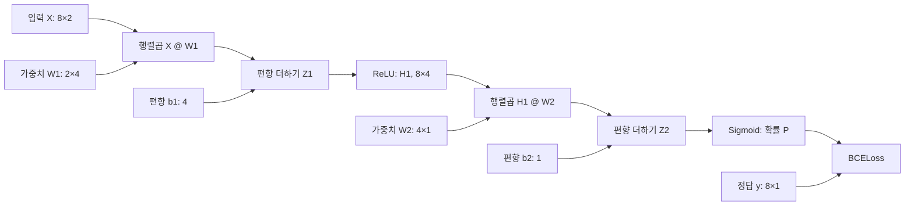
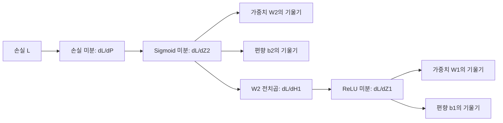

# 03.[신경망의 학습원리] : 역전파와 기울기 문제

<br>

# **1. 딥러닝 모델 개발의 전체 흐름**

> ## **1-1) 딥러닝 학습을 먼저 하나의 흐름으로 이해하기**

앞선 강의에서는 입력 데이터가 여러 Layer를 통과하면서 Prediction을 계산하는 **Forward Propagation**을 학습했다.

하지만 실제 Deep Learning Model Development에서는 예측값을 계산하는 것만으로 끝나지 않는다.

전체 학습 과정은 다음과 같이 연결된다.

```text
데이터 준비
↓
모델 정의
↓
Loss Function 정의
↓
Optimizer 정의
↓
Forward Propagation
↓
Loss 계산
↓
Backward Propagation
↓
Gradient 계산
↓
Parameter Update
↓
반복 학습
↓
평가 / 예측
```

이를 PyTorch 코드 흐름으로 바꾸면 다음과 같다.

```text
X, y 준비
↓
model 정의
↓
criterion 정의
↓
optimizer 정의
↓
optimizer.zero_grad()
↓
pred = model(X)
↓
loss = criterion(pred, y)
↓
loss.backward()
↓
optimizer.step()
```

즉 딥러닝 학습의 핵심은 단순히 `model(X)`를 반복하는 것이 아니라,

> **예측 → 오차 측정 → Gradient 계산 → Parameter 수정**

과정을 반복하는 것이다.

[Python Code] "딥러닝 모델(MLP) 개발 흐름"

```python
# 딥러닝 모델(MLP) 개발 흐름
# 예제: 축구 선수의 슈팅 성공 여부 예측

import torch
import torch.nn as nn

torch.manual_seed(42)  # 재현성을 위한 난수 시드 고정

# STEP 1. 학습 데이터 준비
# 특성 2개를 입력 X로, 골 성공 여부를 정답 y로 구성
#
# X의 Feature
# 1. 슈팅에 유리한 각도 (0~1, 높을수록 유리한 각도)
# 2. 슈팅 파워 (0~1, 높을수록 강한 슈팅)
#
# y의 Label
# 0 = 골 실패
# 1 = 골 성공
#
# Batch Size = 8
# Input Feature = 2

X = torch.tensor([
    [0.1, 0.2],
    [0.2, 0.1],
    [0.3, 0.5],
    [0.4, 0.2],
    [0.6, 0.5],
    [0.7, 0.8],
    [0.8, 0.6],
    [0.9, 0.9]
], dtype=torch.float32)  # [슈팅 각도 유리도, 슈팅 파워]

y = torch.tensor([
    [0], [0], [0], [0],
    [1], [1], [1], [1]
], dtype=torch.float32)  # [골 성공 여부]

print("X shape :", X.shape)  # (8, 2)
print("y shape :", y.shape)  # (8, 1)

# STEP 2. MLP 모델 정의
# 모델 구조: Input 2 → Hidden Layer 4 → Output 1

model = nn.Sequential(

    # 입력 Feature 2개 → 은닉층 뉴런 4개
    # Shape: (8, 2) → (8, 4)
    nn.Linear(2, 4),

    # ReLU 활성화 함수
    # 음수는 0, 양수는 그대로 유지
    # 비선형 변환
    nn.ReLU(),

    # 은닉층 뉴런 4개 → 출력 뉴런 1개
    # Shape: (8, 4) → (8, 1)
    nn.Linear(4, 1),

    # Sigmoid 활성화 함수
    # 출력 Logit을 0~1 사이의 골 성공 확률로 변환
    nn.Sigmoid()
)

# STEP 3. Loss / Optimizer 정의

# Binary Cross Entropy Loss
# 예측한 골 성공 확률과 실제 골 성공 여부의 오차 계산
criterion = nn.BCELoss()

# Adam Optimizer
# 학습률(Learning Rate) = 0.05
# 가중치와 편향을 업데이트
optimizer = torch.optim.Adam(model.parameters(), lr=0.05)

# STEP 4. 모델 학습

for epoch in range(501):  # Epoch 0~500, 총 501번 업데이트

    # 4.1 기존 기울기 초기화
    optimizer.zero_grad()

    # 4.2 순전파 (Forward Propagation)
    # 입력 → 은닉층 → ReLU → 출력층 → Sigmoid
    pred = model(X)

    # 4.3 손실함수(Loss) 계산
    # 예측한 골 성공 확률과 실제 정답 비교
    loss = criterion(pred, y)

    # 4.4 역전파 (Backpropagation)
    # Chain Rule을 이용하여 각 층의 기울기 계산
    loss.backward()

    # 4.5 Optimizer
    # 계산된 기울기를 바탕으로 가중치와 편향 업데이트
    optimizer.step()

    # 100 Epoch마다 Loss 출력
    if epoch % 100 == 0:
        print(f"Epoch {epoch}, Loss: {loss.item():.4f}")

# STEP 5. 테스트 (예측 결과 생성)

model.eval()  # 평가 모드

with torch.no_grad():

    # 학습된 모델로 골 성공 확률 예측
    probabilities = model(X)

    # 확률이 0.5 이상이면 골 성공(1)
    # 확률이 0.5 미만이면 골 실패(0)
    predictions = (probabilities >= 0.5).int()

print("골 성공 확률:", probabilities.squeeze().tolist())
print("예측:", predictions.squeeze().tolist())
print("정답:", y.int().squeeze().tolist())
```

[Result]

```text
X shape : torch.Size([8, 2])
y shape : torch.Size([8, 1])

Epoch 0, Loss: 0.7311
Epoch 100, Loss: 0.0122
Epoch 200, Loss: 0.0031
Epoch 300, Loss: 0.0015
Epoch 400, Loss: 0.0009
Epoch 500, Loss: 0.0006

예측: [0, 0, 0, 0, 1, 1, 1, 1]
정답: [0, 0, 0, 0, 1, 1, 1, 1]
```

<br>

> ## **1-2) Forward·Backward·Optimizer의 역할 구분**

세 과정은 서로 역할이 다르다.

| 단계 | 역할 | 대표 PyTorch 코드 |
| --- | --- | --- |
| Forward | 현재 Parameter로 Prediction 계산 | `model(X)` |
| Loss | Prediction과 정답의 차이 계산 | `criterion(pred, y)` |
| Backward | Parameter별 Gradient 계산 | `loss.backward()` |
| Update | Gradient를 이용해 Parameter 변경 | `optimizer.step()` |

특히 다음 두 코드를 혼동하면 안 된다.

```python
loss.backward()
```

는 **Gradient를 계산**한다.

반면

```python
optimizer.step()
```

은 **실제 Weight와 Bias를 변경**한다.

<br>

> ## **1-3) Parameter와 Hyperparameter**

딥러닝 학습에서는 Parameter와 Hyperparameter를 구분해야 한다.

| 구분 | 예 | 누가 결정하는가 |
| --- | --- | --- |
| Parameter | Weight, Bias | 학습 과정에서 Model이 Update |
| Hyperparameter | Learning Rate, Batch Size, Epoch, Hidden Size | 사람이 설정 |

즉

```text
Weight / Bias
→ 학습 대상
```

이고,

```text
Learning Rate / Batch Size
→ 학습 방법을 결정하는 설정
```

이다.

<br><br>

---

# **2. 실제 예제로 보는 딥러닝 학습 문제**

> ## **2-1) 야구 투구 운동역학 데이터**

투구 동작 분석 시스템에서 한 Pitching Session의 고부하 패턴을 분류한다고 가정하자.

입력 Feature는 다음과 같다.

| 변수 | 의미 |
| --- | --- |
| `elbow_torque_norm` | 정규화된 팔꿈치 Valgus Torque |
| `shoulder_rotation_velocity_norm` | 어깨 내회전 각속도 |
| `workload_ratio_norm` | 최근 투구 부하 비율 |

정답은

```text
0 = 일반 부하 패턴
1 = 고부하 패턴
```

으로 정의한다.

예를 들어 입력 하나가

```text
[0.73, 0.69, 0.71]
```

이고 실제 정답이

```text
y = 1
```

이라고 하자.

Model이 현재

```text
P(y=1) = 0.39
```

정도로 예측했다면 실제 정답과 Prediction 사이에 차이가 있다.

Model은 이 차이를 이용해 Weight와 Bias를 수정해야 한다.

<br>

> ## **2-2) 학습 과정**

Binary Classification Network가 다음 구조라고 하자.

```text
Input 3
↓
Linear(3 → 5)
↓
ReLU
↓
Linear(5 → 3)
↓
ReLU
↓
Linear(3 → 1)
↓
Logit
```

Training에서는 다음 순서가 반복된다.

```text
운동역학 Feature
↓
Forward
↓
Logit
↓
BCE Loss
↓
Backward
↓
Gradient
↓
Adam Optimizer
↓
Weight / Bias Update
```

<br><br>

---

# **3. 역전파(Backpropagation)의 핵심 원리**

> ## **3-1) 역전파란?**

Backpropagation은 **최종 Loss를 기준으로 각 Parameter가 Loss에 얼마나 영향을 주었는지 Gradient를 계산하는 과정**이다.

- 손실함수 계산 (실제값 - 예측값)

순전파가

```text
Input
→ Hidden Layer
→ Output
→ Loss
```

방향이라면,

역전파는

```text
Loss
→ Output Layer
→ Hidden Layer
→ Input 쪽 Layer
```

방향으로 Gradient가 전달된다.

> 역전파는 순전파(예측값을 도출)가 있어야 존재할 수 있다.

- 예시 모델의 순전파 :   
    1. 입력 3개 → 은닉층 1(4개) → 은닉층 2(2개) → 출력층(1개)   
    2. 각 은닉층에서는 Linear 연산과 ReLU를 사용하고, 출력층에서는 최종 Logit을 사용한다.

    3. **입력 데이터 → 은닉층 1 → 은닉층 2 → Logit → 예측 확률**

- 순전파로 손실함수를 계산한 뒤, 가중치와 편향을 변경하며 손실의 차이를 줄여나가야한다.

<br>

> ## **3-2) Gradient의 의미**

어떤 Weight를 `w`라고 하면

$$
\frac{\partial L}{\partial w}
$$

는 `w`를 아주 조금 변경했을 때 Loss가 어느 방향으로 얼마나 변화하는지를 나타낸다.

예를 들어

```text
∂L/∂w > 0
```

이라면 `w`를 증가시키면 현재 위치에서 Loss가 증가하는 방향이다.

반대로

```text
∂L/∂w < 0
```

이라면 `w`를 증가시키는 방향이 Loss 감소 방향일 수 있다.

Gradient-based Optimizer는 이러한 정보를 이용한다.

<br>

> ## **3-3) Chain Rule과 Backpropagation**

신경망은 여러 함수가 연결된 Composite Function이다.

예를 들어

$$
z_1=xW_1+b_1
$$

$$
h_1=ReLU(z_1)
$$

$$
z_2=h_1W_2+b_2
$$

$$
L=Loss(z_2,y)
$$

라고 하자.

첫 번째 Weight `W₁`이 Loss에 미치는 영향을 계산하려면 여러 연산을 거쳐야 한다.

개념적으로 다음과 같다.

$$
\frac{\partial L}{\partial W_1}
=
\frac{\partial L}{\partial z_2}
\cdot
\frac{\partial z_2}{\partial h_1}
\cdot
\frac{\partial h_1}{\partial z_1}
\cdot
\frac{\partial z_1}{\partial W_1}
$$

즉 각 연산의 Local Derivative를 연결하여 앞쪽 Layer까지 Gradient를 전달한다.

이것이 Backpropagation의 핵심이다.

<br><br>

---

# **4. PyTorch Autograd (자동 미분)**

> ## **4-1) Autograd가 필요한 이유**

간단한 Linear Regression에서는 Gradient를 직접 계산할 수 있다.

하지만 DNN에는 수많은 Parameter가 존재할 수 있다.

예를 들어

```text
Input 3
→ Hidden 5
→ Hidden 3
→ Output 1
```

Network의 Parameter 개수는 다음과 같다.

첫 번째 Layer:

$$
3\times5+5=20
$$

두 번째 Layer:

$$
5\times3+3=18
$$

Output Layer:

$$
3\times1+1=4
$$

따라서 전체 Parameter는

$$
20+18+4=42
$$

개이다.

실제 DNN에서는 수십만~수십억 개 이상의 Parameter를 사용할 수도 있으므로 Gradient를 직접 구현하는 방식은 현실적이지 않다.

PyTorch의 **Autograd**가 이러한 미분을 자동으로 수행한다.

<br>

> ## **4-2) Computation Graph**

PyTorch는 Gradient 추적이 필요한 Tensor 연산을 연결하여 Computation Graph를 구성한다.

예를 들어

```text
X
↓
Linear
↓
ReLU
↓
Linear
↓
Loss
```

연산을 수행하면 내부적으로 각 연산의 연결 관계를 추적한다.

그리고

```python
loss.backward()
```

를 실행하면 이 Graph를 역방향으로 따라가며 Chain Rule을 적용한다.

```python
"""축구 슈팅 성공 예측 MLP (2→4→1)의 계산 그래프와 역전파 그래프.

설치: pip install graphviz
Mac에서 dot 미설치 시: brew install graphviz
실행: python draw_mlp_computation_graph.py
"""
from graphviz import Digraph
from pathlib import Path
import sys

OUT = Path(__file__).resolve().parent
FONT = ("Apple SD Gothic Neo" if sys.platform == "darwin" else
        "Malgun Gothic" if sys.platform == "win32" else "NanumGothic")

def new_graph(title):
    g = Digraph(format="png")
    g.attr(rankdir="LR", bgcolor="#ffffff", pad="0.38", nodesep="0.45", ranksep="0.66",
           label=title, labelloc="t", fontsize="23", fontname=FONT, fontcolor="#17324d",
           splines="spline", dpi="175")
    g.attr("node", shape="box", style="rounded,filled", fillcolor="#eef5fc",
           color="#89abc5", fontname=FONT, fontsize="13", fontcolor="#17324d",
           margin="0.17,0.11", penwidth="1.3")
    g.attr("edge", color="#67849c", arrowsize="0.75", penwidth="1.6", fontname=FONT, fontsize="11")
    return g

# 1. 순전파의 실제 연산 의존성을 보여 주는 Computation Graph
forward = new_graph("MLP Computation Graph | 순전파 (2 → 4 → 1)")
forward.node("X", "입력 X\n(8 × 2)\n[각도 유리도, 슈팅 파워]", fillcolor="#dbeafe")
forward.node("W1", "학습 파라미터 W₁\n(2 × 4)", fillcolor="#fff2d5", color="#dbb870")
forward.node("b1", "학습 파라미터 b₁\n(4,)", fillcolor="#fff2d5", color="#dbb870")
forward.node("M1", "행렬곱\nX @ W₁\n(8 × 4)")
forward.node("Z1", "편향 더하기\nZ₁ = M₁ + b₁\n(8 × 4)")
forward.node("H1", "ReLU\nH₁ = ReLU(Z₁)\n(8 × 4)", fillcolor="#d9f4eb", color="#7fc1ab")
forward.node("W2", "학습 파라미터 W₂\n(4 × 1)", fillcolor="#fff2d5", color="#dbb870")
forward.node("b2", "학습 파라미터 b₂\n(1,)", fillcolor="#fff2d5", color="#dbb870")
forward.node("M2", "행렬곱\nH₁ @ W₂\n(8 × 1)")
forward.node("Z2", "편향 더하기\nLogit Z₂ = M₂ + b₂\n(8 × 1)")
forward.node("P", "Sigmoid\n확률 P\n(8 × 1)", fillcolor="#d9f4eb", color="#7fc1ab")
forward.node("Y", "정답 y\n(8 × 1)", fillcolor="#dbeafe")
forward.node("L", "BCELoss\n손실 L (스칼라)", fillcolor="#fce3e0", color="#df9b93")
for a, b in [
    ("X", "M1"), ("W1", "M1"), ("M1", "Z1"), ("b1", "Z1"),
    ("Z1", "H1"), ("H1", "M2"), ("W2", "M2"),
    ("M2", "Z2"), ("b2", "Z2"), ("Z2", "P"),
    ("P", "L"), ("Y", "L")
]:
    forward.edge(a, b)
forward.render(str(OUT / "mlp_computation_graph"), cleanup=True)

# 2. 동일한 그래프에서 역전파로 계산하는 손실 기울기의 의존 관계
backward = new_graph("MLP Backpropagation | Chain Rule (역전파)")
backward.node("L", "손실 L\nBCELoss", fillcolor="#fce3e0", color="#df9b93")
backward.node("gP", "∂L/∂P\n손실함수 미분")
backward.node("gZ2", "∂L/∂Z₂\n× Sigmoid'(Z₂)")
backward.node("gH1", "∂L/∂H₁\n× W₂ᵀ")
backward.node("gZ1", "∂L/∂Z₁\n× ReLU'(Z₁)")
backward.node("gW2", "∂L/∂W₂\nH₁ᵀ @ (∂L/∂Z₂)", fillcolor="#fff2d5", color="#dbb870")
backward.node("gb2", "∂L/∂b₂\n배치 방향 합", fillcolor="#fff2d5", color="#dbb870")
backward.node("gW1", "∂L/∂W₁\nXᵀ @ (∂L/∂Z₁)", fillcolor="#fff2d5", color="#dbb870")
backward.node("gb1", "∂L/∂b₁\n배치 방향 합", fillcolor="#fff2d5", color="#dbb870")
for a, b in [
    ("L", "gP"), ("gP", "gZ2"),
    ("gZ2", "gH1"), ("gH1", "gZ1"),
    ("gZ2", "gW2"), ("gZ2", "gb2"),
    ("gZ1", "gW1"), ("gZ1", "gb1")
]:
    backward.edge(a, b)
backward.render(str(OUT / "mlp_backpropagation_graph"), cleanup=True)

print("저장 완료:")
print(OUT / "mlp_computation_graph.png")
print(OUT / "mlp_backpropagation_graph.png")
```

[Result] "순전파, 역전파 Computation Graph"





<br>

> ## **4-3) `loss.backward()`**

다음 코드는 Backpropagation을 수행한다.

```python
loss.backward()
```

이 명령이 실행되면 Trainable Parameter 각각에 대해

$$
\frac{\partial L}{\partial \theta}
$$

가 계산된다.

여기서 `θ`는 Weight나 Bias 같은 Model Parameter를 의미한다.

<br>

> ## **4-4) `.grad`**

계산된 Gradient는 Parameter의 `.grad`에 저장된다.

예를 들어

```python
model[0].weight.grad
```

는 첫 번째 Linear Layer Weight에 대한 Loss Gradient이다.

중요한 특징은

> **Parameter와 해당 Gradient의 Shape가 동일하다.**

는 것이다.

예를 들어

```text
Weight Shape = (5, 3)
```

이면

```text
Gradient Shape = (5, 3)
```

이다.

<br><br>

---

# **5. PyTorch로 실제 Gradient 확인하기**

> ## **5-1) 운동역학 Binary Classification 예제**

[ Python : code ] "투구 운동역학 DNN에서 Autograd로 Layer별 Gradient 계산"

```python
import torch
import torch.nn as nn

torch.manual_seed(7)

# Pitching biomechanics features
X = torch.tensor([
    [0.42, 0.35, 0.28],
    [0.55, 0.48, 0.44],
    [0.73, 0.69, 0.71],
    [0.31, 0.29, 0.25],
    [0.82, 0.76, 0.79],
    [0.67, 0.62, 0.58]
], dtype=torch.float32)

# 0 = 일반 부하, 1 = 고부하
y = torch.tensor([
    [0.], [0.], [1.],
    [0.], [1.], [1.]
])

model = nn.Sequential(
    nn.Linear(3, 5),
    nn.ReLU(),
    nn.Linear(5, 3),
    nn.ReLU(),
    nn.Linear(3, 1)
)

criterion = nn.BCEWithLogitsLoss()

# 이전 Gradient 초기화
model.zero_grad()

# Forward
logits = model(X)

# Loss
loss = criterion(logits, y)

# Backward
loss.backward()

print("Loss:", round(loss.item(), 4))

for name, param in model.named_parameters():
    print(
        name,
        "| Parameter:", tuple(param.shape),
        "| Gradient:", tuple(param.grad.shape),
        "| Grad Norm:", round(param.grad.norm().item(), 5)
    )
```

[ Result ]

```text
Loss: 0.7226

0.weight | Parameter: (5, 3) | Gradient: (5, 3) | Grad Norm: 0.03782
0.bias   | Parameter: (5,)   | Gradient: (5,)   | Grad Norm: 0.01655

2.weight | Parameter: (3, 5) | Gradient: (3, 5) | Grad Norm: 0.06886
2.bias   | Parameter: (3,)   | Gradient: (3,)   | Grad Norm: 0.04105

4.weight | Parameter: (1, 3) | Gradient: (1, 3) | Grad Norm: 0.08224
4.bias   | Parameter: (1,)   | Gradient: (1,)   | Grad Norm: 0.10783
```

<br>

> ## **5-2) 결과 해석**

첫 번째 Layer의

```text
0.weight
```

는

```text
Linear(3, 5)
```

의 Weight이다.

PyTorch는 Weight를

```text
(out_features, in_features)
```

형태로 저장하므로 Shape은

```text
(5, 3)
```

이다.

Gradient도

```text
(5, 3)
```

이다.

즉 Weight의 각 원소마다 Loss에 대한 미분값 하나가 존재한다.

[Python Code] ""

```python
import torch
import torch.nn as nn

# 재현 가능한 결과를 위한 난수 시드
torch.manual_seed(2)

# ----------------------
# 1. 입력 데이터와 실제 정답
# ----------------------

X = torch.tensor([
    [0.5, 0.3, 0.8],
    [0.2, 0.0, 0.3],
    [0.8, 0.4, 1.0],
    [0.3, 0.1, 0.5]
], dtype=torch.float32)

y = torch.tensor([
    [1.0],
    [0.0],
    [1.0],
    [0.0]
])

# ----------------------
# 2. DNN 모델 정의
# ----------------------

model = nn.Sequential(
    nn.Linear(3, 4),
    nn.ReLU(),

    nn.Linear(4, 2),
    nn.ReLU(),

    nn.Linear(2, 1)
)

# 이진 분류 손실 함수
loss_fn = nn.BCEWithLogitsLoss()

# 학습 모드
model.train()

# ----------------------
# 3. 순전파
# ----------------------

# 기존 Gradient 초기화
model.zero_grad()

# 현재 가중치 저장
weight_before = model[0].weight.detach().clone()

# Logit 계산
logits = model(X)

# 손실 계산
loss = loss_fn(logits, y)

print("입력 Shape:", tuple(X.shape))
print("Logit Shape:", tuple(logits.shape))
print("손실:", round(loss.item(), 4))

# ----------------------
# 4. 역전파
# ----------------------

loss.backward()

# ----------------------
# 5. Gradient 확인
# ----------------------

for name, parameter in model.named_parameters():
    print(
        f"{name} | "
        f"파라미터 Shape: {tuple(parameter.shape)} | "
        f"Gradient Shape: {tuple(parameter.grad.shape)} | "
        f"Gradient 크기: {parameter.grad.norm().item():.5f}"
    )

# ----------------------
# 6. 파라미터 변경 여부 확인
# ----------------------

weight_after = model[0].weight.detach()

is_changed = not torch.equal(
    weight_before,
    weight_after
)

print("역전파 후 가중치 변경 여부:", is_changed)
```

[Result]

```text
입력 Shape: (4, 3)
Logit Shape: (4, 1)

손실: 0.7115
0.weight | 파라미터 Shape: (4, 3) | Gradient Shape: (4, 3) | Gradient 크기: 0.06920
0.bias | 파라미터 Shape: (4,) | Gradient Shape: (4,) | Gradient 크기: 0.05926

2.weight | 파라미터 Shape: (2, 4) | Gradient Shape: (2, 4) | Gradient 크기: 0.04049
2.bias | 파라미터 Shape: (2,) | Gradient Shape: (2,) | Gradient 크기: 0.04378

4.weight | 파라미터 Shape: (1, 2) | Gradient Shape: (1, 2) | Gradient 크기: 0.00328
4.bias | 파라미터 Shape: (1,) | Gradient Shape: (1,) | Gradient 크기: 0.11058
역전파 후 가중치 변경 여부: False
```

<br>

> ## **5-3) Gradient Norm**

Gradient Tensor 전체를 하나의 크기로 요약할 때 Norm을 사용할 수 있다.

예를 들어

$$
g=[3,4]
$$

라면 L2 Norm은

$$
\lVert g \rVert_2
=
\sqrt{3^2+4^2}
=
5
$$

이다.

PyTorch에서는

```python
param.grad.norm()
```

으로 확인할 수 있다.

다만 Gradient Norm 하나만 보고 정상·비정상을 결정하면 안 된다.

<br><br>

---

# **6. Backward와 Parameter Update는 다르다**

> ## **6-1) `loss.backward()` 이후**

Backpropagation 이후에는

```text
Gradient는 계산됨
Weight는 그대로
Bias도 그대로
```

이다.

즉

```python
loss.backward()
```

만 실행했다고 해서 Training Parameter가 변경되는 것은 아니다.

<br>

> ## **6-2) `optimizer.step()`**

실제 Parameter Update는 Optimizer가 수행한다.

```python
optimizer.step()
```

을 실행하면 현재 `.grad`에 저장된 정보를 이용하여 Parameter를 변경한다.

SGD의 기본 원리는

$$
\theta_{new}
=
\theta_{old}
-
\alpha\nabla L
$$

형태이다.

하지만 Adam처럼 더 복잡한 Optimizer는 Momentum과 Adaptive Scaling 등을 함께 이용하므로 단순한 SGD 공식과 완전히 같지는 않다.

<br>

> ## **6-3) Weight 변경 여부 확인**

[ Python : code ] "Backward만 수행했을 때와 Optimizer Step 이후 Weight 변화 비교"

```python
optimizer = torch.optim.Adam(model.parameters(), lr=0.05)

before = model[0].weight.detach().clone()

optimizer.zero_grad()

logits = model(X)
loss = criterion(logits, y)

loss.backward()

after_backward = model[0].weight.detach().clone()

print(
    "Backward 후 변경:",
    not torch.equal(before, after_backward)
)

optimizer.step()

after_step = model[0].weight.detach().clone()

print(
    "Optimizer Step 후 변경:",
    not torch.equal(before, after_step)
)
```

[ Result ]

```text
Backward 후 변경: False
Optimizer Step 후 변경: True
```

따라서

```text
Backward = Gradient 계산
Optimizer Step = Parameter 변경
```

으로 구분해야 한다.

<br><br>

---

# **7. Gradient를 초기화해야 하는 이유**

> ## **7-1) PyTorch Gradient는 기본적으로 누적된다**

PyTorch에서는 `.backward()`를 여러 번 실행하면 기존 `.grad`에 새로운 Gradient가 더해진다.

개념적으로

```text
첫 번째 Gradient = g₁
두 번째 Gradient = g₂
```

라면 초기화하지 않을 경우

```text
.grad = g₁ + g₂
```

가 될 수 있다.

<br>

> ## **7-2) 일반적인 Training Loop**

따라서 일반적인 학습에서는 새로운 Batch를 처리하기 전에

```python
optimizer.zero_grad()
```

를 호출한다.

전체 순서는 다음과 같다.

```text
optimizer.zero_grad()
↓
Forward
↓
Loss
↓
Backward
↓
optimizer.step()
```

<br>

> ## **7-3) Gradient Accumulation과는 구분하기**

Gradient를 일부러 여러 Batch에 걸쳐 누적하는 Training Technique도 존재한다.

이를 Gradient Accumulation이라고 한다.

하지만 일반적인 학습에서는 의도하지 않은 누적을 막기 위해 매 Iteration마다 Gradient를 초기화한다.

<br><br>

---

# **8. `torch.no_grad()`와 Training Mode**

> ## **8-1) `torch.no_grad()`**

Prediction 단계에서는 Gradient 계산이 필요하지 않다.

따라서 다음과 같이 사용할 수 있다.

```python
with torch.no_grad():
    prediction = model(X)
```

이 구간에서는 Autograd가 연산 Graph를 Gradient 계산용으로 추적하지 않는다.

<br>

> ## **8-2) Training 전체에 사용하면 안 되는 이유**

다음처럼 Training 전체를 감싸면 문제가 된다.

```python
with torch.no_grad():
    logits = model(X)
    loss = criterion(logits, y)
    loss.backward()
```

Gradient 추적이 비활성화되어 Backpropagation을 정상적으로 수행할 수 없기 때문이다.

<br>

> ## **8-3) `model.train()`과 `model.eval()`**

두 명령도 역할이 다르다.

```python
model.train()
```

은 Training Mode로 전환하고,

```python
model.eval()
```

은 Evaluation Mode로 전환한다.

이는 Dropout, Batch Normalization처럼 Training과 Evaluation에서 동작이 달라지는 Layer에 영향을 준다.

`model.eval()` 자체가 Autograd를 끄는 것은 아니다.

따라서 Evaluation에서는 보통

```python
model.eval()

with torch.no_grad():
    ...
```

를 함께 사용한다.

<br><br>

---

# **9. 기울기 소실(Vanishing Gradient)**

- 경사하강법의 가중치 업데이트 = 기울기 x 학습률에 의해 결정됨

> ## **9-1) 기울기 소실이란?**

Backpropagation 과정에서 Gradient가 이전 Layer로 전달될수록 지나치게 작아지는 현상이다.

예를 들어 Gradient 전달 과정에서 매번 `0.5`가 곱해진다고 하자.

$$
1\times0.5^1=0.5
$$

$$
1\times0.5^2=0.25
$$

$$
1\times0.5^4=0.0625
$$

$$
1\times0.5^8=0.00390625
$$

Layer가 깊어질수록 앞쪽으로 전달되는 Gradient가 빠르게 작아진다.

<br>

> ## **9-2) Parameter Update에 미치는 영향**

경사하강법에서

$$
\Delta\theta
=
-\alpha\nabla L
$$

이다.

Learning Rate가

```text
0.01
```

이고 Gradient가

```text
0.000001
```

이라면

$$
\Delta\theta
=
-0.01\times0.000001
$$

$$
=-0.00000001
$$

이다.

> 즉 Parameter가 거의 바뀌지 않는다.

<br>

> ## **9-3) 학습에서 나타날 수 있는 현상**

Vanishing Gradient가 지속되면 특히 Input에 가까운 앞쪽 Layer에서

- Weight Update가 거의 일어나지 않음
- Training 속도가 매우 느림
- Loss 개선이 정체됨
- 앞쪽 Layer가 유용한 Representation을 충분히 학습하지 못함

등의 문제가 발생할 수 있다.

<br><br>

---

# **10. 기울기 폭주(Exploding Gradient)**

> ## **10-1) 기울기 폭주란?**

Gradient가 Layer를 역으로 통과하면서 지나치게 커지는 현상이다.

예를 들어 매 단계 `2`가 곱해진다면

$$
1\times2^1=2
$$

$$
1\times2^2=4
$$

$$
1\times2^4=16
$$

$$
1\times2^8=256
$$

처럼 빠르게 증가한다.

<br>

> ## **10-2) Parameter Update에 미치는 영향**

Learning Rate가

```text
0.01
```

이고 Gradient가

```text
100000
```

이라면

$$
\Delta\theta
=
-0.01\times100000
$$

$$
=-1000
$$

이다.

> 한 번의 Update에서 Weight가 매우 크게 변할 수 있다.

<br>

> ## **10-3) 학습에서 나타나는 현상**

Exploding Gradient가 심해지면

- Loss가 크게 진동
- Loss가 급격히 증가
- Parameter가 매우 큰 값으로 변함
- `inf`
- `nan`

등이 발생할 수 있다.

<br><br>

---

# **11. 기울기 소실과 폭주 비교**

> ## **11-1) 두 문제의 차이**

| 구분 | Vanishing Gradient | Exploding Gradient |
| --- | --- | --- |
| Gradient | 지나치게 작음 | 지나치게 큼 |
| Parameter Update | 거의 없음 | 지나치게 큼 |
| 학습 | 느리거나 정체 | 불안정 또는 발산 |
| 앞쪽 Layer | 학습 어려움 | 큰 Gradient 가능 |
| 대표 대응 | Activation·Initialization·Architecture 검토 | Clipping·Initialization·LR 검토 |

<br>

> ## **11-2) Gradient 크기만 보고 단정하면 안 된다**

작은 Gradient가 항상 Vanishing Gradient를 의미하는 것은 아니다.

Model이 Loss Minimum 근처에 있다면 Gradient가 자연스럽게 작아질 수 있다.

마찬가지로 특정 Layer의 Gradient가 한 번 크게 계산되었다고 해서 바로 Exploding Gradient라고 단정할 수 없다.

따라서 다음을 함께 확인해야 한다.

```text
Gradient 변화
+
Training Loss
+
Validation 성능
+
Parameter 변화
+
학습 전체 추세
```

<br><br>

---

# **12. Activation Function과 Gradient**

> ## **12-1) Sigmoid**

Sigmoid의 도함수는

$$
\sigma'(z)
=
\sigma(z)(1-\sigma(z))
$$

이다.

최대값은 `0.25`이다.

입력이 큰 양수 또는 큰 음수가 되면 Sigmoid Output이 1 또는 0에 가까워지고 Gradient는 0에 가까워진다.

따라서 깊은 Hidden Layer에서 반복적으로 사용할 경우 Vanishing Gradient와 연결될 수 있다.

<br>

> ## **12-2) Tanh**

Tanh의 도함수는

$$
tanh'(z)
=
1-tanh^2(z)
$$

이다.

`z=0` 부근에서는 Gradient가 비교적 크지만 입력 절댓값이 커지면 Tanh Output이 ±1에 가까워지고 Gradient가 0에 가까워진다.

<br>

> ## **12-3) ReLU**

ReLU는

$$
ReLU(z)=\max(0,z)
$$

이다.

미분은 개념적으로

$$
ReLU'(z)
=
\begin{cases}
0 & z<0\\
1 & z>0
\end{cases}
$$

이다.

양수 영역에서는 Gradient가 1이므로 Sigmoid의 포화 문제를 완화하는 데 도움이 된다.

하지만 음수 영역에서는 Gradient가 0이다.

<br>

> ## **12-4) Dead ReLU**

특정 Neuron이 계속 음수 Pre-Activation을 가지면

```text
ReLU Output = 0
Gradient = 0
```

상태가 반복될 수 있다.

그 결과 해당 Neuron으로 들어오는 Weight가 충분히 Update되지 않을 수 있다.

이를 Dead ReLU라고 한다.

<br>

> ## **12-5) 비교**

| 함수 | Gradient 특징 | 주요 고려사항 |
| --- | --- | --- |
| Sigmoid | 최대 0.25 | Saturation 시 Vanishing 가능 |
| Tanh | 최대 1 | Saturation 시 Vanishing 가능 |
| ReLU | 양수 1, 음수 0 | Dead ReLU 가능 |

<br><br>

---

# **13. Gradient Norm으로 학습 상태 확인하기**

> ## **13-1) Gradient Monitoring**

실제 Training에서는 각 Layer의 Gradient를 기록하여 변화 추세를 볼 수 있다.

예를 들어

```python
for name, param in model.named_parameters():
    if param.grad is not None:
        print(name, param.grad.norm())
```

을 이용할 수 있다.

<br>

> ## **13-2) 어떤 패턴을 확인하는가?**

예를 들어 다음과 같은 현상을 관찰할 수 있다.

| 관찰 결과 | 검토할 내용 |
| --- | --- |
| 앞쪽 Layer Gradient가 계속 0에 가까움 | Vanishing Gradient 가능성 |
| 특정 시점부터 Gradient가 급증 | Exploding 가능성 |
| Loss와 Gradient가 함께 급증 | Learning Rate·Initialization 등 확인 |
| ReLU Layer Gradient가 자주 0 | Dead ReLU 가능성 |

중요한 것은 **한 번의 값이 아니라 여러 Iteration과 Epoch에 걸친 추세**이다.

<br><br>

---

# **14. Gradient Clipping**

> ## **14-1) Gradient Clipping이란?**

Gradient Clipping은 지나치게 큰 Gradient를 제한하여 Parameter Update가 너무 커지는 것을 완화하는 방법이다.

주로 **Exploding Gradient 대응**에 사용한다.

<br>

> ## **14-2) Norm 기준 Clipping**

Gradient가

$$
g=[6,8]
$$

이라고 하자.

L2 Norm은

$$
\lVert g \rVert_2
=
\sqrt{6^2+8^2}
=
10
$$

이다.

`max_norm=5`로 제한한다면

$$
\frac{5}{10}=0.5
$$

비율을 적용하여

$$
g_{new}
=
[6,8]\times0.5
$$

$$
=[3,4]
$$

가 된다.

새로운 Norm은

$$
\sqrt{3^2+4^2}=5
$$

이다.

<br>

> ## **14-3) PyTorch Gradient Clipping**

PyTorch에서는

```python
torch.nn.utils.clip_grad_norm_()
```

을 사용할 수 있다.

중요한 순서는 다음과 같다.

```text
Backward
↓
Gradient 생성
↓
Gradient Clipping
↓
Optimizer Step
```

Clipping을 `backward()`보다 먼저 수행할 수는 없다.

아직 Gradient가 계산되지 않았기 때문이다.

<br>

> ## **14-4) 실제 코드**

[ Python : code ] "전체 Gradient Norm을 계산하고 Gradient Clipping 적용"

```python
model.zero_grad()

logits = model(X)
loss = criterion(logits, y)

loss.backward()

def total_grad_norm(model):
    grad_norms = [
        p.grad.norm()
        for p in model.parameters()
        if p.grad is not None
    ]

    return torch.linalg.vector_norm(
        torch.stack(grad_norms)
    )

before = total_grad_norm(model)

torch.nn.utils.clip_grad_norm_(
    model.parameters(),
    max_norm=0.05
)

after = total_grad_norm(model)

print("Clipping 전:", round(before.item(), 5))
print("Clipping 후:", round(after.item(), 5))
```

[ Result ]

```text
Clipping 전: 0.16285
Clipping 후: 0.05000
```

이번 `0.05`는 Clipping 동작을 명확하게 보여주기 위한 예제 값이다.

모든 Model에 `0.05`를 사용해야 한다는 의미는 아니다.

<br>

> ## **14-5) Gradient Clipping의 한계**

Gradient Clipping은

```text
너무 큰 Gradient
```

를 제한하는 방법이다.

따라서

```text
Vanishing Gradient
```

를 해결하는 방법은 아니다.

이미 매우 작은 Gradient를 Clipping한다고 해서 커지지는 않는다.

<br><br>

---

# **15. Weight Initialization**

> ## **15-1) 초기화가 중요한 이유**

DNN의 Training은 Randomly Initialized Weight에서 시작하는 경우가 많다.

초기 Weight가 지나치게 작으면 Forward Activation이나 Gradient가 작아질 수 있다.

반대로 지나치게 크면 Activation과 Gradient가 불안정하게 커질 수 있다.

따라서 Network 구조와 Activation Function에 맞는 Initialization을 고려한다.

<br>

> ## **15-2) Xavier Initialization**

Xavier Initialization은 Sigmoid나 Tanh 계열 Network에서 자주 연결하여 학습하는 초기화 방법이다.

핵심 아이디어는 Layer를 지날 때 Activation과 Gradient의 규모가 지나치게 작아지거나 커지지 않도록 Weight Scale을 조절하는 것이다.

<br>

> ## **15-3) He Initialization**

He Initialization은 ReLU 계열 Activation과 자주 함께 사용된다.

PyTorch에서는 다음과 같이 사용할 수 있다.

[ Python : code ] "ReLU Hidden Layer에 He Initialization 적용"

```python
for layer in model:
    if isinstance(layer, nn.Linear):
        nn.init.kaiming_normal_(
            layer.weight,
            nonlinearity="relu"
        )

        if layer.bias is not None:
            nn.init.zeros_(layer.bias)
```

[ Result ]

```text
각 Linear Layer의 Weight가
ReLU 계열에 맞는 Kaiming 방식으로 다시 초기화됨
```

Output Layer까지 무조건 동일한 ReLU용 Initialization을 적용해야 한다는 의미는 아니다.

실제 모델에서는 Layer의 역할과 Activation 구조를 고려해야 한다.

<br><br>

---

# **16. Learning Rate와 Gradient 문제**

> ## **16-1) Learning Rate의 역할**

Parameter Update 크기는 Gradient뿐 아니라 Learning Rate의 영향을 받는다.

SGD 기준으로

$$
\Delta\theta
=
-\alpha\nabla L
$$

이다.

따라서 같은 Gradient라도 Learning Rate가 다르면 Update 크기가 달라진다.

<br>

> ## **16-2) Gradient와 Learning Rate를 구분해야 한다**

다음 두 문제는 서로 다르다.

```text
Gradient 자체가 너무 큼
```

과

```text
Learning Rate가 너무 큼
```

은 동일한 현상이 아니다.

Gradient는 Backpropagation 결과이고 Learning Rate는 그 Gradient를 실제 Parameter Update에 얼마나 반영할지 결정한다.

<br>

> ## **16-3) 예시**

Gradient가

```text
10
```

이라고 하자.

Learning Rate가 `0.1`이면

$$
\Delta w=-1
$$

이고,

Learning Rate가 `0.001`이면

$$
\Delta w=-0.01
$$

이다.

따라서 Training이 불안정할 때는

- Gradient가 비정상적으로 큰지
- Learning Rate가 너무 큰지

둘을 구분하여 확인해야 한다.

<br><br>

---

# **17. Sigmoid + BCELoss와 BCEWithLogitsLoss**

> ## **17-1) 두 구현 방식**

Binary Classification에서는 다음 두 방식이 가능하다.

### 방식 A

```text
Linear
↓
Sigmoid
↓
Probability
↓
BCELoss
```

PyTorch 코드에서는

```python
model = nn.Sequential(
    ...,
    nn.Linear(4, 1),
    nn.Sigmoid()
)

criterion = nn.BCELoss()
```

처럼 사용할 수 있다.

<br>

> ## **17-2) Logit을 직접 사용하는 방식**

또 다른 방식은

```text
Linear
↓
Raw Logit
↓
BCEWithLogitsLoss
```

이다.

```python
model = nn.Sequential(
    ...,
    nn.Linear(4, 1)
)

criterion = nn.BCEWithLogitsLoss()
```

이 방식은 Sigmoid와 BCE에 해당하는 계산을 결합하여 처리한다.

<br>

> ## **17-3) 비교**

| 구분 | Sigmoid + BCELoss | BCEWithLogitsLoss |
| --- | --- | --- |
| Model Output | Probability | Logit |
| Model 마지막 Sigmoid | O | X |
| Loss | `BCELoss` | `BCEWithLogitsLoss` |
| Prediction Probability | 바로 사용 | `torch.sigmoid(logit)` |
| Training 구현 | 가능 | 일반적으로 더 편리 |

`BCEWithLogitsLoss`를 사용할 때 Model에 Sigmoid를 넣으면 중복 적용이 될 수 있으므로 주의한다.

<br><br>

---

# **18. 실제 PyTorch Training Loop**

> ## **18-1) Full Training Code**

이번에는 앞의 개념을 하나의 Training Loop로 연결한다.

[ Python : code ] "운동역학 고부하 패턴 분류 DNN의 전체 학습 흐름"

```python
import torch
import torch.nn as nn

torch.manual_seed(42)

# STEP 1
# 학습 데이터 준비

X = torch.tensor([
    [0.42, 0.35, 0.28],
    [0.55, 0.48, 0.44],
    [0.73, 0.69, 0.71],
    [0.31, 0.29, 0.25],
    [0.82, 0.76, 0.79],
    [0.67, 0.62, 0.58]
], dtype=torch.float32)

y = torch.tensor([
    [0.], [0.], [1.],
    [0.], [1.], [1.]
])

# STEP 2
# DNN 모델 정의 -> 뉴런 사이의 가중치와 편향이 학습됨
model = nn.Sequential(
    nn.Linear(3, 5),
    nn.ReLU(),
    nn.Linear(5, 3),
    nn.ReLU(),
    nn.Linear(3, 1)
)

criterion = nn.BCEWithLogitsLoss()

optimizer = torch.optim.Adam(
    model.parameters(),
    lr=0.01
)

for epoch in range(501):

    # 1. 이전 Gradient 초기화
    optimizer.zero_grad()

    # 2. Forward
    logits = model(X)

    # 3. Loss
    loss = criterion(logits, y)

    # 4. Backward
    loss.backward()

    # 5. 필요 시 Gradient Clipping
    torch.nn.utils.clip_grad_norm_(
        model.parameters(),
        max_norm=1.0
    )

    # 6. Parameter Update
    optimizer.step()

    if epoch % 100 == 0:
        print(
            f"Epoch {epoch:3d} | "
            f"Loss {loss.item():.4f}"
        )

# Evaluation
model.eval()

with torch.no_grad():

    logits = model(X)

    probabilities = torch.sigmoid(logits)

    predictions = (probabilities >= 0.5).int()

print(
    "Probability:",
    probabilities.squeeze().tolist()
)

print(
    "Prediction:",
    predictions.squeeze().tolist()
)

print(
    "Target:",
    y.int().squeeze().tolist()
)
```

[ Result ]

```text
Epoch이 증가하면서 Training Loss를 확인할 수 있음

학습 완료 후:
- Logit 계산
- Sigmoid Probability 계산
- Threshold 0.5 적용
- Prediction Class 생성
```

Random Initialization과 PyTorch Version, 실행 환경 등에 따라 세부 Loss 값은 달라질 수 있다.

<br>

> ## **18-2) 복잡한 코드 흐름도**

```text
X, y
│
▼
optimizer.zero_grad()
│
▼
model(X)
│
▼
Logits
│
▼
BCEWithLogitsLoss
│
▼
Loss
│
▼
loss.backward()
│
▼
Parameter.grad
│
├─ Gradient Monitoring
│
├─ 필요 시 Gradient Clipping
│
▼
optimizer.step()
│
▼
Weight / Bias Update
│
▼
다음 Epoch
```

<br>

> ## **18-3) 각 코드의 역할**

| 코드 | 역할 |
| --- | --- |
| `optimizer.zero_grad()` | 이전 Gradient 초기화 |
| `model(X)` | Forward |
| `criterion(logits, y)` | Loss 계산 |
| `loss.backward()` | Backpropagation |
| `param.grad` | Gradient 확인 |
| `clip_grad_norm_()` | 큰 Gradient 제한 |
| `optimizer.step()` | Parameter Update |
| `model.eval()` | Evaluation Mode |
| `torch.no_grad()` | Gradient 추적 없이 Prediction |

<br><br>

---

# **19. Gradient 문제 진단 흐름**

> ## **19-1) Loss가 줄지 않을 때**

Loss가 개선되지 않는다고 해서 곧바로 Vanishing Gradient라고 판단하면 안 된다.

다음 순서로 점검할 수 있다.

```text
Loss가 감소하지 않음
↓
입력 데이터 / Label 확인
↓
Learning Rate 확인
↓
Gradient 존재 여부 확인
↓
Layer별 Gradient Norm 확인
↓
Activation 상태 확인
↓
Initialization 확인
↓
Optimizer / Model 구조 확인
```

<br>

> ## **19-2) Gradient가 지나치게 작은 경우**

다음 내용을 검토한다.

- Sigmoid/Tanh가 Saturation 영역에 있는지
- ReLU가 대부분 0을 출력하는지
- 초기 Weight Scale이 적절한지
- 지나치게 깊은 구조인지
- 앞쪽 Layer와 뒤쪽 Layer의 Gradient 차이가 지속적으로 큰지

<br>

> ## **19-3) Gradient가 지나치게 큰 경우**

다음을 확인할 수 있다.

- Learning Rate
- Initialization
- Input Scaling
- Loss 변화
- Gradient Norm 추세
- Gradient Clipping 필요 여부

<br>

> ## **19-4) 단일 값보다 추세가 중요하다**

예를 들어 한 Epoch에서 Gradient Norm이 작았다는 사실보다

```text
Epoch 1    0.10
Epoch 20   0.02
Epoch 50   0.00001
Epoch 100  0.000001
```

처럼 앞쪽 Layer Gradient가 지속적으로 줄어드는 패턴이 더 중요한 정보가 될 수 있다.

<br><br>

---

# **20. 자주 혼동하는 개념 비교**

> ## **20-1) Forward vs Backward vs Optimizer**

| 개념 | 무엇을 하는가 |
| --- | --- |
| Forward | Prediction 계산 |
| Loss | Prediction 평가 |
| Backward | Gradient 계산 |
| Optimizer | Parameter Update |

<br>

> ## **20-2) `.grad` vs Parameter**

| 구분 | 예 |
| --- | --- |
| Parameter | `model[0].weight` |
| Gradient | `model[0].weight.grad` |

Parameter는 실제 Model이 사용하는 Weight이다.

Gradient는 그 Weight를 어떻게 변경할지 판단하는 미분 정보이다.

<br>

> ## **20-3) Vanishing vs 작은 Gradient**

| 상황 | 의미 |
| --- | --- |
| Loss Minimum 근처에서 작은 Gradient | 자연스러울 수 있음 |
| 앞쪽 Layer에서 지속적으로 거의 0 | Vanishing 의심 가능 |
| ReLU에서 특정 Neuron Gradient 0 | Dead ReLU 가능 |

<br>

> ## **20-4) Exploding Gradient vs 큰 Learning Rate**

| 문제 | 발생 위치 |
| --- | --- |
| Exploding Gradient | Backpropagation에서 Gradient 자체가 커짐 |
| 큰 Learning Rate | 계산된 Gradient를 Update에 과하게 반영 |

둘은 서로 영향을 줄 수 있지만 동일한 개념은 아니다.

<br>

> ## **20-5) Clipping vs Learning Rate 감소**

| 방법 | 무엇을 조절하는가 |
| --- | --- |
| Gradient Clipping | Gradient 자체의 크기 |
| Learning Rate 감소 | Gradient가 Parameter에 반영되는 크기 |

<br>

> ## **20-6) `model.eval()` vs `torch.no_grad()`**

| 코드 | 역할 |
| --- | --- |
| `model.eval()` | Model을 Evaluation Mode로 전환 |
| `torch.no_grad()` | Autograd Tracking 비활성화 |

두 기능은 목적이 다르므로 Evaluation에서 함께 사용하는 경우가 많다.

<br><br>

---

# **21. Advanced 추가 학습**

> ## **21-1) Residual Connection**

아주 깊은 Network에서는 Residual Connection을 이용하여

```text
F(x) + x
```

형태로 정보를 전달할 수 있다.

이는 깊은 Network에서 Optimization과 Gradient 전달을 개선하는 데 중요한 구조이다.

<br>

> ## **21-2) Batch Normalization과 Layer Normalization**

Normalization Layer는 Activation 분포와 Training 안정성에 영향을 줄 수 있다.

Network 종류에 따라 BatchNorm 또는 LayerNorm 등이 사용된다.

<br>

> ## **21-3) Gradient Hook**

PyTorch에서는 Hook을 등록하여 특정 Tensor 또는 Parameter의 Gradient를 Training 중 자동으로 기록할 수 있다.

큰 Network에서 Gradient Monitoring을 자동화할 때 유용하다.

<br>

> ## **21-4) Gradient Accumulation**

GPU Memory 때문에 큰 Batch를 한 번에 처리하기 어렵다면 여러 Mini-Batch의 Gradient를 의도적으로 누적한 뒤 한 번 Update하는 방식도 사용할 수 있다.

이는 실수로 `zero_grad()`를 빼먹은 것과는 다른 의도적인 Training Technique이다.

<br><br>

---

# **22. 핵심정리**

1. Deep Learning Training은 단순한 Forward Propagation만으로 이루어지지 않는다.

2. 전체 학습 흐름은 다음과 같다.

```text
Data
→ Model
→ Forward
→ Loss
→ Backward
→ Gradient
→ Optimizer
→ Parameter Update
```

3. Forward Propagation은 현재 Weight와 Bias를 이용하여 Prediction을 계산한다.

4. Loss Function은 Prediction과 Target의 차이를 수치화한다.

5. Backpropagation은 Loss에서 시작하여 각 Trainable Parameter에 대한 Gradient를 계산한다.

6. Backpropagation의 수학적 핵심은 Chain Rule이다.

7. PyTorch는 Autograd를 이용하여 Gradient 계산을 자동화한다.

8. `loss.backward()`를 실행하면 Trainable Parameter의 Gradient가 계산된다.

9. 계산된 Gradient는 `.grad`에 저장된다.

10. Parameter와 해당 Gradient는 동일한 Shape를 가진다.

11. `loss.backward()`는 Weight를 직접 변경하지 않는다.

12. 실제 Parameter Update는 `optimizer.step()`이 수행한다.

13. 따라서

```text
Backward
≠
Parameter Update
```

이다.

14. PyTorch의 Gradient는 기본적으로 누적된다.

15. 일반적인 Training에서는 새로운 Iteration 전에 `optimizer.zero_grad()`로 Gradient를 초기화한다.

16. Prediction 단계에서는 `torch.no_grad()`를 이용하여 Gradient Tracking을 끌 수 있다.

17. Training 단계 전체를 `torch.no_grad()`로 감싸면 Backpropagation을 수행할 수 없다.

18. Vanishing Gradient는 역전파 과정에서 Gradient가 지나치게 작아지는 현상이다.

19. Gradient가 지나치게 작으면 Parameter Update가 거의 발생하지 않을 수 있다.

20. 깊은 Network의 앞쪽 Layer가 충분히 학습되지 않을 수 있다.

21. Exploding Gradient는 역전파 과정에서 Gradient가 지나치게 커지는 현상이다.

22. Gradient가 지나치게 크면 Parameter Update도 크게 발생할 수 있다.

23. 심한 경우 Loss 발산, `inf`, `nan` 등이 발생할 수 있다.

24. Sigmoid는 Saturation 영역에서 Gradient가 0에 가까워질 수 있다.

25. Tanh 역시 입력 절댓값이 큰 영역에서는 Gradient가 작아질 수 있다.

26. ReLU는 양수 영역에서 Gradient가 1이므로 일부 Vanishing 문제를 완화할 수 있다.

27. 하지만 ReLU의 음수 영역에서는 Gradient가 0이다.

28. 특정 ReLU Neuron이 계속 0만 출력하는 현상을 Dead ReLU와 연결할 수 있다.

29. Gradient Norm은 여러 Gradient의 전체 크기를 요약하는 방법이다.

30. `parameter.grad.norm()`을 이용하여 Layer별 Gradient 크기를 확인할 수 있다.

31. Gradient가 작다고 해서 항상 Vanishing Gradient인 것은 아니다.

32. Loss Minimum 부근에서는 Gradient가 자연스럽게 작아질 수 있다.

33. 따라서 Gradient는 단일 시점보다 Epoch와 Iteration에 따른 변화 추세를 확인하는 것이 중요하다.

34. Gradient Clipping은 지나치게 큰 Gradient를 제한한다.

35. Gradient Clipping은 주로 Exploding Gradient 완화에 사용한다.

36. Gradient Clipping은 Vanishing Gradient를 해결하는 방법이 아니다.

37. Clipping은

```text
Backward
→ Clipping
→ Optimizer Step
```

순서로 적용한다.

38. Weight Initialization은 Forward Activation과 Backward Gradient의 크기에 영향을 준다.

39. Xavier Initialization은 Sigmoid/Tanh 계열 Network와 연결해 이해할 수 있다.

40. He/Kaiming Initialization은 ReLU 계열 Activation과 자주 함께 사용된다.

41. Learning Rate는 Gradient 자체를 계산하는 값이 아니다.

42. Learning Rate는 계산된 Gradient를 Parameter Update에 얼마나 반영할지 결정한다.

43. 따라서 Exploding Gradient와 지나치게 큰 Learning Rate는 구분해야 한다.

44. Binary Classification은 `Sigmoid + BCELoss` 구조로 구현할 수 있다.

45. PyTorch에서는 Raw Logit과 `BCEWithLogitsLoss`를 사용하는 방식도 일반적이다.

46. `BCEWithLogitsLoss`를 사용할 때 Model Output에 Sigmoid를 중복 적용하지 않는다.

47. Training 완료 후 Probability가 필요하면

```python
torch.sigmoid(logits)
```

를 적용할 수 있다.

48. Prediction Class는 Probability에 Threshold를 적용하여 생성한다.

49. Deep Learning Model Debugging에서는 Loss만 보는 것이 아니라 Gradient, Activation, Learning Rate, Initialization 등을 함께 살펴봐야 한다.

50. 이번 강의의 가장 중요한 전체 흐름은 다음과 같다.

```text
Input Data
↓
Forward Propagation
↓
Prediction / Logit
↓
Loss Calculation
↓
Backpropagation
↓
Autograd가 Gradient 계산
↓
Gradient 상태 확인
↓
필요 시 Clipping
↓
Optimizer
↓
Weight / Bias Update
↓
다음 Iteration
```

51. 결국 **순전파는 “현재 모델이 무엇을 예측하는가”를 계산하고, 역전파는 “그 예측을 개선하려면 각 Parameter를 어느 방향으로 바꿔야 하는가”를 계산하며, Optimizer는 그 정보를 이용해 실제 Parameter를 변경한다.**