# 04. [신경망의 학습원리] : 신경망 최적화

<br>

# 0. 가장 먼저: 경사하강법의 3가지 데이터 처리 방식

경사하강법(Gradient Descent)
- 한 번의 Parameter 업데이트에 몇 개의 학습 Sample을 쓰는가에 따라 구분할 수 있다. 

- 반면 SGD·Momentum·Adam 등의 Optimizer는 *계산된 Gradient를 어떻게 활용하는가*를 구분하는 개념이다.

| 종류 | 한 번의 Gradient 계산에 쓰는 데이터 | 업데이트 횟수(1 Epoch, N개 자료) | 특징 |
| --- | --- | --- | --- |
| **Batch Gradient Descent (BGD)** | 전체 N개 | 1회 | 전체 데이터의 평균 Gradient를 사용하여 비교적 일정한 경로 |
| **Stochastic Gradient Descent (순수 SGD)** | Sample 1개 | N회 | 계산은 잦고 개별 Gradient의 변동이 큼 |
| **Mini-Batch Gradient Descent** | Batch Size B개 | 보통 `ceil(N/B)`회 | 연산 효율과 Gradient 변동성의 균형 |

예를 들어, 

- 축구 슈팅 1,000개를 한 Epoch 학습할 때 Batch GD는 1회,

- 순수 SGD는 1,000회, Mini-Batch(B=50)는 20회 Parameter를 업데이트한다. 

- 모두 같은 학습 목적함수를 최적화하지만 **한 Step에서 참고하는 데이터가 다르다.**

$$
\theta_{t+1}=\theta_t-\eta g_t
$$

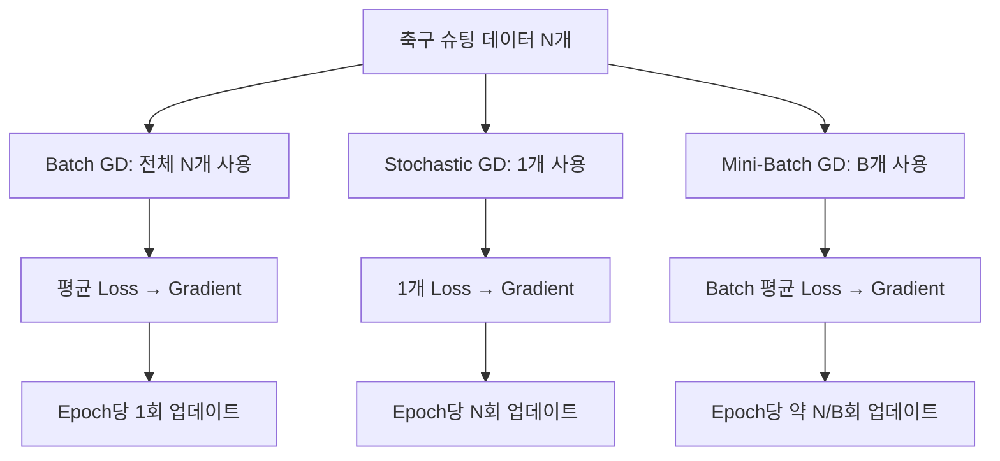

**경기분석 예제:** 

- 슈팅 거리·각도에서 득점 여부를 예측할 때 

- Match Event 1,000개를 50개씩 Mini-Batch로 사용하면, 

- 매번 다른 슈팅 상황의 평균 오차를 보고 모델을 수정한다.

**운동역학 예제:** 

- 투구 선수의 팔꿈치 Valgus Torque, 어깨 회전 속도, 투구 수 데이터를 사용하여 고부하 패턴을 학습한다면, 

- Mini-Batch에 선수별 데이터가 고르게 섞이도록 구성해 선수 개인차에 따른 학습 편향을 줄일 수 있다. 

- 단, 실제 성능 평가는 선수 단위의 데이터 누수를 방지한 분리가 필요하다.

### 같은 목적함수에서 업데이트 경로 비교 (계산 예제)

아래 곡선은 실제 경기 데이터가 아니라 `L(w) = 평균((w-a_i)^2)`인 단순 1차원 장난감 모델에서 생성했다. 동일한 업데이트 횟수로 비교할 때 개별 Sample을 쓰는 SGD와 Mini-Batch는 경로가 흔들릴 수 있다. Mini-Batch는 항상 더 매끈하다고 보장되는 것은 아니다.

```mermaid
xychart-beta
    title "Batch GD"
    x-axis "Update" [0, 1, 2, 3, 4, 5, 6, 7, 8, 9, 10, 11, 12]
    y-axis "Mean squared loss" 0 --> 8
    line [6.35, 4.276, 2.949, 2.1, 1.556, 1.208, 0.986, 0.843, 0.752, 0.694, 0.656, 0.633, 0.617]
```

```mermaid
xychart-beta
    title "Mini-Batch GD"
    x-axis "Update" [0, 1, 2, 3, 4, 5, 6, 7, 8, 9, 10, 11, 12]
    y-axis "Mean squared loss" 0 --> 8
    line [6.35, 4.471, 3.234, 1.891, 1.479, 0.943, 0.826, 0.838, 0.647, 0.639, 0.641, 0.635, 0.615]
```

```mermaid
xychart-beta
    title "Stochastic GD"
    x-axis "Update" [0, 1, 2, 3, 4, 5, 6, 7, 8, 9, 10, 11, 12]
    y-axis "Mean squared loss" 0 --> 8
    line [6.35, 3.976, 3.453, 2.942, 2.569, 2.294, 1.52, 1.573, 1.099, 1.153, 0.951, 1.026, 0.698]
```

> **PyTorch 주의:** 
> - `torch.optim.SGD(...)`는 옵티마이저의 **파라미터 업데이트 규칙**을 의미한다. 
> - `DataLoader(batch_size=1)`이면 순수 SGD에 가깝고, 
> - `batch_size=32`이면 Mini-Batch SGD에 해당한다.

<br><br>

---

<br>

# 1. 신경망 최적화의 전체 흐름

> ## 1-1) 역전파 다음에는 무엇을 하는가?

앞선 강의에서는 순전파로 Prediction을 계산하고, Loss를 구한 뒤 Backpropagation을 통해 각 Parameter의 Gradient를 계산했다.

하지만 Gradient가 계산되었다고 해서 Weight와 Bias가 자동으로 변경되는 것은 아니다.

실제 학습에서는 계산된 Gradient를 이용하여 Parameter를 수정해야 한다.

이 과정을 **Optimization**이라고 하고, Parameter Update 규칙을 담당하는 알고리즘을 **Optimizer**라고 한다.

전체 Deep Learning Training Flow는 다음과 같다.

```text
입력 데이터
↓
Forward Propagation
↓
Prediction / Logit
↓
Loss 계산
↓
Backpropagation
↓
Gradient 계산
↓
Optimizer
↓
Weight / Bias Update
↓
다음 Iteration
```

즉,

```text
Backpropagation
= 어떻게 바꿀지를 계산

Optimizer
= 계산된 정보를 이용해 실제로 바꿈
```

으로 구분하면 된다.

<br>

> ## 1-2) Optimization이란?

Optimization은 Loss를 줄일 수 있는 Model Parameter를 찾아가는 과정이다.

Model Parameter를 `θ`라고 하면 학습 목표는 개념적으로 다음과 같이 표현할 수 있다.

$$
\theta^{*}
=
\underset{\theta}{\mathrm{argmin}}
\;L(\theta)
$$

- `θ`: 현재 Weight와 Bias
- `L(θ)`: 현재 Parameter에서의 Loss
- `θ*`: Loss를 작게 만드는 Parameter

를 의미한다.

Neural Network에는 수많은 Weight와 Bias가 있기 때문에 이를 한 번에 정확히 계산하여 최솟값을 찾기보다는 Gradient를 이용하여 조금씩 이동한다.

<br>

> ## 1-3) Backpropagation과 Optimizer의 역할 비교

| 구분 | Backpropagation | Optimizer |
| --- | --- | --- |
| 목적 | Gradient 계산 | Parameter Update |
| 입력 | Loss와 Computation Graph | Parameter와 Gradient |
| 대표 코드 | `loss.backward()` | `optimizer.step()` |
| 결과 | `.grad` 생성 | Weight/Bias 값 변경 |

따라서 다음 두 코드는 서로 다른 역할을 한다.

```python
loss.backward()
```

```python
optimizer.step()
```

첫 번째는 **Gradient 계산**, 두 번째는 **Parameter 변경**이다.

<br><br>

### 경기분석·운동역학 적용: 역전파와 업데이트 구분

**경기분석:** 

- 축구 득점 예측 모델에서 `pred=0.30`, 정답 `y=1`이면 BCE Loss를 구한다. `backward()`는 슈팅 거리·각도에 연결된 Weight의 기울기를 계산하고, `step()`은 실제 Weight를 바꾼다.

**운동역학:** 

- 투구 팔꿈치 토크가 고부하인지 분류할 때 센서 입력을 정규화하고, `loss.backward()` 후 각 근골격계 Feature 연결 가중치의 `.grad`를 모니터링한다. 

- 이 기울기를 부상 위험에 대한 인과적 기여로 해석하지는 않는다.


<br><br>

---


# 2. SGD의 기본 원리

> ## 2-1) SGD란?

SGD는 **Stochastic Gradient Descent(확률적 경사하강법)** 의 약자로 Gradient를 이용하여 Parameter를 업데이트하는 대표적인 Optimizer이다.

기본적인 업데이트식은 다음과 같다.

$$
\theta_t
=
\theta_{t-1}
-
\eta g_t
$$

- `θₜ₋₁`: Update 전 Parameter
- `θₜ`: Update 후 Parameter
- `η`: Learning Rate
- `gₜ`: 현재 Gradient

이다.

가장 중요한 부분은

```text
현재 Parameter - Learning Rate × Gradient
```

이다.

**Gradient는 Loss가 증가하는 국소적인 방향을 나타내므로 Gradient의 반대 방향으로 이동하여 Loss 감소를 시도한다.**

<br>

> ## 2-2) SGD의 간단한 계산

현재 Weight가

```text
w = 2
```

이고 Gradient가

```text
Gradient = -0.5
```

Learning Rate가

```text
η = 0.1
```

이라고 하자.

업데이트하면

$$
w_{new}
=
2
-
0.1(-0.5)
$$

$$
=
2.05
$$

이다.

Gradient가 음수이므로 Weight가 증가했다.

반대로 **Gradient가 양수이면 Weight는 감소하는 방향으로 Update된다.**

<br>

> ## 2-3) Gradient 크기도 중요하다

Learning Rate가 같다고 하더라도 Gradient의 절댓값이 클수록 SGD의 Update도 커진다.

예를 들어 `η=0.1`일 때를 비교하면 다음과 같다.

| Gradient | Parameter 변화량 |
| ---: | ---: |
| `-0.1` | `+0.01` |
| `-1.0` | `+0.10` |
| `-5.0` | `+0.50` |
| `+2.0` | `-0.20` |

즉 기본 SGD에서는

$$
|\Delta\theta|
=
\eta |g|
$$

관계가 성립한다.

<br>

> ## 2-4) SGD와 Batch Size는 다른 개념이다

`SGD`라는 이름 때문에 반드시 데이터 한 개씩 학습해야 한다고 생각하기 쉽다.

하지만 실제 PyTorch에서는

```python
torch.optim.SGD(...)
```

를 Mini-Batch 학습에도 사용할 수 있다.

다음 개념을 구분해야 한다.

| 개념 | 결정하는 것 |
| --- | --- |
| Batch Size | 한 번 Gradient 계산에 사용하는 데이터 수 |
| Optimizer | 계산된 Gradient로 Parameter를 어떻게 Update할지 |

예를 들어

```text
Batch Size = 32
Optimizer = SGD
```

도 충분히 가능하다.

즉 32개의 데이터로 평균 Loss와 Gradient를 계산한 뒤 SGD가 Parameter를 한 번 Update할 수 있다.

<br><br>

### 경기분석·운동역학 적용: SGD의 한 Step

**경기분석:** 

- 농구 슈팅 성공 예측에서 특정 Weight가 `w=2.0`, `grad=-0.5`이고 `lr=0.1`이면 SGD 업데이트 후 `w=2.05`가 된다. 

- 이 수치는 가상 Gradient 예제다.

**운동역학:** 

- 수영 스트로크 빈도와 체간 회전 변동성을 이용해 피로 패턴을 분류할 때, 각 Mini-Batch의 Gradient로 Weight를 한 번씩 업데이트할 수 있다.

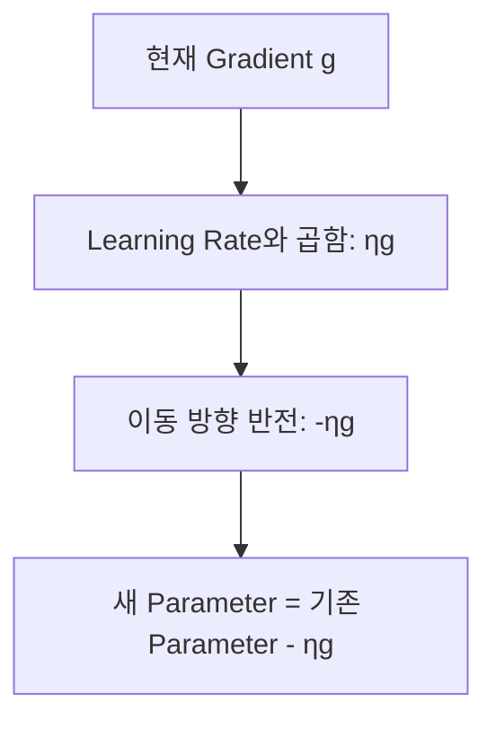

<br><br>

---


# 3. SGD에서 Momentum이 필요한 이유

> ## 3-1) Gradient 방향이 계속 바뀌는 경우

Mini-Batch마다 데이터가 다르므로 Gradient도 매번 달라질 수 있다.

예를 들어 한 Parameter에 대해 다음 Gradient가 계산되었다고 하자.

```text
Step 1: +4
Step 2: +4
Step 3: -2
Step 4: -2
```

기본 SGD는 매 Step 현재 Gradient만 사용한다.

따라서 Gradient의 부호가 바뀌면 Update 방향도 즉시 바뀐다.

이러한 특성 때문에 Loss Surface에 따라 Parameter가 여러 방향으로 흔들리면서 이동할 수 있다.

<br>

> ## 3-2) Momentum의 핵심 아이디어

Momentum은 **이전 Gradient 또는 이전 이동 방향의 정보를 현재 Update에 함께 반영**한다.

직관적인 이동평균 형태로 표현하면 다음과 같다.

$$
m_t
=
\beta m_{t-1}
+
(1-\beta)g_t
$$

$$
\theta_t
=
\theta_{t-1}
-
\eta m_t
$$

여기서

- `mₜ`: Gradient 방향의 누적 정보
- `β`: 이전 정보를 얼마나 유지할지 결정하는 값
- `η`: Learning Rate

이다.

※ Momentum의 수식 표기와 Scale Convention은 구현에 따라 조금 다를 수 있지만 핵심은 **과거 방향 정보를 누적한다는 것**이다.

<br>

> ## 3-3) Momentum의 직관

Gradient가 계속 같은 방향이라면

```text
이전 방향
+
현재 Gradient
```

가 함께 작용하면서 그 방향의 움직임이 유지된다.

반대로 Gradient가 한 번 반대 방향으로 바뀌더라도 과거 정보가 남아 있기 때문에 Parameter가 즉시 크게 반대쪽으로 이동하지 않을 수 있다.

예를 들어

```text
Gradient
+4 → +4 → -2 → -2
```

처럼 바뀐다면 Momentum은 세 번째 Step에서 이전 `+4` 방향의 정보를 일부 기억한다.

따라서 기본 SGD보다 Update 방향이 천천히 전환될 수 있다.

<br>

> ## 3-4) SGD와 Momentum 비교

| 특징 | 기본 SGD | SGD + Momentum |
| --- | --- | --- |
| 현재 Gradient | 사용 | 사용 |
| 과거 Gradient 정보 | 사용하지 않음 | 사용 |
| 방향 변화 | 즉각 반영 | 과거 방향을 함께 반영 |
| 추가 상태값 | 거의 없음 | Momentum Buffer 필요 |
| 기대 효과 | 단순한 Update | 일부 진동 완화 및 방향 유지 |

<br><br>

### 경기분석·운동역학 적용: Momentum의 누적 방향

**경기분석:** 

- 슈팅 이벤트 Mini-Batch에 역습과 지공 데이터가 번갈아 나타나 Gradient 부호가 자주 바뀔 때 

- Momentum은 이전 방향 정보를 유지해 일부 지그재그 이동을 줄일 수 있다.

**운동역학:** 

- 달리기 착지 충격량과 좌우 비대칭 Feature의 Gradient가 Batch마다 흔들리더라도 Momentum Buffer를 사용해 업데이트 방향을 완화할 수 있다. 

- 이는 물리학적 운동량을 직접 계산한다는 의미가 아니라 최적화 기법의 이름이다.

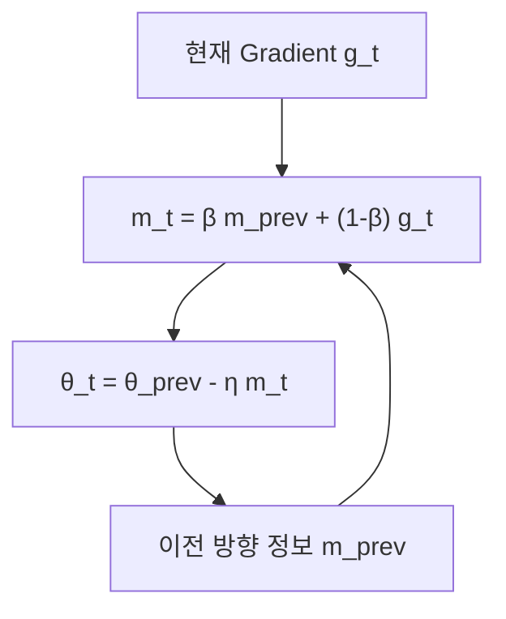

<br><br>

---

# 4. Adam의 핵심 원리

> ## 4-1) Adam이란?

Adam은 **Adaptive Moment Estimation**의 약자이다.

Adam 역시 Gradient를 이용하지만 현재 Gradient 하나만 사용하는 것이 아니라 크게 두 가지 상태를 유지한다.

```text
1. Gradient의 이동평균
2. Gradient²의 이동평균
```

일반적으로 각각 `m`, `v`라고 표현한다.

<br>

> ## 4-2) 첫 번째 이동평균 m

첫 번째 이동평균은 다음과 같이 표현한다.

$$
m_t
=
\beta_1m_{t-1}
+
(1-\beta_1)g_t
$$

`m`은 최근 Gradient들의 방향과 크기를 누적해서 보는 역할을 한다.

Momentum의 아이디어와 연결해서 이해할 수 있다.

예를 들어 Gradient가 계속 음수라면 `m`도 음수 방향의 정보를 유지하게 된다.

<br>

> ## 4-3) 두 번째 이동평균 v

Adam은 Gradient를 제곱한 값에 대해서도 이동평균을 계산한다.

$$
v_t
=
\beta_2v_{t-1}
+
(1-\beta_2)g_t^2
$$

Gradient를 제곱하면 부호가 사라진다.

| Gradient | Gradient² |
| ---: | ---: |
| `-3` | `9` |
| `-1` | `1` |
| `+1` | `1` |
| `+3` | `9` |

따라서 `v`는 Gradient의 **크기 Scale에 대한 누적 정보**를 제공한다.

<br>

> ## 4-4) Bias Correction

Adam은 `m`과 `v`를 일반적으로 0에서 시작한다.

학습 초반에는 이 값들이 0의 영향을 받을 수 있기 때문에 Bias Correction을 사용한다.

$$
\hat{m}_t
=
\frac{m_t}
{1-\beta_1^t}
$$

$$
\hat{v}_t
=
\frac{v_t}
{1-\beta_2^t}
$$

이후 보정된 값을 사용하여 Parameter를 Update한다.

<br>

> ## 4-5) Adam의 Parameter Update

Adam의 핵심 Update 식은 다음과 같다.

$$
\theta_t
=
\theta_{t-1}
-
\eta
\frac{\hat{m}_t}
{\sqrt{\hat{v}_t}+\epsilon}
$$

여기서

- `η`: 기본 Learning Rate
- `m̂`: Gradient 방향에 대한 정보
- `v̂`: Gradient Scale에 대한 정보
- `ε`: 0으로 나누는 것을 방지하기 위한 작은 값

이다.

Adam을 이해할 때는 식 전체를 외우기보다 다음 구조가 중요하다.

```text
현재 Gradient
↓
Gradient 이동평균 m
+
Gradient² 이동평균 v
↓
Bias Correction
↓
Parameter별 Update Scale 조정
↓
Parameter Update
```

<br>

> ## 4-6) 왜 Adaptive Optimizer인가?

SGD에서는 같은 Learning Rate가 모든 Parameter의 Gradient에 직접 적용된다.

반면 Adam은 Parameter마다 서로 다른 `m`과 `v`를 유지한다.

즉

```text
Weight A의 Gradient History
≠
Weight B의 Gradient History
```

라면 실제 Update Scale도 다르게 조절될 수 있다.

이를 **Adaptive Update**라고 이해할 수 있다.

단,

```text
Gradient가 크면 무조건 작게 Update
Gradient가 작으면 무조건 크게 Update
```

라고 단순하게 이해하면 안 된다.

Adam의 Update는 현재 Gradient뿐 아니라 이전 Gradient History와 두 Moment 값에 의해 결정된다.

> Adam의 업데이트 크기는 과거 Gradient의 이동평균 `m`과 제곱 이동평균 `v`에 따라 달라진다. 이전 예측 오차와 업데이트 크기를 단순 비교하여 다음 Step을 무조건 키우거나 줄이는 방식은 아니다.

<br><br>

### 경기분석·운동역학 적용: Adam의 두 Moment

**경기분석:** 

- 축구 패스 성공 예측에서 패스 거리와 압박 강도에 연결된 Weight가 서로 다른 Gradient 이력을 가진다면, 

- Adam은 각 Parameter에 대해 별도의 `m`, `v`를 관리한다.

**운동역학:** 

- IMU 가속도·각속도·관절 가동범위 Feature를 함께 쓰는 MLP에서 Gradient Scale이 다를 때, 

- Adam은 Parameter별 보정된 방향과 Scale로 업데이트한다. **정규화·검증이 불필요해지는 것은 아니다.**

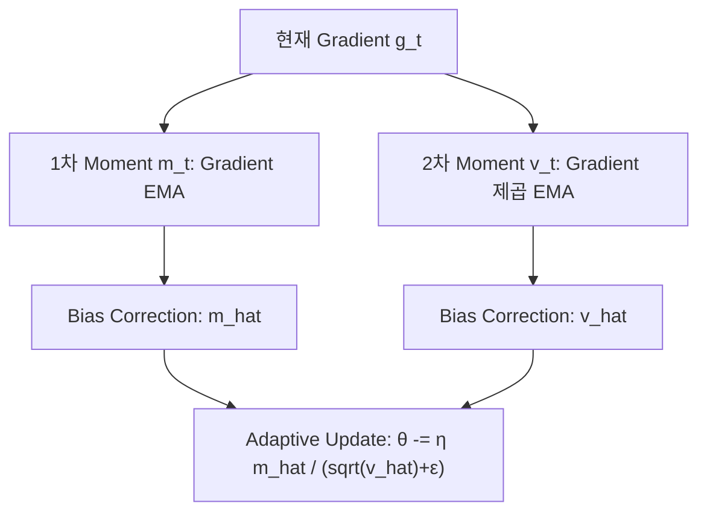

<br><br>

---


# 5. SGD·Momentum·Adam의 수치적 차이

> ## 5-1) 동일한 Gradient Sequence 사용

다음 Gradient가 순서대로 발생했다고 가정하자.

```text
g₁ = -0.8
g₂ = +0.2
g₃ = -0.6
```

초기 Parameter는

```text
θ₀ = 0
```

이고 Learning Rate는

```text
η = 0.1
```

이라고 하자.

직관을 위해 Momentum과 Adam의 계수를 단순화하여 `0.5`로 사용한다.

<br>

> ## 5-2) 기본 SGD

SGD는 현재 Gradient만 이용한다.

첫 번째 Step:

$$
\Delta\theta
=
-0.1(-0.8)
=
+0.08
$$

두 번째 Step:

$$
\Delta\theta
=
-0.1(0.2)
=
-0.02
$$

세 번째 Step:

$$
\Delta\theta
=
-0.1(-0.6)
=
+0.06
$$

따라서

```text
0
→ 0.08
→ 0.06
→ 0.12
```

가 된다.

<br>

> ## 5-3) Momentum

Momentum은 이전 Gradient 방향을 누적한다.

따라서 현재 Gradient가 순간적으로 반대 방향으로 바뀌더라도 이전 방향의 영향이 남을 수 있다.

예를 들어 두 번째 Step의 Gradient는 `+0.2`이지만 첫 번째 `-0.8` 방향의 정보가 남아 있기 때문에 기본 SGD와 다른 방향으로 이동할 수도 있다.

<br>

> ## 5-4) Adam

Adam에서는 `m`과 `v`를 모두 계산하므로 현재 Gradient 크기만 보고 Update 크기를 결정할 수 없다.

예를 들어 첫 번째 Gradient `-0.8`에서는 Bias Correction 후 약 `+0.1` 방향의 Update가 발생할 수 있다.

두 번째 Gradient가 `+0.2`로 반전되어도 과거 `-0.8` Gradient 정보가 `m`에 남아 있으므로 바로 반대 방향으로 움직이지 않을 수 있다.

<br>

> ## 5-5) Python으로 직접 비교

[ Python : code ] "동일한 Gradient Sequence에서 SGD·Momentum·Adam Update 원리 비교"

```python
import numpy as np

gradients = [-0.8, 0.2, -0.6]

lr = 0.1
beta1 = 0.5
beta2 = 0.5
eps = 1e-8

theta_sgd = 0.0
theta_momentum = 0.0
theta_adam = 0.0

momentum = 0.0
m = 0.0
v = 0.0

for t, grad in enumerate(gradients, start=1):

    # SGD
    theta_sgd -= lr * grad

    # Momentum
    momentum = (
        beta1 * momentum
        + (1 - beta1) * grad
    )
    theta_momentum -= lr * momentum

    # Adam
    m = beta1 * m + (1 - beta1) * grad
    v = beta2 * v + (1 - beta2) * grad ** 2

    m_hat = m / (1 - beta1 ** t)
    v_hat = v / (1 - beta2 ** t)

    theta_adam -= (
        lr * m_hat
        / (np.sqrt(v_hat) + eps)
    )

    print(
        f"Step {t} | "
        f"SGD={theta_sgd:.4f} | "
        f"Momentum={theta_momentum:.4f} | "
        f"Adam={theta_adam:.4f}"
    )
```

[ Result ]

```text
Step 1 | SGD=0.0800 | Momentum=0.0400 | Adam=0.1000
Step 2 | SGD=0.0600 | Momentum=0.0500 | Adam=0.1272
Step 3 | SGD=0.1200 | Momentum=0.0850 | Adam=0.1992
```

세 Optimizer에 같은 Gradient가 들어가도 Parameter의 이동 경로가 달라진다.

이는 각 Optimizer가 Gradient를 사용하는 방식이 다르기 때문이다.

<br>

> ## 5-6) 비교표

| 구분 | SGD | Momentum | Adam |
| --- | --- | --- | --- |
| 현재 Gradient | O | O | O |
| 과거 방향 정보 | X | O | O |
| Gradient² 정보 | X | X | O |
| Parameter별 상태 | 거의 없음 | Momentum Buffer | `m`, `v` |
| Update 구조 | 단순 | 이전 방향 반영 | 방향 + Scale 적응 |
| Memory 사용 | 비교적 적음 | SGD보다 증가 | 더 많은 상태 저장 |
| 주요 장점 | 단순하고 명확 | 일부 진동 완화 | Parameter별 적응적 Update |

<br>

> ## **5-7) 옵티마이저(Optimizer) 종류와 최적화 경로 비교**

### 1. Optimizer란?

Optimizer는 역전파(Backpropagation)에서 계산한 Gradient를 이용해 모델의 Weight와 Bias를 업데이트하는 알고리즘이다.

**핵심 학습 흐름**

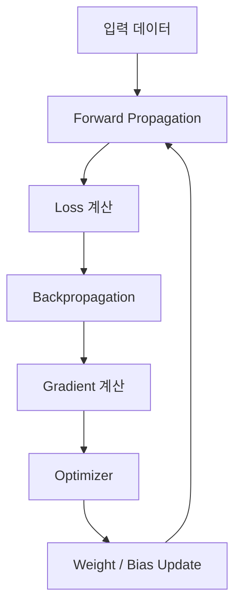

각 Optimizer는 동일한 Gradient를 받아도 **업데이트 방향과 이동 크기를 다르게 결정**할 수 있다.

따라서 같은 Loss Function에서도 최솟값으로 이동하는 경로와 수렴 속도가 달라진다.

### 2. Optimizer 종류별 비교

<p align="center">
  
</p>

| Optimizer | 핵심 아이디어 | 특징 |
| --- | --- | --- |
| SGD | 현재 Gradient 사용 | 가장 기본적인 업데이트 |
| Momentum | 과거 이동 방향 누적 | 진동 완화 및 이동 방향 유지 |
| NAG | 예상 이동 위치에서 Gradient 계산 | Momentum 방향을 미리 보정 |
| AdaGrad | 과거 Gradient 제곱 누적 | Parameter별 Learning Rate 조절 |
| RMSProp | 최근 Gradient 제곱의 이동평균 | AdaGrad의 과도한 학습률 감소 완화 |
| AdaDelta | Gradient와 Update 제곱의 이동평균 | 업데이트 크기를 적응적으로 조절 |
| Adam | Momentum + 적응적 Scaling | 방향과 Gradient 크기 정보 동시 활용 |
| AdamW | Adam + 분리된 Weight Decay | 가중치 감쇠를 명확하게 적용 |

---

### 3. SGD (Stochastic Gradient Descent)

SGD는 현재 Gradient의 반대 방향으로 Parameter를 이동한다.

$$
\theta_t=\theta_{t-1}-\eta g_t
$$

- 현재 Gradient만 이용한다.
- 구조가 단순하고 이해하기 쉽다.
- 좁은 골짜기 형태의 Loss Surface에서는 좌우 진동이 나타날 수 있다.
- Learning Rate에 따라 수렴 속도와 안정성이 크게 달라진다.

**스포츠 경기분석 예제**

축구 슈팅 성공 확률을 예측하는 MLP에서 현재 Gradient를 사용해 가중치를 한 번씩 업데이트한다.

---

### 4. Momentum

Momentum은 과거 Gradient의 누적 정보를 현재 업데이트에 반영한다.

$$
m_t=\beta m_{t-1}+(1-\beta)g_t
$$

$$
\theta_t=\theta_{t-1}-\eta m_t
$$

※ 위 수식은 이동평균으로 표현한 Momentum의 한 형태다.

- 이전 Gradient의 방향 정보를 기억한다.
- 반복적으로 같은 방향으로 이동할 때 그 방향을 유지하는 효과가 있다.
- 좁은 Loss Valley에서 발생하는 진동을 완화할 수 있다.
- 누적된 방향 때문에 최솟값을 지나칠 수도 있다.

**운동역학 예제**

달리기 지면반력 데이터로 부상 위험을 예측할 때 Mini-Batch마다 Gradient가 흔들린다면, Momentum이 업데이트 방향을 부드럽게 만드는 데 도움을 줄 수 있다.

---

### 5. NAG (Nesterov Accelerated Gradient)

NAG는 Momentum을 확장한 방법이다.

일반적인 Momentum은 현재 위치에서 계산된 Gradient를 이용하지만, NAG는 **Momentum으로 이동할 것으로 예상되는 위치의 Gradient를 반영**한다.

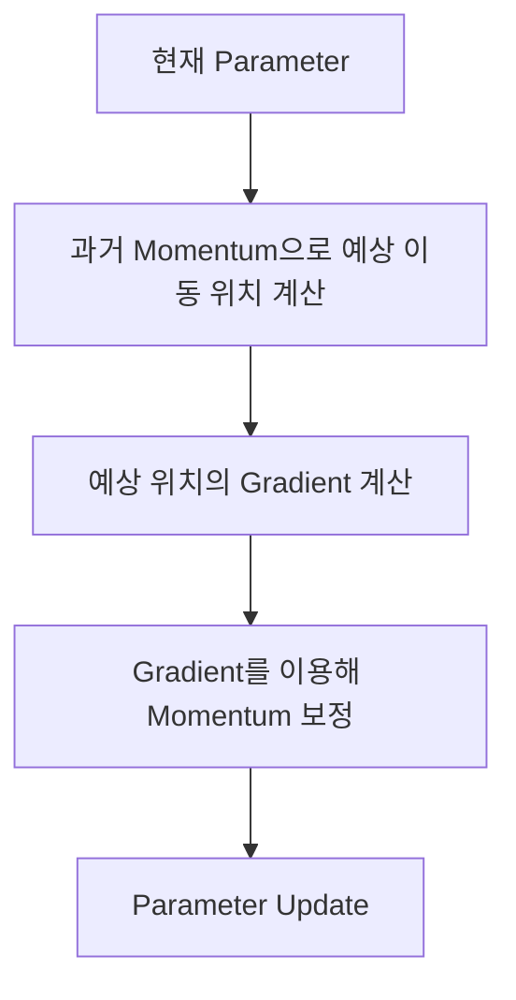

- Momentum의 이동 방향을 미리 고려한다.
- 예상 위치에서 계산한 Gradient를 이용하여 이동을 보정한다.
- 일부 문제에서는 일반 Momentum보다 더 효율적으로 수렴할 수 있다.

**스포츠 경기분석 예제**

농구 선수의 점프슛 성공률 예측 모델에서 Loss Surface가 복잡하다면 일반 Momentum과 NAG의 수렴 속도를 비교할 수 있다.

---

### 6. AdaGrad (Adaptive Gradient)

AdaGrad는 Parameter별로 과거 Gradient의 제곱을 누적한다.

$$
G_t=G_{t-1}+g_t^2
$$

$$
\theta_t
=
\theta_{t-1}
-
\frac{\eta}{\sqrt{G_t}+\epsilon}g_t
$$

- Gradient가 자주 크게 발생한 Parameter의 유효 학습률은 점차 감소한다.
- 드물게 업데이트되는 Feature에 상대적으로 큰 업데이트를 적용할 수 있다.
- 누적된 제곱 Gradient가 계속 증가하므로 학습률이 지나치게 작아질 수 있다.

**스포츠 경기분석 예제**

축구 경기 이벤트 데이터에서 드물게 나타나는 특정 이벤트 Feature를 학습할 때 AdaGrad의 특성을 활용할 수 있다.

---

### 7. RMSProp (Root Mean Square Propagation)

RMSProp은 AdaGrad처럼 과거 모든 Gradient 제곱을 계속 더하지 않고, **최근 Gradient 제곱의 이동평균**을 사용한다.

$$
v_t=\rho v_{t-1}+(1-\rho)g_t^2
$$

$$
\theta_t
=
\theta_{t-1}
-
\frac{\eta}{\sqrt{v_t}+\epsilon}g_t
$$

- 최근 Gradient 크기를 기준으로 Parameter별 업데이트를 조절한다.
- AdaGrad의 지속적인 학습률 감소 문제를 완화한다.
- Gradient Scale이 서로 다른 Parameter를 처리할 때 유용할 수 있다.

**운동역학 예제**

IMU 시계열로 보행 패턴을 학습하는 RNN에서 RMSProp과 Adam을 비교할 수 있다.

---

### 8. AdaDelta

AdaDelta는 RMSProp과 관련된 적응형 최적화 방법이다.

Gradient 제곱의 이동평균뿐 아니라 Parameter 업데이트 제곱의 이동평균도 활용한다.

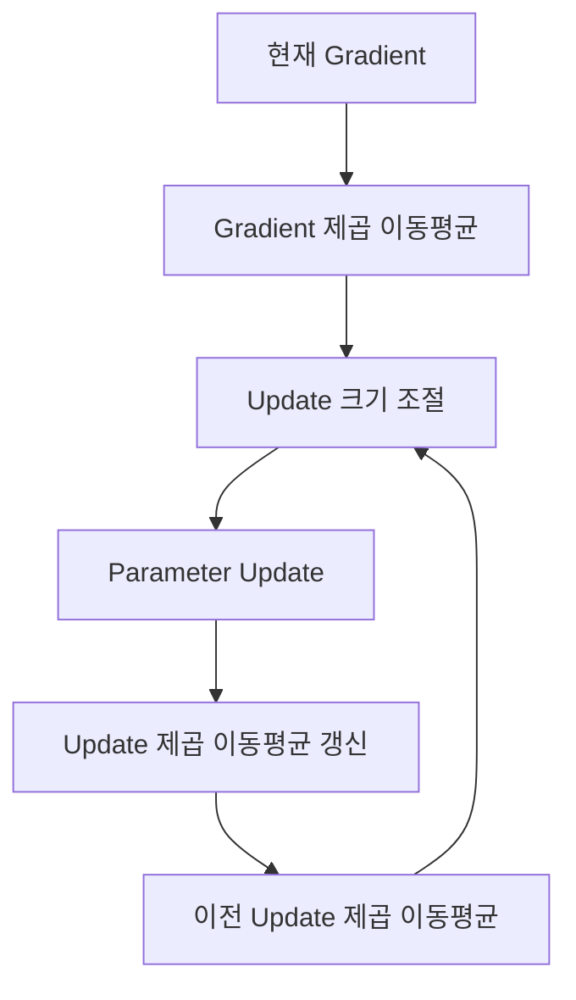

- Parameter별 업데이트 크기를 적응적으로 조절한다.
- AdaGrad의 누적 Gradient 문제를 완화한다.
- 이전 업데이트의 크기 정보도 활용한다.

**운동역학 예제**

수영 선수의 스트로크 동작을 분류하는 CNN에서 AdaDelta를 다른 적응형 Optimizer와 비교할 수 있다.

---

### 9. Adam (Adaptive Moment Estimation)

Adam은 Gradient의 첫 번째 이동평균과 제곱 Gradient의 이동평균을 함께 계산한다.

**첫 번째 Moment**

$$
m_t=\beta_1m_{t-1}+(1-\beta_1)g_t
$$

**두 번째 Moment**

$$
v_t=\beta_2v_{t-1}+(1-\beta_2)g_t^2
$$

**Bias Correction**

$$
\hat{m}_t=\frac{m_t}{1-\beta_1^t}
$$

$$
\hat{v}_t=\frac{v_t}{1-\beta_2^t}
$$

**Parameter Update**

$$
\theta_t
=
\theta_{t-1}
-
\eta\frac{\hat{m}_t}{\sqrt{\hat{v}_t}+\epsilon}
$$

### Adam의 계산 흐름

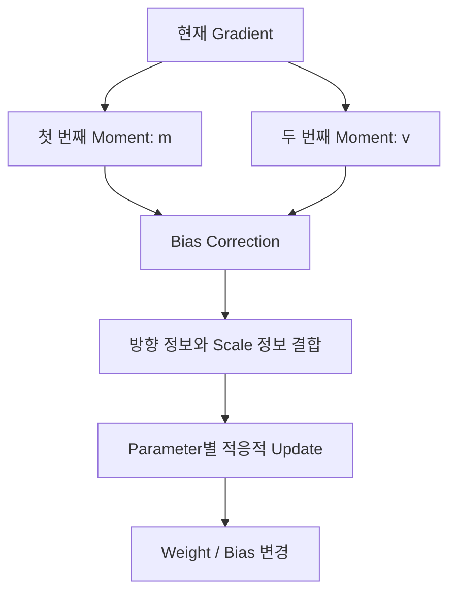

- Momentum처럼 과거 Gradient 방향을 반영한다.
- RMSProp처럼 Gradient 크기에 따라 업데이트를 조절한다.
- 여러 Deep Learning 모델에서 자주 사용되는 초기 선택지다.
- 항상 SGD보다 좋은 일반화 성능을 보장하지는 않는다.

**스포츠 경기분석 예제**

축구 선수의 슈팅 성공 여부를 예측하는 MLP나 경기 이벤트 Sequence를 처리하는 Transformer의 학습에 사용할 수 있다.

---

### 10. AdamW

AdamW는 Adam에 Weight Decay를 분리하여 적용하는 Optimizer이다.

일반적인 Adam의 적응형 업데이트와 별도로 Parameter를 감쇠시킨다.

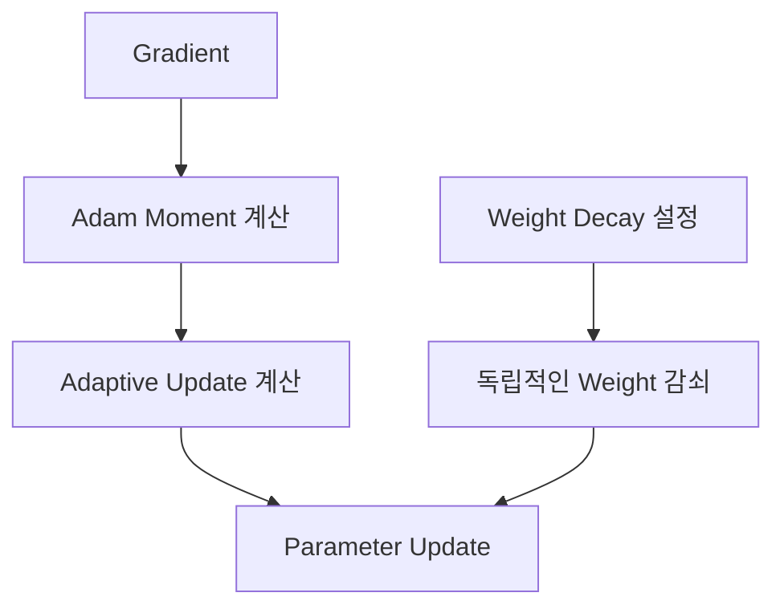

- Adam의 기본적인 적응형 업데이트 구조를 사용한다.
- Weight Decay를 Gradient 기반 업데이트와 분리하여 적용한다.
- Transformer를 비롯한 여러 Deep Learning 모델에서 자주 사용한다.
- Weight Decay의 효과는 모델과 학습 설정에 따라 달라진다.

**스포츠 경기분석 예제**

축구 경기 이벤트 Transformer의 학습에서 AdamW를 사용하고 Validation 성능을 기준으로 Weight Decay를 조정할 수 있다.

---

### 11. PyTorch에서 Optimizer 정의하기

```python
import torch

# model은 사전에 정의된 PyTorch 신경망

# 기본 SGD
sgd = torch.optim.SGD(
    model.parameters(),
    lr=0.01
)

# SGD + Momentum
momentum = torch.optim.SGD(
    model.parameters(),
    lr=0.01,
    momentum=0.9
)

# NAG
nag = torch.optim.SGD(
    model.parameters(),
    lr=0.01,
    momentum=0.9,
    nesterov=True
)

# AdaGrad
adagrad = torch.optim.Adagrad(
    model.parameters(),
    lr=0.01
)

# RMSProp
rmsprop = torch.optim.RMSprop(
    model.parameters(),
    lr=0.001
)

# AdaDelta
adadelta = torch.optim.Adadelta(
    model.parameters(),
    lr=1.0
)

# Adam
adam = torch.optim.Adam(
    model.parameters(),
    lr=0.001
)

# AdamW
adamw = torch.optim.AdamW(
    model.parameters(),
    lr=0.001,
    weight_decay=0.01
)
```

실제 Training에서는 위 Optimizer 중 하나를 선택하여 사용한다.


<br><br>

### 경기분석·운동역학 적용 : 같은 Gradient, 다른 Parameter 경로

**경기분석:** 

- 같은 축구 슈팅 데이터·초기 Weight·Gradient 순서를 고정한 뒤 SGD·Momentum·Adam을 적용하면 

- 아래 수치 예제처럼 Weight 이동 경로가 달라진다. **더 큰 이동량이 더 좋은 성능이라는 뜻은 아니다.**

**운동역학:** 

- 무릎 관절 부하 예측 모델에서도 Optimizer별 학습·검증 곡선을 따로 기록해야 한다. 

- 초기 손실 감소 속도만으로 일반화 성능을 판단하면 안 된다.

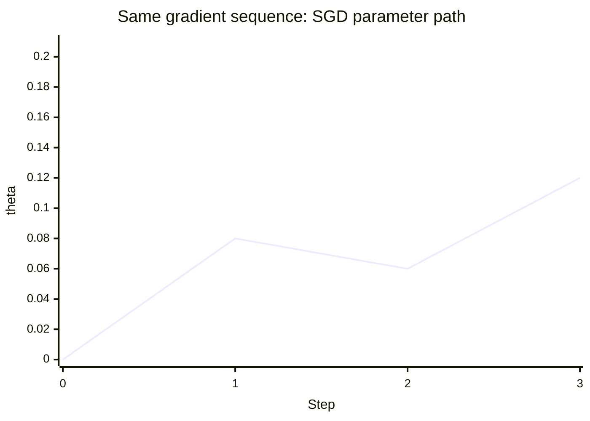

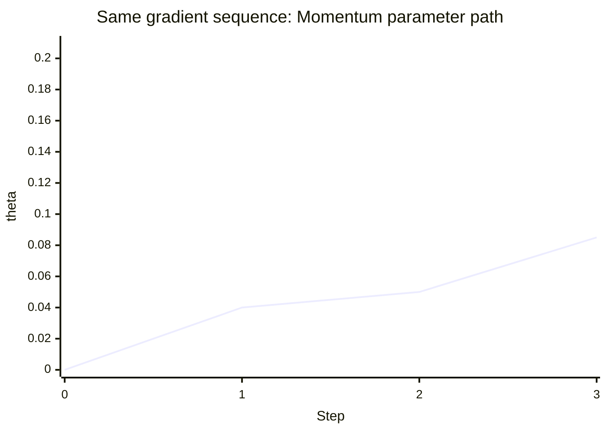

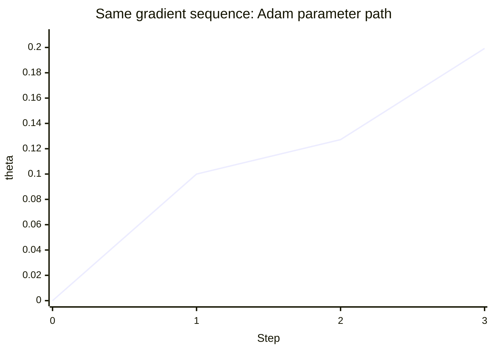

<br><br>

---


# 6. Adam이 항상 SGD보다 좋은 것은 아니다

> ## 6-1) Optimizer는 학습 경로를 결정한다

동일한 Model과 Dataset이라도 Optimizer가 달라지면 Parameter가 이동하는 경로가 달라진다.

따라서 다음이 달라질 수 있다.

```text
Loss 감소 속도
Parameter 이동 경로
Convergence 위치
Validation Performance
Training Stability
```

<br>

> ## 6-2) Adam의 장점

Adam은 Parameter마다 `m`과 `v`를 계산하므로 다양한 Gradient Scale이 존재하는 Model에서 편리하게 사용할 수 있다.

또한 초기 실험에서 안정적으로 학습이 시작되는지 확인하기 위한 기본 선택지로 많이 활용할 수 있다.

<br>

> ## 6-3) SGD의 장점

SGD는 Update 구조가 단순하기 때문에 Optimizer의 동작을 해석하기 쉽다.

Momentum이나 Learning Rate Schedule을 함께 사용하면 매우 강력한 Training 방법이 될 수 있다.

일부 문제에서는 적절하게 조정한 SGD가 Adam보다 좋은 Validation Performance를 보일 수도 있다.

따라서

```text
Adam > SGD
```

처럼 절대적인 순위를 정하면 안 된다.

<br>

> ## 6-4) 공정한 비교가 필요한 이유

예를 들어

```text
SGD lr=0.1
Adam lr=0.001
```

을 사용해 Loss를 비교했다고 하자.

두 Optimizer의 Update Mechanism과 Learning Rate Scale 자체가 다르기 때문에 단순히 동일한 Epoch의 Loss만으로 Optimizer의 우열을 단정하기 어렵다.

Optimizer 비교 시에는

- Learning Rate
- Scheduler
- Batch Size
- Weight Initialization
- Epoch
- Random Seed
- Validation Metric

등을 함께 고려해야 한다.

<br><br>

### 경기분석·운동역학 적용: 검증 성능이 중요한 이유

**경기분석:** 

- 한 시즌의 슈팅 이벤트로 Training한 모델이 다음 시즌의 경기에서도 득점 확률을 잘 예측하는지는 별도 경기·시즌 데이터로 검증한다. 

- Adam의 Training Loss가 더 낮더라도 Validation Log Loss는 높을 수 있다.

**운동역학:** 

- 운동선수의 여러 반복 측정 데이터가 Train과 Validation에 동시에 들어가면 선수 고유 패턴을 외운 모델이 과대평가될 수 있다. 

- 선수 단위 분할 등 적절한 검증 설계가 필요하다.

<br><br>

---


# 7. Learning Rate의 역할

> ## 7-1) Learning Rate란?

Learning Rate는 Optimizer가 Parameter를 Update할 때 **얼마나 크게 이동할지를 조절하는 Hyperparameter**이다.

SGD에서는

$$
\theta_{new}
=
\theta_{old}
-
\eta g
$$

이므로 Learning Rate `η`가 직접 Update Scale에 영향을 준다.

<br>

> ## 7-2) 동일한 Gradient에서 Learning Rate 비교

현재

```text
w = 1
Gradient = -2
```

라고 하자.

Learning Rate에 따라 다음처럼 달라진다.

| Learning Rate | 변화량 | Update 후 w |
| ---: | ---: | ---: |
| `0.01` | `+0.02` | `1.02` |
| `0.10` | `+0.20` | `1.20` |
| `0.50` | `+1.00` | `2.00` |

즉 Learning Rate가 클수록 동일한 Gradient에 대한 이동량이 커진다.

하지만 이동량이 크다고 반드시 학습이 더 좋은 것은 아니다.

<br><br>

### 경기분석·운동역학 적용: Learning Rate가 결정하는 이동 폭

**경기분석:** 

- 축구 패스 성공률 예측 모델에서 Gradient가 `-2`라면 

- `lr=0.01`과 `lr=0.10`은 같은 방향으로 각각 `+0.02`, `+0.20`만큼 Weight를 이동시킨다(SGD 기준).

**운동역학:** 

- 점프 착지 시 최대 수직 지면반력 예측 모델의 Training이 요동친다면,

-  관절·힘 데이터의 Scale을 확인하고 Learning Rate를 함께 점검한다.

<br><br>

---


# 8. Learning Rate가 너무 작은 경우

> ## 8-1) Parameter가 너무 조금 움직인다

다음 Loss를 생각하자.

$$
L(w)
=
(w-3)^2
$$

최적 Parameter는

```text
w = 3
```

이다.

현재

```text
w = 1
```

이면 Gradient는

$$
\frac{dL}{dw}
=
2(w-3)
$$

$$
=
-4
$$

이다.

Learning Rate가 `0.05`라면

$$
w_{new}
=
1-0.05(-4)
$$

$$
=
1.2
$$

이다.

Loss는

$$
(1.2-3)^2
=
3.24
$$

가 된다.

기존 Loss `4`보다 줄었지만 아직 최적값까지 거리가 많이 남아 있다.

<br>

> ## 8-2) 너무 작은 Learning Rate의 특징

Learning Rate가 지나치게 작으면

```text
Parameter Update가 작음
↓
Loss가 천천히 감소
↓
많은 Iteration 필요
↓
Training 시간이 길어질 수 있음
```

과 같은 현상이 나타날 수 있다.

다만 작은 Learning Rate가 항상 나쁜 것은 아니다.

Training 후반의 세밀한 Parameter 조정에는 작은 Learning Rate가 유용할 수 있다.

<br><br>

### 경기분석·운동역학 적용: 작은 LR의 완만한 곡선

**경기분석:** 

- 경기당 슈팅 기대득점 모델의 Loss가 조금씩만 감소한다면 학습률이 지나치게 작은지 확인한다. 

- 단, 특성 전처리나 모델 구조 문제도 함께 점검한다.

**운동역학:** 

- 관절 각속도 예측 모델에서도 작은 Learning Rate는 미세 조정에 유리할 수 있지만 초기 학습을 길게 만든다.

아래는 본문의 정확한 목적함수 `L(w)=(w-3)^2`, 초기 `w=1`, `lr=0.05`를 5회 반복한 Loss이다.

```mermaid
xychart-beta
    title "Small LR 0.05: slow decrease"
    x-axis "Step" [0, 1, 2, 3, 4, 5]
    y-axis "Loss" 0 --> 4.5
    line [4, 3.24, 2.6244, 2.1258, 1.7219, 1.3947]
```

<br><br>

---


# 9. Learning Rate가 너무 큰 경우

> ## 9-1) Overshooting

같은 Loss

$$
L(w)
=
(w-3)^2
$$

에서 `w=1`, Gradient `-4`라고 하자.

Learning Rate가 `0.8`이면

$$
w_{new}
=
1-0.8(-4)
$$

$$
=
4.2
$$

이다.

최적값 `3`을 지나쳤다.

이를 **Overshooting**이라고 한다.

그렇다고 항상 Loss가 증가하는 것은 아니다.

새로운 Loss는

$$
(4.2-3)^2
=
1.44
$$

이므로 기존 Loss `4`보다 작다.

<br>

> ## 9-2) 지나치게 큰 경우

Learning Rate가 `1.1`이면

$$
w_{new}
=
1-1.1(-4)
$$

$$
=
5.4
$$

이다.

Loss는

$$
(5.4-3)^2
=
5.76
$$

으로 오히려 증가한다.

즉 Negative Gradient 방향으로 이동했더라도 Step Size가 지나치게 크면 Loss가 커질 수 있다.

<br>

> ## 9-3) 반복 학습에서의 진동과 발산

Learning Rate가 크면 다음 현상이 나타날 수 있다.

```text
최솟값 통과
↓
반대쪽에서 Gradient 방향 반전
↓
다시 최솟값 통과
↓
반복
```

이때 이동 폭이 유지되면 Oscillation이 발생할 수 있다.

이동 폭이 점점 커진다면 Divergence로 이어질 수 있다.

<br><br>

### 경기분석·운동역학 적용: 지나친 Learning Rate의 진동·발산

**경기분석:** 축구 압박 강도 기반 패스 성공 예측이 Epoch마다 큰 폭으로 흔들린다면 Learning Rate 감소, 입력 Scale, Label·Batch 구성 확인이 필요하다.

**운동역학:** 수직 지면반력 회귀 모델의 Loss가 계속 증가한다면 큰 LR로 최적점을 넘나드는지 확인한다. 다음 그래프는 본문과 같은 `L(w)=(w-3)^2`, `lr=1.1`의 계산 예제다.

```mermaid
xychart-beta
    title "Large LR 1.1: divergent loss"
    x-axis "Step" [0, 1, 2, 3, 4, 5]
    y-axis "Loss" 0 --> 25
    line [4, 5.76, 8.2944, 11.9439, 17.1993, 24.7669]
```

<br><br>

---


# 10. Learning Rate별 수렴 비교

> ## 10-1) 동일한 Loss에서 비교하기

[ Python : code ] "SGD에서 Learning Rate에 따른 수렴·진동·발산 비교"

```python
import torch

learning_rates = [
    0.05,
    0.2,
    0.8,
    1.1
]

for lr in learning_rates:

    w = torch.nn.Parameter(
        torch.tensor(1.0)
    )

    optimizer = torch.optim.SGD(
        [w],
        lr=lr
    )

    for step in range(5):

        optimizer.zero_grad()

        loss = (w - 3) ** 2

        loss.backward()

        optimizer.step()

    final_loss = (w - 3) ** 2

    print(
        f"lr={lr:.2f} | "
        f"w={w.item():.4f} | "
        f"Loss={final_loss.item():.4f}"
    )
```

[ Result ]

```text
lr=0.05 | w=1.8190 | Loss=1.3947
lr=0.20 | w=2.8445 | Loss=0.0242
lr=0.80 | w=3.1555 | Loss=0.0242
lr=1.10 | w=7.9766 | Loss=24.7670
```

<br>

> ## 10-2) 결과 해석

`lr=0.05`는 Loss가 감소하지만 Parameter가 천천히 `3`에 접근한다.

`lr=0.20`은 비교적 안정적으로 `3`에 접근한다.

`lr=0.80`은 `3`을 양쪽으로 Overshooting하면서 접근하지만 결국 Loss가 감소한다.

`lr=1.10`은 이동 폭이 점점 커지면서 Loss가 증가한다.

이를 정리하면 다음과 같다.

| Learning Rate | 관찰 결과 | 해석 |
| --- | --- | --- |
| `0.05` | 느린 감소 | 작은 Step |
| `0.20` | 안정적 감소 | 적절한 범위의 예 |
| `0.80` | 진동하며 감소 | Overshooting 발생 |
| `1.10` | Loss 증가 | Divergence |

<br><br>

### 경기분석·운동역학 적용: 수렴곡선 해석

**경기분석:** 

- 같은 축구 슈팅 예측 데이터로 Learning Rate별 Train/Validation Loss 곡선을 기록하면, 

- 작은 LR의 느린 개선, 큰 LR의 진동·발산을 비교할 수 있다.

**운동역학:** 

- 달리기 착지 패턴 분류에서는 선수 단위 Validation 결과를 함께 그려야 한다. 

- 아래는 실험 성능이 아니라 본문의 1차원 함수를 계산한 곡선이다.

```mermaid
xychart-beta
    title "Moderate LR 0.20: converge"
    x-axis "Step" [0, 1, 2, 3, 4, 5]
    y-axis "Loss" 0 --> 4.5
    line [4, 1.44, 0.5184, 0.1866, 0.0672, 0.0242]
```

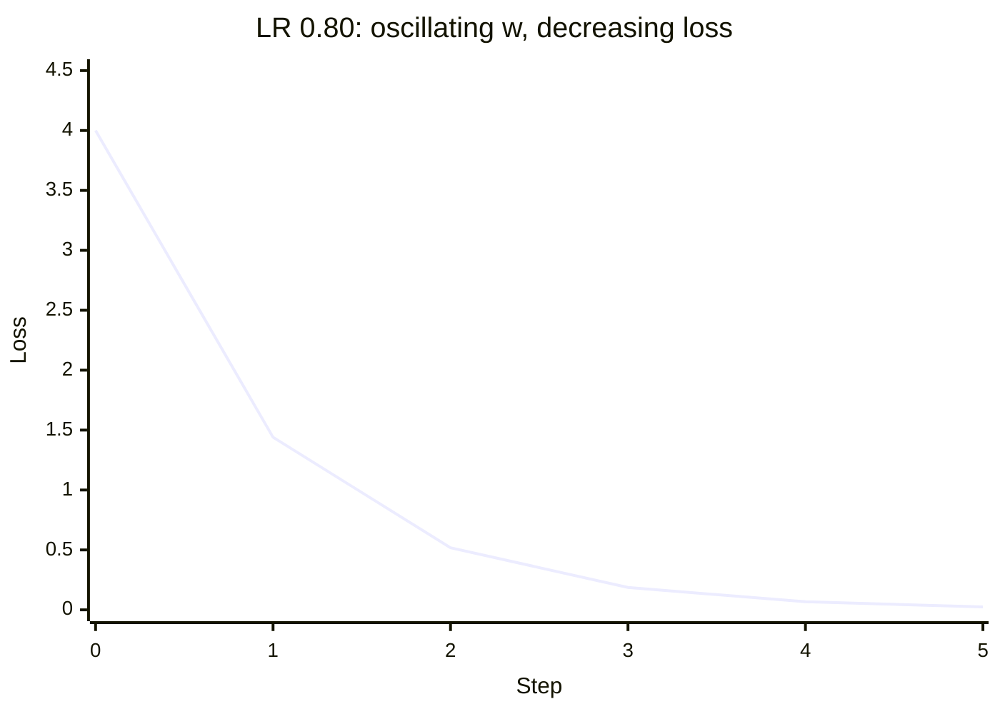

<br><br>

---


# 11. SGD와 Adam에서 Learning Rate의 의미

> ## 11-1) SGD

SGD에서는 Learning Rate가 현재 Gradient에 직접 곱해진다.

$$
\Delta\theta
=
-\eta g
$$

따라서 Gradient와 Learning Rate를 알면 Update를 직접 계산할 수 있다.

<br>

> ## 11-2) Adam

Adam에서는

$$
\Delta\theta
=
-\eta
\frac{\hat m}
{\sqrt{\hat v}+\epsilon}
$$

형태로 Update된다.

따라서 Learning Rate가 동일하더라도 `m`, `v`가 Parameter마다 다르므로 실제 Step Size도 달라질 수 있다.

<br>

> ## 11-3) 같은 Learning Rate ≠ 같은 Update

예를 들어

```python
SGD(lr=0.01)
Adam(lr=0.01)
```

이라고 정의해도 Parameter가 동일한 크기로 바뀌는 것은 아니다.

| Optimizer | 실제 Update 결정 요소 |
| --- | --- |
| SGD | 현재 Gradient + Learning Rate |
| Momentum SGD | 현재 Gradient + Momentum History + Learning Rate |
| Adam | `m` + `v` + Bias Correction + Learning Rate |

따라서 Optimizer별 Learning Rate를 독립적으로 조정해야 한다.

<br><br>

### 경기분석·운동역학 적용: Optimizer별 LR은 별도 튜닝

**경기분석:** 동일한 슈팅 성공 분류 모델에서 SGD `lr=0.01`과 Adam `lr=0.01`이 같은 이동 폭을 갖지는 않는다. Optimizer마다 별도의 LR 탐색이 필요하다.

**운동역학:** 관절 토크 예측 모델의 Weight별 Gradient Scale이 달라 Adam의 Moment 이력이 다르게 형성될 수 있으므로 SGD용 최적 LR을 그대로 옮기지 않는다.

<br><br>

---


# 12. 실제 스포츠 센서 데이터로 신경망 최적화

> ## 12-1) 수영 스트로크 효율 데이터

수영선수의 Wearable Sensor 데이터를 이용하여 고피로 Stroke Pattern을 분류한다고 가정하자.

Feature는 다음과 같이 구성한다.

| 변수 | 의미 |
| --- | --- |
| `stroke_rate_norm` | 정규화된 Stroke Rate |
| `trunk_roll_variability_norm` | 체간 회전 변동성 |
| `heart_rate_load_norm` | 심박 부하 |
| Target | `0=일반`, `1=고피로 Pattern` |

데이터는 모델 학습 원리를 설명하기 위한 소규모 예제이다.

<br>

> ## 12-2) Network 구조

```text
Input Features 3
↓
Linear(3 → 5)
↓
ReLU
↓
Linear(5 → 1)
↓
Logit
```

Loss Function은

```python
BCEWithLogitsLoss
```

를 사용한다.

따라서 Model 내부에는 Sigmoid를 넣지 않고 Raw Logit을 출력한다.

<br>

> ## 12-3) Adam을 이용한 전체 Training Loop

[ Python : code ] "수영 Wearable Data의 고피로 Stroke Pattern 분류 모델 학습"

```python
import torch
import torch.nn as nn

torch.manual_seed(42)

# --------------------------------
# 1. 데이터 준비
# --------------------------------

X = torch.tensor([
    [0.22, 0.31, 0.18],
    [0.35, 0.40, 0.28],
    [0.48, 0.52, 0.46],
    [0.58, 0.61, 0.55],
    [0.68, 0.72, 0.66],
    [0.79, 0.81, 0.76],
    [0.88, 0.90, 0.85],
    [0.95, 0.93, 0.91]
], dtype=torch.float32)

y = torch.tensor([
    [0.], [0.], [0.], [0.],
    [1.], [1.], [1.], [1.]
])

# --------------------------------
# 2. 모델 정의
# --------------------------------

model = nn.Sequential(
    nn.Linear(3, 5),
    nn.ReLU(),
    nn.Linear(5, 1)
)

# --------------------------------
# 3. Loss / Optimizer
# --------------------------------

criterion = nn.BCEWithLogitsLoss()

optimizer = torch.optim.Adam(
    model.parameters(),
    lr=0.03
)

# --------------------------------
# 4. Training
# --------------------------------

for epoch in range(401):

    # 기존 Gradient 초기화
    optimizer.zero_grad()

    # Forward
    logits = model(X)

    # Loss
    loss = criterion(logits, y)

    # Backward
    loss.backward()

    # Parameter Update
    optimizer.step()

    if epoch % 100 == 0:
        print(
            f"Epoch {epoch:3d} | "
            f"Loss={loss.item():.4f}"
        )

# --------------------------------
# 5. Evaluation
# --------------------------------

model.eval()

with torch.no_grad():

    logits = model(X)

    probabilities = torch.sigmoid(logits)

    predictions = (
        probabilities >= 0.5
    ).int()

print(
    "Prediction:",
    predictions.squeeze().tolist()
)

print(
    "Target:",
    y.int().squeeze().tolist()
)
```

[ Result ]

```text
Epoch   0 | Loss=0.8021
Epoch 100 | Loss=0.1557
Epoch 200 | Loss=0.0586
Epoch 300 | Loss=0.0290
Epoch 400 | Loss=0.0163

Prediction: [0, 0, 0, 0, 1, 1, 1, 1]
Target:     [0, 0, 0, 0, 1, 1, 1, 1]
```

<br>

> ## 12-4) 코드 결과 해석

초기 Model은 Random Weight에서 시작하므로 Loss가 약 `0.8021`이다.

Training이 진행되면서

```text
0.8021
↓
0.1557
↓
0.0586
↓
0.0290
↓
0.0163
```

으로 감소했다.

이 과정에서 반복적으로 다음 일이 발생했다.

```text
Forward
↓
Loss 계산
↓
Backward
↓
Weight/Bias Gradient 계산
↓
Adam이 m, v Update
↓
Weight/Bias Update
```

최종적으로 Training Data에서는 Threshold `0.5`를 기준으로 모든 Label을 맞혔다.

하지만 이것만으로 Model의 일반화 성능이 좋다고 판단할 수는 없다.

실제 실무에서는 별도의 Validation/Test Data를 이용하여 평가해야 한다.

<br>

> ## 12-5) 전체 Training Flowchart

```text
Swimming Sensor Data
X = (8, 3)
│
▼
Linear(3 → 5)
│
▼
ReLU
│
▼
Linear(5 → 1)
│
▼
Logit
│
▼
BCEWithLogitsLoss
│
▼
Loss
│
▼
loss.backward()
│
▼
각 Parameter의 Gradient
│
▼
Adam
├─ Gradient Moving Average m
├─ Squared Gradient Moving Average v
└─ Learning Rate
│
▼
optimizer.step()
│
▼
Weight / Bias Update
│
▼
다음 Epoch
```

이 흐름이 신경망 Optimization의 핵심 구조이다.

<br><br>

### 경기분석·운동역학 적용: 훈련 데이터와 검증 데이터

**경기분석:** 

- 축구 패스 이벤트 입력을 `[패스 거리, 수비 압박, 패스 속도]`로 두고 성공 여부를 0/1로 학습할 수 있다. 

- 경기·선수 단위 분리 여부를 사전에 정해야 한다.

**운동역학:** 

- 본문 수영 데이터의 `[Stroke Rate, 체간 회전 변동성, 심박 부하]`는 실제 운동 강도에 대한 여러 신호를 담지만, 

- 학습 데이터 8개만으로 피로 상태의 일반화 성능을 평가할 수 없다.

```mermaid
flowchart TD
    D["수영 IMU / 경기 이벤트"] --> S["입력 정규화와 데이터 분할"]
    S --> F["MLP Forward → Logit"] --> L["BCEWithLogitsLoss"] --> B["Autograd Backward"]
    B --> A["Adam: m, v 갱신"] --> U["Parameter Update"] --> F
    S --> V["별도 Validation/Test"]
    U --> V
```

<br><br>

---


# 13. 실제 PyTorch Training Loop에서 반드시 구분할 코드

> ## 13-1) `optimizer.zero_grad()`

```python
optimizer.zero_grad()
```

이전 Iteration에서 계산되어 `.grad`에 남아 있는 Gradient를 초기화한다.

PyTorch Gradient는 기본적으로 누적되므로 일반적인 Training에서는 매 Iteration마다 초기화한다.

<br>

> ## 13-2) `model(X)`

```python
logits = model(X)
```

현재 Weight와 Bias를 이용하여 Forward Propagation을 수행한다.

Optimizer가 실행되는 것이 아니다.

<br>

> ## 13-3) `loss.backward()`

```python
loss.backward()
```

Autograd가 Backpropagation을 수행하여 Parameter별 Gradient를 계산한다.

하지만 아직 Weight는 바뀌지 않는다.

<br>

> ## 13-4) `optimizer.step()`

```python
optimizer.step()
```

계산된 `.grad`와 Optimizer 내부 규칙을 이용하여 Weight와 Bias를 실제로 Update한다.

<br>

> ## 13-5) 학습 한 Iteration의 정확한 흐름

```text
optimizer.zero_grad()
↓
Forward
↓
Loss
↓
loss.backward()
↓
Gradient
↓
optimizer.step()
```

각 단계를 다음과 같이 기억하면 된다.

| 코드 | 핵심 질문 |
| --- | --- |
| `zero_grad()` | 이전 Gradient를 비웠는가? |
| `model(X)` | 현재 Model Prediction은 무엇인가? |
| `criterion()` | Prediction이 얼마나 틀렸는가? |
| `backward()` | 어느 Parameter를 어느 방향으로 바꿔야 하는가? |
| `step()` | 실제 Parameter를 어떻게 움직일 것인가? |

<br><br>

### 경기분석·운동역학 적용: 코드 한 줄씩 점검

**경기분석:** 

- 슈팅 이벤트 32건씩 Mini-Batch로 읽는다면,

-  `zero_grad → forward → loss → backward → step`을 매 Batch 반복한다.

**운동역학:** 

- IMU 센서 파형에서 추출한 Feature로 피로 분류를 할 때도 같은 순서지만, 

- `model.eval()`과 `torch.no_grad()`는 평가 단계에 두고 Training의 `backward()`를 감싸면 안 된다.

<br><br>

---


# 14. Optimizer와 Learning Rate 선택

> ## 14-1) 무조건 하나의 정답은 없다

Optimizer 선택에는 절대적인 정답이 없다.

Model Architecture, Dataset, Batch Size, Initialization 등에 따라 결과가 달라진다.

따라서 Optimizer는 경험적으로 비교하고 Validation Performance를 이용하여 결정하는 것이 중요하다.

<br>

> ## 14-2) Adam을 우선 고려할 수 있는 경우

다음과 같은 상황에서는 Adam을 초기 Baseline으로 고려할 수 있다.

- 새로운 DNN을 빠르게 학습해 보고 싶은 경우
- Parameter별 Gradient Scale이 다양한 경우
- 복잡한 Model에서 우선 Training이 정상적으로 되는지 확인하려는 경우

그러나 Adam을 사용한다고 자동으로 최적의 성능을 얻는 것은 아니다.

<br>

> ## 14-3) SGD를 고려할 수 있는 경우

다음과 같은 경우 SGD도 중요한 선택지가 된다.

- Momentum을 포함한 단순한 Optimization 구조를 원하는 경우
- Learning Rate Schedule을 세밀하게 조절하는 경우
- Adam과 Validation Performance를 비교하려는 경우
- 특정 Architecture에서 SGD가 더 좋은 Generalization을 보이는 경우

<br>

> ## 14-4) Learning Rate 진단

| 학습 현상 | Learning Rate 관점에서 검토 |
| --- | --- |
| Loss가 매우 천천히 감소 | LR이 너무 작은지 확인 |
| Loss가 안정적으로 감소 | 현재 LR 유지 검토 |
| Loss가 크게 진동 | LR 감소 검토 |
| Loss가 급격하게 증가 | LR, Gradient, Initialization 등 함께 확인 |

단,

```text
Loss가 안 줄어든다
=
무조건 Learning Rate 문제
```

는 아니다.

다음 요소도 영향을 줄 수 있다.

- Input Scaling
- Weight Initialization
- Activation Function
- Gradient 문제
- Model Capacity
- 잘못된 Label
- Loss Function
- Batch 구성

따라서 전체 Training 상태를 함께 진단해야 한다.

<br><br>

### 경기분석·운동역학 적용: Optimizer 선택의 실전 기준

**경기분석:** 축구 기대득점(xG) 분류 모델에서는 Validation Log Loss, Calibration, PR-AUC 같은 목표에 맞는 지표를 사전에 정의하고 SGD·Adam을 비교한다.

**운동역학:** 선수별 피로 또는 운동부하 패턴 분류에서는 Sensitivity와 False Positive 영향을 함께 확인한다. Optimizer 자체가 의료적 타당성을 보증하지는 않는다.

<br><br>

---


# 15. Parameter와 Hyperparameter 다시 구분하기

> ## 15-1) Parameter

Model이 Training 과정에서 학습하는 값이다.

대표적으로

```text
Weight
Bias
```

가 있다.

Backpropagation으로 Gradient를 계산하고 Optimizer가 이를 Update한다.

<br>

> ## 15-2) Hyperparameter

Model Parameter를 잘 학습하기 위해 사람이 설정하는 값이다.

예를 들어

- Learning Rate
- Batch Size
- Number of Epochs
- Hidden Unit 수
- Optimizer 종류
- Momentum 계수
- Weight Decay

등이 있다.

<br>

> ## 15-3) 비교

| 구분 | Parameter | Hyperparameter |
| --- | --- | --- |
| 대표 예 | Weight, Bias | LR, Batch Size |
| 학습 중 자동 Update | O | 일반적으로 X |
| Gradient 계산 대상 | O | 일반적인 Training에서는 X |
| 목적 | Prediction Function 구성 | Training 과정 조절 |

<br><br>

### 경기분석·운동역학 적용: Parameter와 Hyperparameter

**경기분석:** 

- 슈팅 거리 Weight는 학습되는 Parameter이고, 

- `lr=0.001`, `batch_size=32`, `Adam` 선택은 Hyperparameter이다.

**운동역학:** 

- 관절 각도·힘 신호를 몇 Hz로 샘플링하고 어떻게 정규화하는지는 데이터 전처리 설정이다. 

- 회귀 모델의 Weight·Bias는 역전파로 학습되는 Parameter라는 점에서 구분한다.

<br><br>

---


# 16. 자주 혼동하는 개념 비교

> ## 16-1) Gradient와 Learning Rate

| 구분 | Gradient | Learning Rate |
| --- | --- | --- |
| 의미 | Loss의 기울기 | Update 크기 조절값 |
| 계산/설정 | Backpropagation이 계산 | 사람이 설정 |
| 역할 | 방향과 민감도 정보 | Step Scale 조정 |

<br>

> ## 16-2) Backpropagation과 Optimizer

| Backpropagation | Optimizer |
| --- | --- |
| Gradient 계산 | Parameter Update |
| `loss.backward()` | `optimizer.step()` |
| Weight 변경 X | Weight 변경 O |

<br>

> ## 16-3) SGD와 Momentum

| SGD | Momentum |
| --- | --- |
| 현재 Gradient 중심 | 과거 방향 정보 추가 |
| 방향이 즉시 바뀜 | 방향 변화가 완화될 수 있음 |
| 추가 상태 적음 | Momentum Buffer 필요 |

<br>

> ## 16-4) Momentum과 Adam

| Momentum | Adam |
| --- | --- |
| Gradient 방향 History 중심 | 방향 + Gradient Scale History |
| 하나의 주요 상태 | `m`, `v` 두 Moment |
| Adaptive Scaling 없음 | Parameter별 Adaptive Scaling |

<br>

> ## 16-5) 큰 Gradient와 큰 Learning Rate

두 문제는 동일하지 않다.

```text
Exploding Gradient
→ Gradient 자체가 너무 큼
```

```text
Large Learning Rate
→ 정상 Gradient도 Update에 너무 크게 반영
```

따라서 Training이 발산한다고 해서 무조건 Gradient Explosion이라고 판단해서는 안 된다.

<br><br>

### 경기분석·운동역학 적용: 혼동하기 쉬운 해석

**경기분석:** 패스 성공 예측 Loss가 증가했다고 무조건 Gradient Explosion이라 부르지 않는다. Learning Rate, 이상치, Label, Loss 구현을 함께 확인한다.

**운동역학:** 운동 분석에서 말하는 물리적 Momentum(질량×속도)은 Momentum Optimizer의 과거 Gradient 누적 정보와는 다른 개념이다.

<br><br>

---


# 17. Advanced 추가 학습

> ## 17-1) Learning Rate Scheduler

Training 초기에는 비교적 큰 Learning Rate를 사용하고, 학습이 진행될수록 Learning Rate를 줄이는 방법을 사용할 수 있다.

```text
초기
→ 큰 Step으로 빠르게 이동

후반
→ 작은 Step으로 세밀하게 조정
```

이를 Learning Rate Scheduling이라고 한다.

<br>

> ## 17-2) AdamW

AdamW는 Adam 계열 Optimizer에서 Weight Decay를 보다 명확하게 분리하여 적용하는 방식이다.

실무 Deep Learning에서 Adam과 함께 자주 비교되는 Optimizer이다.

<br>

> ## 17-3) Optimizer도 Validation 기준으로 비교하기

Optimizer의 목적은 단순히 Training Loss를 가장 빨리 줄이는 것이 아니다.

실제 Model에서는

```text
Training Loss
+
Validation Loss
+
Validation Metric
```

을 함께 확인해야 한다.

Training Loss가 가장 낮은 Optimizer가 반드시 가장 좋은 Generalization Performance를 갖는 것은 아니다.

<br><br>

### 경기분석·운동역학 적용: Scheduler·AdamW

**경기분석:** 

- 축구 이벤트 분류 모델에서 초기에 큰 LR을 사용하고 후반에 줄이는 Scheduler로 Validation Log Loss 변화를 확인할 수 있다. 

- AdamW에서는 Weight Decay를 분리해 Regularization 강도를 튜닝한다.

**운동역학:** 

- 작은 운동학 데이터셋에서는 모델이 선수 개인의 특성을 외우기 쉬우므로 AdamW·Weight Decay·Early Stopping을 Validation 기준으로 검토할 수 있다.

```mermaid
flowchart LR
    A["초기 큰 Learning Rate"] --> B["모델의 빠른 탐색"] --> C["Scheduler: LR 감소"] --> D["후반 세밀한 업데이트"] --> E["Validation 평가"]
```

<br><br>

---


# 18. 핵심정리

1. Optimization은 Model의 Loss를 줄이도록 Weight와 Bias를 조정하는 과정이다.

2. Backpropagation은 Parameter를 직접 변경하지 않는다.

3. Backpropagation은 각 Parameter의 Gradient를 계산한다.

4. 실제 Parameter Update는 Optimizer가 수행한다.

5. 전체 흐름은 다음과 같다.

```text
Forward
→ Loss
→ Backward
→ Gradient
→ Optimizer
→ Parameter Update
```

6. 기본 SGD는 현재 Gradient와 Learning Rate를 이용한다.

$$
\theta_t
=
\theta_{t-1}
-
\eta g_t
$$

7. Gradient가 음수이면 SGD Update에서 Parameter가 증가할 수 있다.

8. Gradient가 양수이면 SGD Update에서 Parameter가 감소할 수 있다.

9. 기본 SGD에서는 Gradient 절댓값이 클수록 동일한 Learning Rate에서 Update 크기도 커진다.

10. PyTorch의 `torch.optim.SGD`는 Mini-Batch Training에서도 사용할 수 있다.

11. Optimizer 종류와 Batch Size는 서로 다른 개념이다.

12. Momentum은 이전 Gradient 또는 Update 방향의 정보를 현재 Update에 반영한다.

13. Momentum을 사용하면 Gradient 방향이 일시적으로 바뀌더라도 Parameter 방향이 즉시 크게 반전되지 않을 수 있다.

14. Adam은 현재 Gradient뿐 아니라 과거 Gradient History도 활용한다.

15. Adam은 Gradient의 첫 번째 이동평균 `m`을 계산한다.

16. `m`은 Gradient 방향과 크기의 History를 반영한다.

17. Adam은 Gradient 제곱의 이동평균 `v`도 계산한다.

18. `v`는 Gradient Scale에 대한 정보를 반영한다.

19. Adam은 초기값 0의 영향을 줄이기 위해 Bias Correction을 사용한다.

20. Adam의 기본 구조는 다음과 같이 이해할 수 있다.

```text
Gradient
↓
m 계산
+
v 계산
↓
Bias Correction
↓
Adaptive Scaling
↓
Parameter Update
```

21. Adam은 Parameter마다 별도의 `m`, `v`를 갖기 때문에 Adaptive Optimizer라고 부른다.

22. Adam이 Gradient가 작은 Parameter를 항상 크게 Update하는 것은 아니다.

23. Adam의 실제 Update는 현재 Gradient와 과거 Gradient History에 의해 결정된다.

24. SGD, Momentum, Adam에 같은 Gradient를 입력해도 Parameter 이동 경로는 달라질 수 있다.

25. Adam이 SGD보다 항상 좋은 Optimizer인 것은 아니다.

26. Optimizer의 성능은 Model, Dataset, Learning Rate, Batch Size, Epoch 등에 따라 달라진다.

27. Training Loss가 빠르게 감소한다고 반드시 Validation Performance가 좋은 것은 아니다.

28. Learning Rate는 Parameter Update Scale을 조절하는 Hyperparameter이다.

29. 기본 SGD에서는

$$
|\Delta\theta|
=
\eta|g|
$$

관계가 있다.

30. Learning Rate가 너무 작으면 Parameter가 천천히 움직여 Training이 오래 걸릴 수 있다.

31. Learning Rate가 너무 크면 최적 지점을 Overshooting할 수 있다.

32. Overshooting이 발생했다고 반드시 Loss가 증가하는 것은 아니다.

33. Overshooting을 하면서도 최적점에 가까워질 수 있다.

34. Learning Rate가 지나치게 크면 Oscillation이 발생할 수 있다.

35. 더 심하면 Loss와 Parameter가 Divergence할 수 있다.

36. SGD와 Adam 모두 Learning Rate가 필요하다.

37. 같은 Learning Rate를 사용해도 SGD와 Adam의 실제 Parameter Update 크기는 다를 수 있다.

38. Adam에서도 Learning Rate는 매우 중요한 Hyperparameter이다.

39. PyTorch Training Loop에서는 일반적으로 다음 순서를 사용한다.

```text
optimizer.zero_grad()
↓
model(X)
↓
Loss 계산
↓
loss.backward()
↓
optimizer.step()
```

40. `optimizer.zero_grad()`는 이전 Gradient를 초기화한다.

41. `loss.backward()`는 Gradient를 계산한다.

42. `optimizer.step()`은 실제 Weight와 Bias를 변경한다.

43. Binary Classification에서 `BCEWithLogitsLoss`를 사용한다면 Model은 Raw Logit을 반환하도록 구성할 수 있다.

44. Prediction Probability가 필요할 때는 Logit에 Sigmoid를 적용할 수 있다.

45. Parameter는 Weight와 Bias처럼 학습 과정에서 Update되는 값이다.

46. Hyperparameter는 Learning Rate나 Batch Size처럼 Training 방법을 조절하는 설정값이다.

47. Loss가 감소하지 않을 때 Learning Rate만 확인해서는 안 된다.

48. Gradient, Initialization, Input Scale, Activation Function, Data, Model Structure도 함께 확인해야 한다.

49. Optimizer를 선택할 때는 Training Loss뿐 아니라 Validation Performance를 함께 비교해야 한다.

50. 이번 강의에서 가장 중요한 관계는 다음과 같다.

```text
Backpropagation
= Gradient를 계산한다.

Optimizer
= Gradient를 어떻게 사용할지 결정한다.

Learning Rate
= Update 크기를 조절한다.

SGD
= 현재 Gradient 중심으로 Update한다.

Momentum
= 과거 방향 정보까지 활용한다.

Adam
= Gradient 방향 History와 Scale History를 함께 활용한다.
```

51. 결국 신경망 학습에서 Optimizer의 역할은 **“역전파가 알려준 방향을 이용해 실제 Weight와 Bias를 어떤 크기와 규칙으로 움직일 것인가”를 결정하는 것**이다.

### 경기분석·운동역학 최종 통합 예제

**경기분석:** 축구 슈팅 데이터(거리·각도·수비 압박)를 Train/Validation으로 나누고, Mini-Batch로 MLP를 학습하면서 SGD·Momentum·Adam을 동일한 검증 지표로 비교한다.

**운동역학:** 수영 스트로크·IMU·심박 데이터를 이용한 고피로 패턴 분류도 같은 흐름을 따른다. 선수 단위 분리, Signal 품질, Normalization을 함께 확인해야 한다.

```mermaid
flowchart TD
    A["경기 이벤트 / 운동역학 데이터"] --> B["선수·경기 단위 데이터 분할"]
    B --> C["Mini-Batch 준비"] --> D["Forward / Loss / Backward"]
    D --> E{"Optimizer 선택"}
    E --> F["SGD: 현재 Gradient"]
    E --> G["Momentum: Gradient History"]
    E --> H["Adam: m, v와 Bias 보정"]
    F --> U["Weight / Bias Update"]
    G --> U
    H --> U
    U --> V["Validation Loss와 목표 Metric 비교"]
```