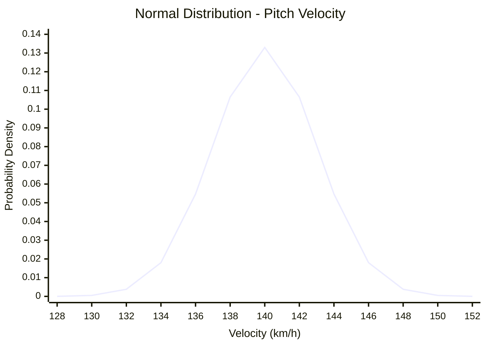

# [06. MSE와 Cross Entropy의 수학적 원리]

<br>

# **1. 손실 함수(Loss Function)는 왜 필요한가?**

머신러닝 모델은 입력 데이터를 이용하여 예측값을 계산한다.

하지만 예측값만 보고는 모델이 얼마나 좋은지 판단하기 어렵다.

예를 들어 수영 선수의 100m 기록을 예측하는 회귀 모델이 다음과 같은 결과를 만들었다고 하자.

| 선수 | 실제 기록 | 예측 기록 |
| --- | ---: | ---: |
| A | 52.0초 | 52.5초 |
| B | 54.0초 | 58.0초 |
| C | 56.0초 | 55.5초 |

각 Sample마다 예측 오차가 다르기 때문에 전체 Model의 Prediction Quality를 하나의 값으로 평가할 기준이 필요하다.

이때 사용하는 것이 **Loss Function**이다.

Loss Function은

```text
실제 정답
vs
Model Prediction
```

의 차이를 숫자로 표현한다.

학습에서는 일반적으로

```text
Loss 계산
↓
Gradient 계산
↓
Parameter Update
↓
Loss 감소
```

과정을 반복한다.

즉 Loss Function은 단순한 평가값이 아니라 **Model Parameter를 어느 방향으로 학습할 것인지 결정하는 기준**이다.

<br><br>

---

# **2. 문제 유형에 따라 Loss Function이 달라진다**

Model이 해결하려는 문제와 가정하는 Probability Distribution이 다르면 적절한 Loss도 달라진다.

| 문제 | 대표적인 출력 | 확률 모델 | 대표 Loss |
| --- | --- | --- | --- |
| Regression | 연속적인 수치 | Normal Distribution | MSE |
| Binary Classification | 0/1 | Bernoulli Distribution | BCE |
| Multiclass Classification | 여러 Class 중 하나 | Categorical Distribution | Cross Entropy |

예를 들어 다음과 같이 사용할 수 있다.

| 실무 문제 | 유형 | Loss |
| --- | --- | --- |
| 30m Sprint Time 예측 | Regression | MSE |
| 다음날 고부하 발생 여부 | Binary Classification | BCE |
| IMU Sensor 동작 종류 분류 | Multiclass Classification | Categorical CE |

이 세 Loss는 서로 완전히 별개의 공식처럼 보이지만 모두 **Maximum Likelihood Estimation(MLE)** 관점에서 연결할 수 있다.

<br><br>

---

# **3. MLE와 Loss Function의 공통 구조**

Maximum Likelihood Estimation의 목적은 관측 데이터를 가장 그럴듯하게 설명하는 Parameter를 찾는 것이다.

$$
\hat{\theta}_{MLE} = \arg\max_{\theta} L(\theta \mid D)
$$

- `θ`: Model Parameter
- `D`: 관측 Dataset
- `L(θ | D)`: Likelihood


Likelihood는 여러 확률 또는 Probability Density의 곱으로 표현되는 경우가 많다.

계산의 안정성과 편의를 위해 Log를 적용하면

$$
\arg\max_{\theta}L = \arg\max_{\theta}\log L
$$


여기에 음수를 붙이면 Maximum 문제가 Minimum 문제로 바뀐다.

$$
\arg\max_{\theta}\log L = \arg\min_{\theta}(-\log L)
$$

즉,

```text
Likelihood 최대화
        ↕
Log-Likelihood 최대화
        ↕
Negative Log-Likelihood 최소화
```

MSE와 Cross Entropy는 특정 Probability Distribution을 가정했을 때 이러한 NLL에서 도출할 수 있다.

<br><br>

---

# **4. MSE(Mean Squared Error)**

MSE는 Regression에서 가장 대표적으로 사용하는 Loss Function 중 하나이다.

실제값을 `y`, Model Prediction을 `ŷ`라고 하면 Sample 하나의 Squared Error는

$$
errors = (y-\hat y)^2
$$

Sample이 `n`개라면 MSE는

$$
MSE = \frac{1}{n}\sum_{i=1}^{n}(y_i-\hat y_i)^2
$$

이다.

즉, 다음 순서로 계산한다.

```text
실제값 - 예측값
↓
Error 계산
↓
제곱
↓
전체 Sample 평균
↓
MSE
```

<br><br>

---

# **5. MSE를 사용하는 이유**

MSE에서는 Error를 제곱하기 때문에 **양수와 음수 Error가 서로 상쇄되지 않는다.**

예를 들어

```text
Error = +3
Error = -3
```

일 때 단순 합은 0이지만 Squared Error는

```text
3² + (-3)²
= 9 + 9
= 18
```

이다.

또한 큰 Error에는 더 큰 Penalty가 적용된다.

| Error | Squared Error |
| ---: | ---: |
| 1 | 1 |
| 2 | 4 |
| 3 | 9 |
| 5 | 25 |
| 10 | 100 |

따라서 MSE는 큰 Prediction Error에 민감하다.

이 특징은 장점이 될 수도 있지만 Outlier가 많은 Dataset에서는 주의해야 한다.

<br><br>

---

# **6. 스포츠 회귀 데이터로 MSE 계산하기**

선수의 30m Sprint Time을 예측한다고 하자.

| 선수 | 실제 기록 `y` | 예측 기록 `ŷ` |
| --- | ---: | ---: |
| A | 4.10 | 4.20 |
| B | 4.30 | 4.00 |
| C | 4.50 | 4.60 |
| D | 4.20 | 4.40 |

각 Error는 다음과 같다.

```text
A: 4.10 - 4.20 = -0.10
B: 4.30 - 4.00 =  0.30
C: 4.50 - 4.60 = -0.10
D: 4.20 - 4.40 = -0.20
```

Squared Error는

```text
0.01
0.09
0.01
0.04
```

이다.

따라서

$$
MSE = \frac{0.01+0.09+0.01+0.04}{4}
$$

$$
= 0.0375
$$

이다.

<br><br>

---

# **7. NumPy로 MSE 계산하기**

[ Python : code ] "스프린트 기록 예측 모델의 MSE 계산"

```python
import numpy as np

y_true = np.array([4.10, 4.30, 4.50, 4.20])
y_pred = np.array([4.20, 4.00, 4.60, 4.40])

errors = y_true - y_pred
squared_errors = errors ** 2
mse = np.mean(squared_errors)

print("Error:", np.round(errors, 2))
print("Squared Error:", np.round(squared_errors, 2))
print("MSE:", round(mse, 4))
```

[ Result ]

```text
Error: [-0.1  0.3 -0.1 -0.2]
Squared Error: [0.01 0.09 0.01 0.04]
MSE: 0.0375
```

MSE가 작아질수록 평균적으로 실제값과 Prediction 사이의 제곱 오차가 작다는 의미이다.

<br><br>

---

# **8. 정규분포(Normal Distribution)**

정규분포(Normal Distribution)는 **평균(Mean)을 중심으로 데이터가 좌우 대칭으로 퍼져 있는 연속 확률분포**이다.

$$
Y\sim N(\mu,\sigma^2)
$$

- $\mu$: 평균(Mean)
- $\sigma^2$: 분산(Variance)
- $\sigma$: 표준편차(Standard Deviation)

정규분포의 확률밀도함수(PDF)는 다음과 같다.

$$
p(y)=\frac{1}{\sqrt{2\pi\sigma^2}}\exp\left(-\frac{(y-\mu)^2}{2\sigma^2}\right)
$$

<br>

> ## 8-1) 정규분포 그래프

예를 들어 투수의 구속이 평균 140km/h, 표준편차 3km/h인 정규분포를 따른다고 가정하자.

$$
Y\sim N(140,3^2)
$$



그래프에서

- **140km/h:** 평균으로, 확률밀도가 가장 높은 지점
- **137~143km/h:** 평균 ±1 표준편차 구간으로 약 68%의 값이 포함되는 범위
- **평균에서 멀어질수록:** 확률밀도가 낮아짐

즉, 실제 구속이 평균인 140km/h 근처에 나타날 가능성이 높다는 의미이다.

<br>

> ## 8-2) 회귀 모델에서 정규분포의 의미

회귀(Regression) 모델은 구속, 거리, 속도처럼 연속적인 숫자를 예측한다.

예를 들어 투수의 구속을 예측한다고 가정하자.

```text
Model Prediction (ŷ) → 140km/h
Actual Value (y)     → 142km/h
Error                → +2km/h
```

모델이 140km/h를 예측했더라도 실제 구속은 138, 141, 142km/h 등으로 나타날 수 있다.

따라서 회귀에서는 **실제값이 모델의 예측값을 평균으로 하는 정규분포를 따른다고 가정**할 수 있다.

$$
Y_i\mid X_i=x_i\sim N(\hat y_i,\sigma^2)
$$

- $\hat y_i$: 모델의 예측값이자 정규분포의 평균
- $Y_i$: 실제 관측값을 나타내는 확률변수
- $\sigma^2$: 오차의 분산

즉, **실제값은 모델의 예측값을 중심으로 퍼져 있다고 가정하는 것**이다.

<br>

> ## 8-3) Noise(오차)의 의미

모델의 예측값과 실제값 사이에는 오차가 발생할 수 있다.

$$
y_i=\hat y_i+\epsilon_i
$$

- $y_i$: 실제값
- $\hat y_i$: 예측값
- $\epsilon_i$: 오차(Noise)

오차가 평균 0인 정규분포를 따른다고 가정하면

$$
\epsilon_i\sim N(0,\sigma^2)
$$


예를 들어

$$
140+2=142
$$

처럼 예측값에 오차가 더해져 실제값이 관측된다고 이해할 수 있다.

<br><br>

---

# **9. 정규분포와 Gaussian NLL의 관계**

> ## **9-1. 정규분포를 사용하는 이유**

회귀(Regression) 모델은 구속, 거리, 속도와 같은 연속형 값을 예측한다.

예를 들어 투수의 구속을 예측한다고 가정하자.

```text
Model Prediction (ŷ) → 140km/h

Actual Value (y)     → 142km/h

Error                → +2km/h
```

모델이 140km/h를 예측하더라도 실제값은 138, 141, 142km/h처럼 다르게 나타날 수 있다.

이러한 차이를 오차(Error)라고 한다.

**회귀 모델에서는 실제값이 모델의 예측값을 중심으로 정규분포를 따른다고 가정할 수 있다.**

$$
Y_i\mid X_i=x_i\sim N(\hat y_i,\sigma^2)
$$

- $Y_i$: 실제 관측값을 나타내는 확률변수
- $\hat y_i$: 모델의 예측값이자 정규분포의 평균
- $\sigma^2$: 오차의 분산

즉, **실제값은 예측값 주변에서 오차를 가지며 나타난다고 가정하는 것**이다.

<br>

> ## **9-2. 정규분포와 Likelihood의 관계**

정규분포에서는 실제값이 평균에 가까울수록 확률밀도(Probability Density)가 높아진다.

회귀에서는 평균을 모델의 예측값으로 설정했으므로 다음과 같이 이해할 수 있다.

| 실제값 y | 예측값 ŷ | 오차 | 해석 |
|---|---|---|---|
| 142 | 142 | 0 | 예측값과 일치 |
| 142 | 141 | 1 | 작은 오차 |
| 142 | 140 | 2 | 상대적으로 큰 오차 |

분산이 동일하다면 실제값과 예측값이 가까울수록 Gaussian Likelihood가 높아진다.

따라서 모델은 **실제 관측값의 Likelihood가 최대가 되는 예측값을 찾도록 학습**할 수 있다.

$$
\max_\theta L(\theta\mid D)
$$

여기서 $\theta$는 모델의 가중치와 편향 등의 Parameter이다.

<br>

> ## **9-3. Gaussian NLL이란?**

`Gaussian`은 정규분포의 가장 대표적인 연속확률분포이다.

`NLL(Negative Log-Likelihood)`은 Likelihood에 로그를 적용하고 음수를 붙인 손실함수이다.

$$
NLL=-\log L
$$

Gaussian NLL은 **정규분포(Gaussian Distribution)를 가정하여 계산한 NLL**이다.

즉, NLL과 Gaussian NLL은 별개의 학습 단계가 아니다.

- **NLL:** 확률분포의 종류와 관계없이 사용하는 일반적인 개념
- **Gaussian NLL:** 정규분포를 적용한 NLL

정규분포의 확률밀도함수는 다음과 같다.

$$
p(y_i\mid\hat y_i,\sigma^2)
=
\frac{1}{\sqrt{2\pi\sigma^2}}
\exp\left(
-\frac{(y_i-\hat y_i)^2}{2\sigma^2}
\right)
$$

이 확률밀도에 음의 로그를 적용하면 Gaussian NLL을 얻는다.

$$
\boxed{
Gaussian\ NLL
=
\frac12\log(2\pi\sigma^2)
+
\frac{(y_i-\hat y_i)^2}{2\sigma^2}
}
$$

수식에서 중요한 부분은 다음 두 가지이다.

> **① 분산과 관련된 항**

$$
\frac12\log(2\pi\sigma^2)
$$

오차가 얼마나 퍼져 있는지 나타내는 분산과 관련된 부분이다.

> **② 실제값과 예측값의 오차 항**

$$
\frac{(y_i-\hat y_i)^2}{2\sigma^2}
$$

실제값과 예측값 사이의 차이를 제곱한 부분이다.

**즉, Gaussian NLL은 정규분포의 분산과 예측 오차를 함께 고려하는 손실함수이다.**

<br><br>

---

# **10. 정규분포 Likelihood에서 MSE가 나오는 과정**

> ## **10-1. 여러 관측값의 Likelihood 계산**

실제 머신러닝에서는 하나의 데이터가 아니라 여러 Sample을 이용하여 모델을 학습한다.

각 Sample의 관측값이 입력과 Model Parameter가 주어졌을 때 서로 독립이라고 가정하자.

그러면 전체 Likelihood는 각 관측값의 확률밀도를 모두 곱하여 계산한다.

$$
L=\prod_{i=1}^{n}p(y_i\mid\hat y_i,\sigma^2)
$$

- $n$: 전체 Sample 개수
- $y_i$: i번째 Sample의 실제값
- $\hat y_i$: i번째 Sample의 예측값
- $\prod$: 모든 값을 곱한다는 의미

즉, **각 Sample에서 실제값이 관측될 가능도를 모두 곱한 값이 전체 Likelihood이다.**

<br>

> ## **10-2. Log-Likelihood로 변환**

Likelihood는 여러 확률밀도를 곱해야 하므로 계산이 복잡해질 수 있다.

따라서 로그를 적용하여 곱셈을 덧셈으로 변환한다.

$$
\log L=\sum_{i=1}^{n}\log p(y_i\mid\hat y_i,\sigma^2)
$$

정규분포의 확률밀도함수를 대입하고 로그의 성질로 정리하면 다음과 같다.

$$
\log L
=
-\frac n2\log(2\pi\sigma^2)
-
\frac{1}{2\sigma^2}
\sum_{i=1}^{n}(y_i-\hat y_i)^2
$$

여기서 중요한 것은 **실제값과 예측값의 차이를 제곱한 항이 나타난다는 것**이다.

$$
(y_i-\hat y_i)^2
$$

이 항은 모델의 예측 오차를 나타낸다.

<br>

> ## **10-3. Negative Log-Likelihood 적용**

머신러닝에서는 일반적으로 Loss를 최소화하는 방향으로 학습한다.

따라서 Log-Likelihood에 음수를 붙여 NLL로 변환한다.

$$
NLL=-\log L
$$

그러면

$$
\boxed{
NLL
=
\frac n2\log(2\pi\sigma^2)
+
\frac{1}{2\sigma^2}
\sum_{i=1}^{n}(y_i-\hat y_i)^2
}
$$

가 된다.

이것이 여러 Sample에 대한 Gaussian NLL이다.

<br>

> ## **10-4. 왜 Gaussian NLL이 MSE와 연결될까?**

Gaussian NLL을 다시 살펴보자.

$$
NLL
=
\underbrace{\frac n2\log(2\pi\sigma^2)}_{\text{첫 번째 항}}
+
\underbrace{\frac{1}{2\sigma^2}}_{\text{계수}}
\underbrace{\sum_{i=1}^{n}(y_i-\hat y_i)^2}_{\text{오차 제곱의 합}}
$$

여기서 **분산 $\sigma^2$가 고정되어 있다고 가정**하면 다음과 같다.

- 첫 번째 항: 일정한 상수
- 두 번째 계수: 일정한 양의 상수
- 세 번째 항: 모델의 예측값에 따라 변하는 값

즉, 가중치와 편향을 변경하더라도 앞의 상수들은 변하지 않는다.

따라서 Gaussian NLL을 최소화하려면 결국 다음 값을 최소화하면 된다.

$$
\sum_{i=1}^{n}(y_i-\hat y_i)^2
$$

이것이 SSE(Sum of Squared Errors), 즉 오차 제곱의 합이다.

여기에 전체 Sample 개수 $n$으로 나누면 MSE가 된다.

$$
\boxed{
MSE=\frac1n\sum_{i=1}^{n}(y_i-\hat y_i)^2
}
$$

Sample 개수도 고정되어 있으므로 SSE를 최소화하는 것과 MSE를 최소화하는 것은 동일한 최적의 Parameter를 찾는다.

**따라서 분산이 일정하다는 가정에서 Gaussian NLL 최소화와 MSE 최소화는 같은 최적의 모델 파라미터를 선택한다.**

<br>

> ## **10-5. 실제 숫자로 이해하기**

투수의 실제 구속과 모델의 예측값이 다음과 같다고 가정하자.

```python
import numpy as np

# 실제 구속
y = np.array([142, 138, 145])

# 모델 예측 구속
y_pred = np.array([140, 140, 144])
```

각 Sample의 오차를 계산하면 다음과 같다.

| Sample | 실제값 y | 예측값 ŷ | 오차 | 오차 제곱 |
|---|---:|---:|---:|---:|
| 1 | 142 | 140 | 2 | 4 |
| 2 | 138 | 140 | -2 | 4 |
| 3 | 145 | 144 | 1 | 1 |

오차 제곱의 합은

$$
SSE=4+4+1=9
$$

이다.

MSE는 전체 Sample 개수인 3으로 나누어 계산한다.

$$
\begin{aligned}
MSE
&=\frac{4+4+1}{3}\\
&=3
\end{aligned}
$$

모델이 학습하면서 가중치와 편향을 변경하여 예측값을 실제값에 더 가깝게 만든다면 오차 제곱의 합이 감소한다.

이때 분산이 일정하다는 가정에서는 Gaussian NLL도 함께 감소한다.

<br>

> ## **10-6. Gaussian NLL과 MSE의 차이**

| 구분 | Gaussian NLL | MSE |
|---|---|---|
| 기반 | 정규분포 | 오차 제곱 |
| 계산 | 분산과 오차를 고려 | 실제값과 예측값의 차이 계산 |
| 목표 | NLL 최소화 | MSE 최소화 |
| 분산 처리 | 분산을 고정하거나 학습 가능 | 분산을 직접 사용하지 않음 |

**주의:** 분산 $\sigma^2$까지 모델이 학습하는 경우에는 Gaussian NLL과 MSE가 일반적으로 동일한 최적화 문제가 아니다.

고정 분산을 가정할 때만 위의 동등한 최적화 관계가 성립한다.

<br>

> ## **10-7. 최종 학습 흐름**

```text
Regression Model
       ↓
연속형 값 예측 (ŷ)
       ↓
실제값 (y)과 오차 발생
       ↓
오차가 정규분포를 따른다고 가정
       ↓
Gaussian Likelihood 계산
       ↓
Log-Likelihood 최대화
       ↕
Gaussian NLL 최소화
       ↕ (분산 고정 시)
MSE 최소화
       ↓
Backpropagation
       ↓
Optimizer
       ↓
Weight & Bias 업데이트
       ⟲ 반복 학습
```


> ## **10-8. MSE와 Gaussian NLL 비교 예제 (Python)**

### 1. 예제 개요

회귀(Regression) 모델 A와 B가 실제값을 얼마나 정확하게 예측했는지 **MSE와 Gaussian NLL을 이용하여 비교**한다.

정규분포의 분산이 고정되어 있다면 MSE와 Gaussian NLL은 동일한 최적의 Model Parameter를 선택한다.

### 2. 데이터 준비

```python
import numpy as np

# 실제값
y_true = np.array([10, 20, 30])

# 모델 A의 예측값
pred_A = np.array([12, 18, 27])

# 모델 B의 예측값
pred_B = np.array([9, 24, 33])

# 정규분포의 표준편차 및 분산
sigma = 2
variance = sigma ** 2
```

| Sample | 실제값 | Model A | Model B |
|---|---:|---:|---:|
| 1 | 10 | 12 | 9 |
| 2 | 20 | 18 | 24 |
| 3 | 30 | 27 | 33 |

### 3. MSE 계산

MSE는 실제값과 예측값의 차이를 제곱한 뒤 평균을 계산한다.

$$
MSE=\frac{1}{n}\sum_{i=1}^{n}(y_i-\hat y_i)^2
$$

```python
# MSE 계산 함수
def mse(y_true, y_pred):
    squared_errors = (y_true - y_pred) ** 2
    return np.mean(squared_errors)

mse_A = mse(y_true, pred_A)
mse_B = mse(y_true, pred_B)
```

**Model A**

$$
\begin{aligned}
MSE_A
&=\frac{(10-12)^2+(20-18)^2+(30-27)^2}{3}\\
&=\frac{4+4+9}{3}\\
&\approx5.667
\end{aligned}
$$

**Model B**

$$
\begin{aligned}
MSE_B
&=\frac{(10-9)^2+(20-24)^2+(30-33)^2}{3}\\
&=\frac{1+16+9}{3}\\
&\approx8.667
\end{aligned}
$$

따라서 **MSE가 작은 Model A가 더 좋은 예측 결과**를 보인다.

---

### 4. Gaussian NLL 계산

Gaussian NLL은 예측 오차가 정규분포를 따른다고 가정하여 계산하는 손실함수이다.

$$
Gaussian\ Mean\ NLL
=
\frac12\log(2\pi\sigma^2)
+
\frac{MSE}{2\sigma^2}
$$

여기서

- $\sigma^2$: 정규분포의 분산
- $MSE$: 평균 제곱 오차
- $\log$: 자연로그

분산을 4로 고정했으므로

$$
\begin{aligned}
Gaussian\ Mean\ NLL
&=\frac12\log(2\pi\times4)+\frac{MSE}{8}\\
&\approx1.612+\frac{MSE}{8}
\end{aligned}
$$

```python
# Gaussian Mean NLL 계산 함수
def gaussian_mean_nll(y_true, y_pred, variance):

    # 실제값과 예측값의 오차 제곱
    squared_errors = (y_true - y_pred) ** 2

    # 정규분포의 분산에 따른 상수
    constant = 0.5 * np.log(2 * np.pi * variance)

    # 예측 오차에 따른 손실
    error_term = squared_errors / (2 * variance)

    # 전체 Sample의 평균 NLL
    return np.mean(constant + error_term)

nll_A = gaussian_mean_nll(y_true, pred_A, variance)
nll_B = gaussian_mean_nll(y_true, pred_B, variance)
```

**Model A**

$$
\begin{aligned}
NLL_A
&\approx1.612+\frac{5.667}{8}\\
&\approx2.320
\end{aligned}
$$

**Model B**

$$
\begin{aligned}
NLL_B
&\approx1.612+\frac{8.667}{8}\\
&\approx2.695
\end{aligned}
$$

Gaussian NLL 역시 Model A가 더 작다.

---

### 5. 최종 결과 출력

```python
print("모델 A MSE:", round(mse_A, 3))
print("모델 B MSE:", round(mse_B, 3))

print("모델 A Mean NLL:", round(nll_A, 3))
print("모델 B Mean NLL:", round(nll_B, 3))
```

**출력 결과**

```text
모델 A MSE: 5.667
모델 B MSE: 8.667

모델 A Mean NLL: 2.320
모델 B Mean NLL: 2.695
```

| 평가 지표 | Model A | Model B |
|---|---:|---:|
| MSE | **5.667** | 8.667 |
| Gaussian Mean NLL | **2.320** | 2.695 |

두 손실함수 모두 Model A의 손실이 더 작다.

---

### 6. 핵심 정리

정규분포의 분산이 고정되어 있다면 Gaussian Mean NLL은 다음과 같이 표현된다.

$$
Gaussian\ Mean\ NLL=Constant+\frac{MSE}{2\sigma^2}
$$

여기서 분산과 상수는 변하지 않으므로 **MSE가 감소하면 Gaussian NLL도 감소한다.**

따라서

```text
Gaussian Likelihood 최대화
             ↕
Gaussian NLL 최소화
             ↕
       MSE 최소화
             ↓
  동일한 최적 Parameter
```

가 성립한다.

**결론적으로 정규분포의 분산이 고정된 회귀 모델에서는 MSE를 최소화하는 것이 Gaussian NLL을 최소화하는 것과 수학적으로 연결된다.**

단, 분산까지 학습하는 경우에는 두 손실함수가 일반적으로 동일한 최적화 문제가 아니다.


<br><br>

---

# **11. MSE와 Gaussian NLL의 관계에서 중요한 조건**

MSE와 Gaussian NLL이 연결된다고 해서 항상 모든 Regression Problem에 MSE가 최적이라는 뜻은 아니다.

다음과 같은 가정이 중요하다.

| 조건 | 의미 |
| --- | --- |
| 연속형 Target | Regression 문제 |
| Gaussian Error | Error가 Normal Distribution 형태라고 가정 |
| Mean 0 Error | 예측을 중심으로 Error가 형성 |
| Fixed Variance | `σ²`가 일정하다고 가정 |
| Independent Observation | Sample Error가 독립이라고 가정 |

특히 Variance까지 Model이 예측하는 Heteroscedastic Regression에서는 Gaussian NLL에 `σ²` 관련 항이 남기 때문에 단순 MSE와 동일하지 않다.

<br><br>

---

# **12. MSE와 MAE의 차이**

Regression에서 자주 비교하는 Loss로 MAE도 있다.

$$
MAE = \frac{1}{n}\sum_{i=1}^{n}|y_i-\hat y_i|
$$

차이를 비교하면 다음과 같다.

| 구분 | MSE | MAE |
| --- | --- | --- |
| Error 처리 | 제곱 | 절댓값 |
| 큰 Error 영향 | 매우 큼 | 상대적으로 작음 |
| Outlier 민감도 | 높음 | 상대적으로 낮음 |
| 확률적 연결 예시 | Gaussian | Laplace |
| 미분 특성 | 부드러운 편 | 0에서 미분 불가능 |

따라서 Loss 선택은 단순 공식 암기가 아니라 **Target과 Error Distribution의 특성**을 고려해야 한다.

<br><br>

---

# **13. Binary Cross Entropy (BCE)**

Binary Cross Entropy(BCE)
-  **이진 분류에서 모델이 예측한 확률과 실제 정답을 비교하여 오차를 계산하는 손실함수(Loss Function)**

<br>

## 13-1. BCE의 기본 개념

Binary Classification에서는 Target이 다음 두 가지로 구분된다.

```text
0 = Normal
1 = High Load
```

모델이 High Load일 확률을 $p$로 예측하면 BCE는 다음과 같다.

$$
BCE=-[y\log(p)+(1-y)\log(1-p)]
$$

- $y$: 실제 정답 (0 또는 1)
- $p$: 모델이 예측한 Class 1의 확률
- $BCE$: 예측에 대한 손실값

**실제 정답에 높은 확률을 부여하면 BCE가 작아지고, 낮은 확률을 부여하면 BCE가 커진다.**

<br>

## 13-2. BCE 계산 예시

모델이 High Load 확률을 0.8로 예측했다고 가정하자.

> **① 실제 정답이 1 (High Load)인 경우**

$$
\begin{aligned}
BCE
&=-[1\log(0.8)+0\log(0.2)]\\
&=-\log(0.8)\\
&\approx0.223
\end{aligned}
$$

실제 정답에 높은 확률을 부여했으므로 Loss가 작다.

> **② 실제 정답이 0 (Normal)인 경우**

$$
\begin{aligned}
BCE
&=-[0\log(0.8)+1\log(0.2)]\\
&=-\log(0.2)\\
&\approx1.609
\end{aligned}
$$

실제 정답에 낮은 확률을 부여했으므로 Loss가 크다.

<br>

## 13-3. Log-Likelihood, NLL, BCE의 차이

| 구분 | 의미 | 목표 |
|---|---|---|
| Likelihood | 관측 데이터의 우도 | 최대화 |
| Log-Likelihood | Likelihood에 로그 적용 | 최대화 |
| NLL | Log-Likelihood에 음수 적용 | 최소화 |
| BCE | 이진 분류에서 정답 확률로 Loss 계산 | 최소화 |
| MLE | Likelihood를 최대화하는 파라미터 추정 | 최적 파라미터 탐색 |

이진 분류에서 베르누이 분포를 가정하면 전체 NLL은 다음과 같다.

$$
NLL=-\sum_{i=1}^{n}[y_i\log(p_i)+(1-y_i)\log(1-p_i)]
$$

전체 NLL을 Sample 개수로 나누면 평균 BCE가 된다.

$$
\boxed{BCE_{\text{mean}}=\frac{NLL}{n}}
$$

즉, **BCE는 베르누이 분포를 가정한 이진 분류에서 사용하는 평균 NLL과 동일하다.**

<br>

## 13-4. PyTorch에서 BCE 사용

```python
import torch.nn as nn

# Binary Classification 손실함수
criterion = nn.BCEWithLogitsLoss()

# 모델의 Logit 출력
logits = model(X)

# BCE Loss 계산
loss = criterion(logits, y)
```

`BCEWithLogitsLoss()`는 Sigmoid와 BCE 계산을 내부적으로 처리하므로 학습할 때 별도의 Sigmoid를 적용하지 않는다.

## 13-5. 핵심 정리

```text
Probability Model
        ↓
Bernoulli Likelihood
        ↓
Log-Likelihood 최대화
        ↕
NLL 최소화
        ↕
BCE 최소화
        ↓
Backpropagation
        ↓
Optimizer
        ↓
Weight, Bias 업데이트
        ⟲ 반복 학습
```

**결론적으로 BCE는 이진 분류에서 실제 정답에 부여한 예측 확률을 평가하는 손실함수이며, BCE를 최소화하는 것은 베르누이 분포의 Likelihood를 최대화하는 것과 연결된다.**


<br><br>

---

# **14. BCE는 실제 정답의 확률만 선택한다**

BCE 식을 실제 정답에 따라 나누어 보면 이해하기 쉽다.

> ## **14-1) 실제 정답이 1**

`y=1`이라면

$$
BCE = -\left[1\log p+0\log(1-p)\right]
$$

따라서

$$
BCE=-\log p
$$

<br>

> ## **14-2) 실제 정답이 0**

`y=0`이라면

$$
BCE = -\left[0\log p+1\log(1-p)\right]
$$

따라서

$$
BCE=-\log(1-p)
$$

즉 BCE는 결국 **실제 정답에 Model이 부여한 Probability의 Negative Log**이다.

<br><br>


---

# **15. 예측 확률에 따른 BCE 변화**

실제 정답이 `1`이라고 하자.

| 예측 Probability `p` | BCE `-log(p)` |
| ---: | ---: |
| 0.99 | 0.010 |
| 0.90 | 0.105 |
| 0.70 | 0.357 |
| 0.50 | 0.693 |
| 0.10 | 2.303 |
| 0.01 | 4.605 |

실제 정답에 높은 Probability를 부여하면 Loss가 작다.

반대로 틀린 방향으로 높은 확신을 가지면 Loss가 매우 커진다.

즉 Cross Entropy는 단순히

```text
정답 / 오답
```

만 보는 것이 아니라 **정답에 얼마나 높은 Probability를 부여했는지**까지 반영한다.

<br><br>

---

# **16. Bernoulli Distribution과 BCE**

Binary Target은 Bernoulli Distribution으로 표현할 수 있다.

$$
P(Y=y) = p^y(1-p)^{1-y}
$$

이 식을 관측된 `y`에 대한 Likelihood로 보면

$$
L(p\mid y) = p^y(1-p)^{1-y}
$$

이다.

Log를 적용하면

$$
\log L = y\log p+(1-y)\log(1-p)
$$

이다.

Negative Log-Likelihood는

$$
-\log L = -\left[y\log p+(1-y)\log(1-p)\right]
$$

이다.

이 식이 바로 BCE이다.

따라서

```text
Bernoulli Likelihood 최대화
↕
Bernoulli NLL 최소화
↕
Binary Cross Entropy 최소화
```

이다.

<br><br>

---

# **17. 스포츠 Binary Classification 예제**

선수의 다음날 고부하 여부를 예측했다고 하자.

| 선수 | 실제 `y` | 예측 Probability `p` |
| --- | ---: | ---: |
| A | 1 | 0.85 |
| B | 0 | 0.20 |
| C | 1 | 0.70 |
| D | 0 | 0.40 |

각 선수의 BCE는

```text
A: -log(0.85)
B: -log(0.80)
C: -log(0.70)
D: -log(0.60)
```

이다.

Model은 실제 Label에 높은 Probability를 줄수록 낮은 Loss를 얻는다.

<br><br>

---

# **18. NumPy로 BCE 계산하기**

[ Python : code ] "선수 고부하 이진 분류 모델의 Binary Cross Entropy 계산"

```python
import numpy as np

y_true = np.array([1, 0, 1, 0])
y_prob = np.array([0.85, 0.20, 0.70, 0.40])

bce_each = -(
    y_true * np.log(y_prob)
    + (1 - y_true) * np.log(1 - y_prob)
)

mean_bce = np.mean(bce_each)

print("선수별 BCE:", np.round(bce_each, 3))
print("Mean BCE:", round(mean_bce, 3))
```

[ Result ]

```text
선수별 BCE: [0.163 0.223 0.357 0.511]
Mean BCE: 0.313
```

Mean BCE가 작다는 것은 주어진 Dataset에서 실제 Label에 상대적으로 높은 Probability를 부여했다는 의미이다.

<br><br>

---

# **19. BCE와 Accuracy는 같은 정보가 아니다**

두 Model이 같은 Class를 예측해도 BCE는 다를 수 있다.

실제 정답이 `1`이라고 하자.

| Model | Probability | Threshold 0.5 Prediction | BCE |
| --- | ---: | ---: | ---: |
| A | 0.95 | 1 | 0.051 |
| B | 0.55 | 1 | 0.598 |

두 Model 모두 정답 Class `1`을 예측했다.

하지만 Model A가 실제 정답에 훨씬 높은 Probability를 부여했기 때문에 BCE가 더 작다.

따라서

```text
Accuracy
→ 최종 Class가 맞았는가?

Cross Entropy
→ 실제 정답에 얼마나 높은 Probability를 주었는가?
```

로 구분할 수 있다.

<br><br>

---

# **20. Categorical Cross Entropy**

Multiclass Classification에서는 여러 Class 중 하나가 정답이다.

예를 들어 IMU Sensor 데이터를 이용해 움직임을 다음과 같이 분류한다고 하자.

```text
Class 0 = Walking
Class 1 = Running
Class 2 = Jumping
Class 3 = Cutting
```

Softmax Model은 각 Class의 Probability를 계산한다.

예를 들어

```text
[0.10, 0.70, 0.10, 0.10]
```

이라면 전체 Probability의 합은 1이다.

$$
\sum_{k=1}^{K}p_k=1
$$

이다.

<br><br>

---

# **21. One-Hot Encoding**

실제 정답이 Running이라면 Class Index는 `1`이다.

이를 One-Hot으로 표현하면

```text
[0, 1, 0, 0]
```

이다.

| Class | 정답 |
| --- | ---: |
| Walking | 0 |
| Running | 1 |
| Jumping | 0 |
| Cutting | 0 |

Categorical Cross Entropy 공식은

$$
CE = -\sum_{k=1}^{K}y_k\log p_k
$$

이다.

One-Hot에서는 실제 정답 Class를 제외한 모든 `yₖ`가 0이므로 결국

$$
CE = -\log(p_{\text{true}})
$$

가 된다.

<br><br>

---

# **22. Categorical Distribution과 Cross Entropy**

Categorical Distribution의 Likelihood는

$$
L(p\mid y) = \prod_{k=1}^{K}p_k^{y_k}
$$

이다.

Log를 적용하면

$$
\log L = \sum_{k=1}^{K}y_k\log p_k
$$

이다.

Negative Log-Likelihood는

$$
NLL = -\sum_{k=1}^{K}y_k\log p_k
$$

이다.

이 식이 Categorical Cross Entropy이다.

따라서

```text
Categorical Likelihood 최대화
↕
Categorical NLL 최소화
↕
Categorical Cross Entropy 최소화
```

이다.

<br><br>

---

# **23. 센서 동작 분류 CE 예제**

실제 동작이 `Running`이라고 하자.

실제 Label은

```text
y = [0, 1, 0, 0]
```

이다.

Model A가

```text
[0.05, 0.80, 0.10, 0.05]
```

를 예측했다면

$$
CE_A = -\log(0.80)
$$

$$
\approx0.223
$$

이다.

Model B가

```text
[0.15, 0.50, 0.20, 0.15]
```

를 예측했다면

$$
CE_B = -\log(0.50)
$$

$$
\approx0.693
$$

이다.

두 Model 모두 Running을 Argmax로 선택하지만 Model A의 CE가 더 작다.

<br><br>

---

# **24. 여러 Sample의 평균 Categorical CE**

다음과 같은 동작 분류 결과가 있다고 하자.

| Sample | 실제 Class | Walking | Running | Jumping |
| --- | --- | ---: | ---: | ---: |
| A | Walking | 0.80 | 0.10 | 0.10 |
| B | Running | 0.20 | 0.60 | 0.20 |
| C | Jumping | 0.10 | 0.30 | 0.60 |

실제 정답 Probability는

```text
[0.8, 0.6, 0.6]
```

이다.

따라서 각 CE는

$$
-\log(0.8)\approx0.223
$$

$$
-\log(0.6)\approx0.511
$$

$$
-\log(0.6)\approx0.511
$$

이다.

Mean CE는

$$
\frac{0.223+0.511+0.511}{3}
$$

$$
\approx0.415
$$

이다.

<br><br>

---

# **25. NumPy로 Categorical Cross Entropy 계산하기**

[ Python : code ] "IMU 동작 분류 모델의 Categorical Cross Entropy 계산"

```python
import numpy as np

y_true = np.array([0, 1, 2])

y_prob = np.array([
    [0.8, 0.1, 0.1],
    [0.2, 0.6, 0.2],
    [0.1, 0.3, 0.6]
])

row_index = np.arange(len(y_true))

true_probs = y_prob[row_index, y_true]
ce_each = -np.log(true_probs)
mean_ce = np.mean(ce_each)

print("정답 Class Probability:", true_probs)
print("Sample별 CE:", np.round(ce_each, 3))
print("Mean CE:", round(mean_ce, 3))
```

[ Result ]

```text
정답 Class Probability: [0.8 0.6 0.6]
Sample별 CE: [0.223 0.511 0.511]
Mean CE: 0.415
```

<br><br>

---

# **26. One-Hot 방식으로 CE 계산하기**

[ Python : code ] "One-Hot Label을 이용한 Categorical Cross Entropy 계산"

```python
import numpy as np

y_true = np.array([
    [1, 0, 0],
    [0, 1, 0],
    [0, 0, 1]
])

y_prob = np.array([
    [0.8, 0.1, 0.1],
    [0.2, 0.6, 0.2],
    [0.1, 0.3, 0.6]
])

ce_each = -np.sum(
    y_true * np.log(y_prob),
    axis=1
)

print("Sample별 CE:", np.round(ce_each, 3))
print("Mean CE:", round(np.mean(ce_each), 3))
```

[ Result ]

```text
Sample별 CE: [0.223 0.511 0.511]
Mean CE: 0.415
```

Class Index를 사용하든 One-Hot을 사용하든 같은 Probability Distribution을 표현한다면 동일한 CE를 얻을 수 있다.

<br><br>

---

# **27. Likelihood와 Mean CE의 관계**

앞선 Example에서 실제 정답에 부여한 Probability는

```text
0.8
0.6
0.6
```

이다.

각 Sample이 조건부 독립이라고 가정하면 전체 Likelihood는

$$
L = 0.8\times0.6\times0.6
$$

$$
= 0.288
$$

이다.

Negative Log-Likelihood는

$$
NLL = -\log(0.288)
$$

$$
\approx1.245
$$

이다.

Mean CE는

$$
Mean\ CE = \frac{1.245}{3}
$$

$$
\approx0.415
$$

이다.

즉 고정된 Dataset에서

```text
Total NLL
↕
Mean Cross Entropy
```

는 단순히 Sample 개수 `n`의 배수 차이이므로 같은 최적 Parameter를 선택한다.

<br><br>

---

# **28. BCE와 Categorical CE 비교**

| 구분 | BCE | Categorical CE |
| --- | --- | --- |
| 대표 문제 | Binary Classification | Multiclass Classification |
| Probability Model | Bernoulli | Categorical |
| 대표 Output | Sigmoid | Softmax |
| Target | `0`, `1` | Class Index / One-Hot |
| Probability 개념 | Positive Class Probability | Class별 Probability Distribution |
| Loss | `-[y log p +(1-y)log(1-p)]` | `-Σ yₖ log pₖ` |
| NLL 연결 | Bernoulli NLL | Categorical NLL |

두 Loss의 공통 원리는 같다.

> 실제 관측된 정답에 높은 Probability를 부여하면 Loss가 작고, 실제 정답에 낮은 Probability를 부여하면 Loss가 커진다.

<br><br>

---

# **29. Multiclass와 Multilabel을 구분해야 한다**

Multiclass Classification은 여러 Class 중 정확히 하나가 정답이다.

예:

```text
보행
달리기
점프
방향 전환
```

중 하나.

따라서 일반적으로

```text
Softmax
+
Categorical Cross Entropy
```

를 사용한다.

반면 Multilabel Classification에서는 여러 Label이 동시에 존재할 수 있다.

예를 들어 Football Video Frame에

```text
선수 존재
공 존재
심판 존재
태클 상황
```

등이 동시에 나타날 수 있다.

이 경우 각 Label을 독립적인 Binary 문제처럼 표현하여

```text
Sigmoid
+
BCE
```

를 활용할 수 있다.

<br><br>

---

# **30. MSE·BCE·CE를 확률분포 관점에서 비교**

| 문제 | Model의 확률적 가정 | Loss |
| --- | --- | --- |
| Regression | Gaussian | MSE |
| Binary Classification | Bernoulli | BCE |
| Multiclass Classification | Categorical | CE |

공통 흐름은 다음과 같다.

```text
Probability Model 정의
        ↓
Model Parameter로 Distribution 결정
        ↓
Observed Data의 Likelihood 계산
        ↓
Log-Likelihood
        ↓
Negative Log-Likelihood
        ↓
Loss Function
        ↓
Loss 최소화
        ↓
Parameter 학습
```

즉 손실 함수는 단순한 임의의 Error Formula가 아니라 **확률 모델과 학습 목적을 연결하는 수학적 도구**로 이해할 수 있다.

<br><br>

---

# **31. 세 Loss의 실무 예제 비교**

| Dataset | Target | 문제 | 적절한 Loss 예시 |
| --- | --- | --- | --- |
| GPS Load | 다음 경기 총 이동거리 | Regression | MSE |
| Wellness | 다음날 High Fatigue 여부 | Binary | BCE |
| IMU Sensor | Walking/Running/Jumping | Multiclass | CE |
| 야구 Tracking | 타구 비거리 | Regression | MSE |
| 의료 Screening | 이상 유무 | Binary | BCE |
| 영상 분석 | 동작 Category | Multiclass | CE |

Loss는 Domain 자체보다 **Target의 구조와 Probability Model**에 따라 선택하는 것이 중요하다.

<br><br>

---

# **32. Numerical Stability**

Cross Entropy를 직접 구현할 때 Probability가 정확히 0이면

$$
\log(0)
$$

을 계산하게 된다.

이는 정의되지 않으며 `-inf` 등의 문제가 발생할 수 있다.

단순한 NumPy 학습 예제에서는 다음과 같이 Probability를 제한할 수 있다.

[ Python : code ] "로그 계산 오류를 줄이기 위한 Probability Clipping"

```python
import numpy as np

probabilities = np.array([
    0.0,
    0.01,
    0.99,
    1.0
])

safe_probabilities = np.clip(
    probabilities,
    1e-7,
    1 - 1e-7
)

print(safe_probabilities)
print(-np.log(safe_probabilities))
```

[ Result ]

```text
[1.000000e-07 1.000000e-02 9.900000e-01 9.999999e-01]

[1.6118096e+01
 4.6051702e+00
 1.0050336e-02
 1.0000001e-07]
```

다만 실제 Deep Learning Framework에서는 단순히 Probability를 계산한 후 Log를 적용하기보다 Logit에서 안정적으로 Loss를 계산하는 함수를 사용하는 것이 일반적이다.

<br><br>

---

# **33. Softmax와 Cross Entropy의 실무 구현**

이론적으로 Multiclass Model은

```text
Logit
↓
Softmax
↓
Probability
↓
Cross Entropy
```

로 이해할 수 있다.

하지만 실제 Library의 Cross Entropy 함수는 보통 **Raw Logit**을 직접 입력받도록 설계된다.

그 이유는 Softmax와 Log 연산을 분리하지 않고 안정적으로 계산할 수 있기 때문이다.

따라서 개념적으로는

```text
Softmax + Cross Entropy
```

이지만 구현에서는

```text
Model → Logits → CrossEntropyLoss
```

와 같이 사용하는 경우가 많다.

이미 Softmax를 적용한 Probability를 다시 Logit용 Cross Entropy 함수에 입력하면 잘못된 계산이 될 수 있으므로 API의 Input 정의를 확인해야 한다.

<br><br>

---

# **34. Loss 값이 작다고 무조건 좋은 Model인가?**

Training Loss가 작다는 것은 Training Dataset을 기준으로 Model이 Objective Function을 잘 최소화했다는 의미이다.

하지만 이것만으로 좋은 Model이라고 단정할 수 없다.

다음도 함께 확인해야 한다.

```text
Training Loss
Validation Loss
Test Performance
Overfitting
Generalization
Calibration
Class Imbalance
Domain Metric
```

예를 들어 Classification에서는 BCE가 작더라도 실제 업무에서 중요한 Recall이 낮을 수 있다.

Regression에서는 MSE가 작더라도 특정 Group에서 Error가 크게 나타날 수 있다.

따라서 Loss는 **Training Objective**이고 실제 Model Evaluation Metric과 반드시 동일한 것은 아니다.

<br><br>

---

# **35. Loss와 Evaluation Metric 차이**

| 구분 | Loss Function | Evaluation Metric |
| --- | --- | --- |
| 목적 | Parameter 학습 | Model 성능 해석 |
| Gradient 필요 | 일반적으로 필요 | 반드시 필요하지 않음 |
| Regression 예 | MSE | RMSE, MAE, R² |
| Classification 예 | BCE, CE | Accuracy, Precision, Recall, F1, AUROC |
| 사용 시점 | Training | Validation/Test |

예를 들어 Injury Screening Model에서 BCE로 학습하더라도 Evaluation에서는 Recall이나 Sensitivity를 중요하게 볼 수 있다.

<br><br>

---

# **36. Loss 계산의 전체 흐름**

Regression은 다음과 같다.

```text
Feature X
↓
Model
↓
Prediction ŷ
↓
Actual y와 비교
↓
Squared Error
↓
Mean
↓
MSE
```

Binary Classification은

```text
Feature X
↓
Model
↓
Logit
↓
Sigmoid Probability
↓
Actual Label
↓
BCE
```

Multiclass Classification은

```text
Feature X
↓
Model
↓
Class Logits
↓
Softmax Distribution
↓
Actual Class
↓
Categorical CE
```

이다.

<br><br>

---

# **37. Probability Model부터 Loss까지의 전체 흐름도**

```text
                Machine Learning Problem
                         │
         ┌───────────────┼─────────────────┐
         │               │                 │
         ↓               ↓                 ↓
    Regression       Binary Class      Multiclass
         │               │                 │
         ↓               ↓                 ↓
      Gaussian        Bernoulli        Categorical
         │               │                 │
         ↓               ↓                 ↓
     Likelihood       Likelihood         Likelihood
         │               │                 │
         ↓               ↓                 ↓
        NLL             NLL               NLL
         │               │                 │
         ↓               ↓                 ↓
        MSE             BCE                CE
         │               │                 │
         └───────────────┼─────────────────┘
                         ↓
                  Loss Minimization
                         ↓
                     Gradient
                         ↓
                 Parameter Update
```

<br><br>

---

# **38. 복합 실무 예제**

하나의 Sports Analytics Platform에서 다음 세 Model을 운영한다고 하자.

| Model | Input | Target |
| --- | --- | --- |
| Model A | GPS, Minutes, HSR | 다음 경기 이동거리 |
| Model B | Wellness, ACWR, Soreness | High Fatigue 여부 |
| Model C | IMU Acceleration | Movement Type |

각 Model의 Loss는 다음과 같이 구성할 수 있다.

```text
Model A
Regression
→ Gaussian Error 가정
→ MSE

Model B
Binary Classification
→ Bernoulli
→ BCE

Model C
Multiclass Classification
→ Categorical
→ CE
```

중요한 것은 스포츠 데이터이기 때문에 특정 Loss를 사용하는 것이 아니다.

**Target Variable과 Probability Distribution의 구조 때문에 Loss가 결정된다.**

<br><br>

---

# **39. 자주 혼동하는 내용**

> ## **39-1) MSE가 곧 Gaussian NLL 자체인가?**

항상 완전히 동일한 값은 아니다.

Fixed Variance Gaussian Model에서는 Gaussian NLL에서 Parameter Optimization과 무관한 Constant 및 Scale Factor를 제거하면 Squared Error 형태가 남는다.

따라서 같은 Mean Model Parameter의 Optimum을 갖는다고 이해하는 것이 정확하다.

<br>

> ## **39-2) BCE가 Accuracy인가?**

아니다.

Accuracy는 최종 Class의 정답 여부를 계산한다.

BCE는 실제 정답에 부여한 Probability까지 평가한다.

<br>

> ## **39-3) CE에서는 가장 큰 Probability만 사용하면 되는가?**

Loss 계산에서는 실제 정답 Class에 부여한 Probability가 핵심이다.

Argmax Class가 정답이더라도 Probability가 낮으면 Loss는 상대적으로 클 수 있다.

<br>

> ## **39-4) Cross Entropy가 작으면 Probability가 반드시 Calibration 되어 있는가?**

그렇지 않다.

낮은 CE는 해당 Dataset에서 좋은 Log-Likelihood를 의미하지만 Probability Calibration은 별도로 확인할 수 있다.

<br>

> ## **39-5) Multiclass에 BCE를 절대 사용할 수 없는가?**

문제 구조를 구분해야 한다.

Mutually Exclusive한 하나의 Class를 선택하는 일반적인 Multiclass에서는 Softmax + CE가 자연스럽다.

여러 Label이 동시에 존재하는 Multilabel에서는 Class별 Sigmoid + BCE를 사용할 수 있다.

<br><br>

---

# **40. Advanced 추가 학습**

> ## **40-1) Heteroscedastic Regression**

Sample마다 Noise Variance가 다르다고 생각하면 Model이 Mean뿐 아니라 Variance도 예측하도록 만들 수 있다.

이 경우 Gaussian NLL을 직접 사용하는 방식이 MSE보다 더 적절할 수 있다.

<br>

> ## **40-2) Label Smoothing**

Multiclass Classification에서 정답 Distribution을 완전한 `1/0` 대신 약간 부드럽게 설정하는 방법이다.

과도한 Confidence를 줄이는 Regularization 방법으로 활용될 수 있다.

<br>

> ## **40-3) Class Weight**

Imbalanced Classification에서는 특정 Class의 Loss에 더 큰 Weight를 부여할 수 있다.

다만 Weight를 변경하면 기본 데이터 분포에서 계산한 단순 평균 NLL과 Objective가 달라진다는 점을 이해해야 한다.

<br>

> ## **40-4) Focal Loss**

쉽게 맞히는 Sample보다 어렵거나 잘못 분류되는 Sample에 더 집중하도록 Cross Entropy를 변형한 Loss이다.

<br><br>

---

# **41. 핵심정리**

1. Loss Function은 Model Prediction과 실제 Target의 차이를 수치화하고 Parameter 학습의 기준을 제공한다.

2. 문제 유형과 확률 모델에 따라 적절한 Loss Function이 달라진다.

3. Regression에서는 대표적으로 MSE를 사용할 수 있다.

4. MSE는

$$
MSE = \frac{1}{n}\sum_{i=1}^{n}(y_i-\hat y_i)^2
$$

로 계산한다.

5. MSE는 Error를 제곱하기 때문에 Error의 부호가 상쇄되지 않는다.

6. 큰 Error에는 상대적으로 더 큰 Penalty가 적용된다.

7. Regression Error를 Independent Gaussian Noise로 가정할 수 있다.

8. Gaussian Model에서 Prediction은 Conditional Mean 역할을 할 수 있다.

9. Gaussian Likelihood의 NLL은 Squared Error 항을 포함한다.

10. Variance가 일정하게 고정되어 있다면 Gaussian NLL 최소화와 Squared Error 최소화는 같은 최적 Mean Parameter를 가진다.

11. 따라서 Fixed Variance Gaussian Model에서는 MSE를 MLE 관점으로 설명할 수 있다.

12. MSE와 Gaussian NLL의 숫자 자체가 항상 동일한 것은 아니다.

13. BCE는 Binary Classification에서 대표적으로 사용하는 Loss이다.

14. BCE 공식은

$$
-\left[y\log p+(1-y)\log(1-p)\right]
$$

이다.

15. 실제 정답이 `1`이면 BCE는

$$
-\log p
$$

로 단순화된다.

16. 실제 정답이 `0`이면 BCE는

$$
-\log(1-p)
$$

로 단순화된다.

17. Bernoulli Likelihood는

$$
p^y(1-p)^{1-y}
$$

이다.

18. Bernoulli Likelihood에 Negative Log를 적용하면 BCE가 된다.

19. 따라서 BCE 최소화는 Bernoulli Likelihood 최대화와 연결된다.

20. BCE는 단순히 예측 Class의 정답 여부만 평가하지 않는다.

21. 실제 정답에 Model이 얼마나 높은 Probability를 부여했는지도 반영한다.

22. 실제 정답에 높은 Probability를 부여하면 BCE가 작아진다.

23. 실제 정답에 매우 낮은 Probability를 부여하면 BCE가 크게 증가한다.

24. Multiclass Classification에서는 Categorical Cross Entropy를 사용할 수 있다.

25. 일반적인 Multiclass에서는 Class Probability의 합이 1인 Categorical Distribution을 모델링한다.

26. Softmax는 Logit을 Categorical Probability Distribution으로 변환한다.

27. One-Hot Encoding에서는 실제 정답 Class만 1이고 나머지는 0이다.

28. Categorical Cross Entropy는

$$
-\sum_k y_k\log p_k
$$

이다.

29. One-Hot Target에서는 결국

$$
-\log(p_{\text{true class}})
$$

만 남는다.

30. 범주분포 Likelihood는

$$
\prod_k p_k^{y_k}
$$

형태로 표현할 수 있다.

31. 이 Likelihood에 Negative Log를 적용하면 Categorical Cross Entropy가 된다.

32. 따라서 CE 최소화 역시 Categorical Likelihood 최대화와 연결된다.

33. Mean CE는 Dataset 전체 NLL을 Sample 개수로 나눈 형태로 이해할 수 있다.

34. 같은 Dataset에서는 Total NLL과 Mean CE가 같은 최적 Parameter를 가진다.

35. BCE는 Bernoulli Distribution과 연결된다.

36. Categorical CE는 Categorical Distribution과 연결된다.

37. MSE는 Fixed Variance Gaussian Model과 연결된다.

38. 세 Loss의 공통 구조는 다음과 같다.

```text
Probability Model
↓
Likelihood
↓
Log-Likelihood
↓
Negative Log-Likelihood
↓
Loss Minimization
```

39. Loss Function은 임의로 정한 Error Formula가 아니라 Probability Model과 연결하여 해석할 수 있다.

40. Multiclass와 Multilabel 문제는 구분해야 한다.

41. Mutually Exclusive한 Multiclass에서는 일반적으로 Softmax + CE를 사용한다.

42. 여러 Label이 동시에 존재하는 Multilabel에서는 Class별 Sigmoid + BCE를 사용할 수 있다.

43. Cross Entropy를 직접 계산할 때 `log(0)` 문제에 주의해야 한다.

44. 실제 Framework에서는 Numerical Stability를 위해 Logit 기반 Loss Function을 사용하는 경우가 많다.

45. Training Loss와 Evaluation Metric은 역할이 다르다.

46. Loss는 Model Parameter Optimization을 위한 Objective이다.

47. Accuracy, F1, RMSE 등의 Metric은 Model 성능을 해석하기 위한 별도 기준으로 사용할 수 있다.

48. 낮은 Training Loss만으로 Generalization Performance를 보장할 수 없다.

49. Validation Data와 Test Data의 성능도 함께 확인해야 한다.

50. 이번 강의의 핵심 연결은 다음과 같다.

```text
Regression
Gaussian
→ Gaussian NLL
→ MSE

Binary Classification
Bernoulli
→ Bernoulli NLL
→ BCE

Multiclass Classification
Categorical
→ Categorical NLL
→ Cross Entropy
```

51. 결국 Model Training은 **관측 데이터를 더 그럴듯하게 설명하는 Parameter를 찾는 과정**으로 해석할 수 있다.

52. 이후 미분과 Backpropagation에서는 이 Loss를 Parameter에 대해 미분하여

```text
Loss
↓
Gradient
↓
Parameter Update
```

과정으로 실제 Model Learning을 수행하게 된다.
